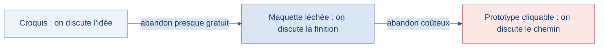

[Sommaire](Readme.md) · [Chapitre suivant →](02-ecrire-spec-ecran.md)

# 01 - Une maquette finie est un risque

> Personne ne jette une maquette bien présentée. C'est tout le problème : plus un écran a l'air fini,
> moins on ose le discuter, et plus les choix qui ne viennent pas de vous ont de chances de survivre
> jusqu'en production. Avant de demander quoi que ce soit à une machine, apprenez à
> **séparer ce que vous aviez dit de ce qu'elle a rempli à votre place.**

## Objectifs

À l'issue de ce chapitre, vous serez capable de :

- **Repérer** ce qu'un modèle a rempli à votre place sur un écran que vous n'aviez pas complètement décrit.
- **Distinguer** la finition de la justesse : un écran peut être très beau et entièrement faux.
- **Évaluer** ce que répond chaque niveau de fidélité, et ce que coûte l'abandon d'un écran léché.
- **Classer** les défauts d'une interface en quatre familles, avec des mots que deux personnes peuvent s'échanger.
- **Anticiper** les quatre choses qu'une interface générée ne produira jamais d'elle-même.

## Sommaire

- [I. Un écran, un vote](#i-un-écran-un-vote)
- [II. Ce qu'un modèle remplit en silence](#ii-ce-quun-modèle-remplit-en-silence)
- [III. La fidélité est un niveau de question](#iii-la-fidélité-est-un-niveau-de-question)
- [IV. Quatre classes de défaut que la finition n'efface pas](#iv-quatre-classes-de-défaut-que-la-finition-nefface-pas)
- [V. Ce qu'une interface générée rate par construction](#v-ce-quune-interface-générée-rate-par-construction)

## I. Un écran, un vote

**Accroche (sondage) :** la journée commence sans annonce de plan ni présentation de logiciel. Un écran est projeté, et c'est tout.

> 🎯 **Le vote.** Une question, une consigne : « **Livrable, ou pas livrable ?** » On lève la main.
> Le nombre est écrit au tableau, et il n'y sera pas touché de la journée.

**Le déroulé, dans l'ordre.**

1. **L'écran arrive sans explication.** Un écran de panier de *Panier Local*, la plateforme de commande auprès de producteurs locaux sur laquelle toute la journée travaille : photos, noms, quantités, un total, deux boutons, des avis, un pied de page. Rien ne le signale comme provisoire — il a la densité et la tenue d'un écran qu'on mettrait en ligne.
2. **La salle vote**, une main levée par personne, sans discussion d'abord.
3. **Le résultat est écrit au tableau** : un nombre, pas un palmarès. Personne n'est renvoyé à une erreur, le but n'est pas de se tromper mais de savoir sur quoi l'on a de l'assurance.
4. **Le formateur révèle alors, point par point**, en montrant à chaque fois l'endroit précis de l'écran :
   - **aucune donnée affichée n'existe** : le prix de chaque article, le stock, la note et la ville du producteur ont été inventés pour remplir le cadre ; personne ne les a relus, parce que personne ne les a écrits ;
   - **les deux boutons ne déclenchent rien** : ils ont la forme de l'action, pas l'action ;
   - **l'écran n'a pas d'état vide** — panier à zéro article, rien n'est prévu — **ni d'état d'erreur ni de chargement** : le réseau qui traîne et le paiement qui refusent n'apparaissent nulle part ;
   - **il n'existe qu'à une largeur**, celle du projecteur ;
   - **aucun mot affiché ne vient de vous** : « Valider » et « Commander » ne s'écrivent pas pour la même raison, l'un ferme une fenêtre, l'autre engage un paiement ;
   - enfin la question qui fait tout le travail : **« qui, dans cette salle, aurait pu dire à l'avance ce que cet écran affiche ? »** Normalement, plus aucune main levée.
5. **On reprend le vote tel quel**, sans rien changer à l'écran. Les mains bougent à peine.

Ce que cette ouverture installe tient en une phrase : **la seule chose sur laquelle la salle avait de l'assurance était la moins vérifiable de toutes.** Vous ne saviez pas si les prix étaient vrais, si les boutons faisaient quelque chose, ni ce qui s'affiche quand le panier est vide. Vous saviez en revanche que c'était bien présenté — et c'est sur cette information que le vote s'est appuyé.

Ce n'est pas une bêtise collective, et ce chapitre ne va pas la punir : c'est une propriété de l'objet. Un croquis ne persuade personne. Une maquette bien typographiée persuade son auteur, et son auteur est justement celui qui doit la vérifier.

Deux choses sont écrites au tableau avec le vote, et volontairement pas dans ce fichier : **le nom de l'outil qui a produit l'écran, et la date de la capture.** Une interface d'outil change plus vite qu'un cours ; ce qui est vrai de la capture du jour ne l'est plus six mois plus tard, et un support écrit ne doit pas faire croire le contraire.

## II. Ce qu'un modèle remplit en silence

Une demande d'écran n'est jamais complète : vous décrivez une intention, quelques champs, deux ou trois contraintes. Entre ce que vous avez dit et l'écran affiché, il y a un trou, et le modèle ne s'arrête pas au trou — il le comble, avec ce qui est **plausible**.

| Ce que vous n'aviez pas dit | Ce que l'écran affiche | À qui appartient la décision |
| --- | --- | --- |
| Quelles données afficher | quatre articles, 12,50 €, « en stock », un producteur « depuis 1987 » | la machine |
| Combien de choses à la fois | quatre lignes de produit, alors qu'un panier habituel en fait deux | la machine |
| L'ordre des informations | le prix avant le nom, l'image avant les deux | la machine |
| Les mots | « Valider » à côté de « Continuer » : deux verbes, deux contrats | la machine |
| Ce qu'on peut faire ici | deux boutons, dont un de trop | la machine |
| Ce qui manque à l'écran | rien : tout est rempli, donc rien ne signale une question | la machine, par défaut |

La dernière ligne est la plus importante. Sur une feuille blanche, un trou se voit : c'est une question qui réclame une réponse. Sur un écran généré, le trou est rempli, et **un champ rempli n'est plus une question, c'est une réponse que personne n'a relue.** C'est là que la finition devient un risque : les hypothèses du modèle prennent à l'écran exactement le même poids que vos décisions, mêmes cartes, même ombre, même interlignage. Elles n'ont aucun signe distinctif.

Avec un collègue, l'affaire se règle par une question : « le prix avant le nom, c'est toi ou c'est moi ? » Avec une machine, elle se règle trop tard : vous avez déjà montré l'écran en réunion, et on l'a déjà trouvé beau.

**Le réflexe à installer aujourd'hui** — deux minutes par écran, trois colonnes, et l'on range chaque élément de l'interface :

1. **je l'avais dit** : je peux le redire sans regarder l'écran ;
2. **je ne l'avais pas dit** : la machine a choisi, et son choix se défend ;
3. **je ne l'aurais pas dit comme ça** : la machine a choisi, et ce choix me déplace.

La troisième colonne est la seule qui coûte quelque chose si on la laisse vide. Les deux premières se règlent en une phrase ; la troisième se règle en production, quand un utilisateur bute dessus.

## III. La fidélité est un niveau de question

On confond deux échelles. La **fidélité** mesure à quel point un objet *ressemble* à la chose finale ; elle ne dit rien de sa *justesse*. Un écran parfait de ressemblance peut être entièrement faux sur l'intention, et quatre boîtes tracées au feutre peuvent être justes. Chaque niveau de fidélité répond à **une question précise**, et à aucune autre.

| Niveau | Ce qu'il vous oblige à décider | La question qu'il répond | Ce que les gens osent dire | Ce que coûte son abandon |
| --- | --- | --- | --- | --- |
| **Croquis** (feutre, ou ASCII dans un fichier) | l'ordre et le nombre | est-ce le bon écran ? | tout, y compris « ce n'est pas ça » | presque rien : quatre boîtes ne font personne pleurer |
| **Maquette léchée statique** | ordre, nombre, couleurs, polices, espacements, images | est-ce bien présenté ? | surtout de la finition : « j'aime bien », « la photo est belle » | quelque chose : on y a passé du temps, on l'a montré |
| **Prototype cliquable** | tout ce qui précède, plus les liens entre écrans | est-ce le bon chemin ? | sur le chemin, à condition de ne pas regarder la finition | beaucoup : du code et des décisions en dépendent déjà |

Remarquez ce qui change entre la première et la deuxième ligne. Le croquis **oblige à parler de l'idée**, parce qu'il n'offre rien d'autre à regarder : les gens le touchent, le rayent, proposent de le jeter sans aucune gêne. La maquette léchée **déplace la conversation** : il y a désormais des couleurs, des photos, une typographie, et c'est là que portent les remarques. Le fond n'est plus discuté — non pas parce qu'il est bon, mais parce qu'il a disparu sous sa présentation.

Ce n'est pas un travers de caractère chez vos collègues, c'est une propriété de l'objet : **jeter un objet soigné a un coût social que jeter quatre boîtes au feutre n'a pas.** Le silence autour d'une maquette réussie n'est pas un accord.

Le coût d'abandon, lui, ne dépend pas de ce que l'écran contient mais de ce que vous y avez mis : le temps passé, ce que vous en avez déjà dit à d'autres, ce qui en dépend déjà — un deuxième écran bâti dessus, deux captures envoyées, un engagement pris. Il ne cesse pas de grimper au fil de la journée, et il ne redescend jamais tout seul.



En découlent trois réflexes qui tiennent toute la journée : **le niveau de fidélité doit être celui de la question que vous posez.**

- Savoir si l'ordre des informations est bon → un croquis. Une maquette léchée ne répond pas mieux à cette question, elle répond à une autre.
- Savoir si le chemin de l'intention à l'action tient → un prototype cliquable, et seulement là.
- Tester la réaction d'un utilisateur à un panier qu'il reconnaît → la maquette est légitime, à condition de dire à voix haute ce qu'elle ne teste pas.

Une machine change la donne sur un point précis : **elle ne vous propose pas le niveau dont vous avez besoin, elle vous propose le plus coûteux à abandonner, dès la première demande.** Elle vous donne la finition du troisième cran avec les garanties du premier. Ce n'est pas un défaut qu'une meilleure invite corrige : c'est ce qu'elle est, une fabrique d'écrans finis, parce que ce sont des écrans finis qu'on lui a montrés.

Si vous voulez garder la liberté de jeter, **décidez du niveau avant de générer**, et écrivez ce que l'écran n'a pas encore à être.

## IV. Quatre classes de défaut que la finition n'efface pas

« C'est moche » ne se transmet pas : on ne peut ni le donner à corriger à quelqu'un, ni le demander à une machine, ni le vérifier après coup. Nommer une famille de défaut transforme une impression en instruction, et une instruction ça se contrôle. Quatre familles suffisent pour regarder un écran à deux et se comprendre.

| Famille | Ce qu'on regarde | Ce qu'un écran généré fait typiquement | Pourquoi la finition n'y change rien |
| --- | --- | --- | --- |
| **Hiérarchie et groupement** | ce qui est premier, ce qui va ensemble, ce qui est secondaire | tout a la même force : le prix et le nom à la même taille ; un séparateur qui coupe en deux ce qui formait un bloc | Un bel alignement ne dit pas ce qui va ensemble : l'espace blanc est un signe, pas une décoration |
| **Couleur et contraste** | ce que l'œil lit vraiment, et ce que la couleur est seule à porter | texte gris pâle sur fond blanc ; deux gris voisins ; la couleur seule à porter un état | Un texte que tout le monde ne lit pas n'est pas du contenu, et ce n'est pas une affaire de goût |
| **Rythme des espacements** | la régularité qui fait groupement, et se reproduit | 13 px là, 21 px plus bas, 27 px plus loin ; des cartes de hauteurs inégales | « Aéré » n'est pas une règle : une valeur irrégulière ne se reproduit pas et ne se tient pas |
| **Parcours** | le chemin de l'intention à l'action, et ce qui le coupe | le bouton visible ne mène nulle part ; deux chemins pour une action ; pas de retour ; rien après la validation | Un bel écran isolé ne dit rien de la suite : un écran n'est jamais seul |

Le haut et le bas de cette liste se voient sans être designer. Le milieu se lit dans les valeurs, pas dans le rendu. Le bloc ci-dessous n'est pas un cours de CSS : c'est le même morceau d'écran avant et après, et les deux défauts sont lisibles dans les chiffres.

```css
/* avant : la finition est là, la hiérarchie et le rythme non */
.carte       { padding: 13px; gap: 27px; }
.carte .nom  { font-size: 15px; font-weight: 400; color: #4a5568; }
.carte .prix { font-size: 15px; font-weight: 400; color: #cbd2d9; }
```

```css
/* après : une échelle, un ordre, un contraste */
.carte       { padding: 16px; gap: 16px; }   /* une valeur, pas trois */
.carte .nom  { font-size: 18px; font-weight: 600; color: #1f2933; }  /* le nom d'abord */
.carte .prix { font-size: 16px; font-weight: 500; color: #3b5b8d; }  /* et il se lit */
```

- Vous n'avez pas à devenir typographe aujourd'hui, ni à placer ces valeurs vous-même.
- Ces quatre familles **se montrent du doigt** : elles sont donc transmissibles à un collègue comme à une machine.
- Tout ce qui se nomme se vérifie. C'est le mouvement de toute la journée.

### EX-01 - Quatre défauts, quatre familles (10 min, binôme, débrief en salle)

**On vous donne un écran** : celui projeté à l'ouverture, remis dans un fichier distribué aux binômes. Un écran généré, fini, soigné.

**Ce que vous rendez, en dix minutes** : **quatre défauts, un par famille**, sur quatre lignes au format

```
famille — ce que je vois (à quel endroit) — ce que ça empêche
```

Trois contraintes : une famille par ligne, quatre lignes, quatre familles différentes ; ce qui ne se montre pas du doigt n'est pas recevable — « c'est froid », « je n'aime pas ce bleu » ne passent pas, il faut un endroit de l'écran et un effet ; et **il n'y a rien à corriger, rien à retoucher, rien à régénérer** — cet atelier n'est pas une performance technique, il s'agit de **voir**.

**Avant d'ouvrir la correction**, vérifiez que :

- [ ] mes quatre lignes citent les **quatre familles différentes**, et pas quatre fois la même ;
- [ ] chaque défaut désigne un **endroit** de l'écran, que l'on peut montrer ;
- [ ] chaque ligne dit **ce que ça empêche**, pas seulement ce qui dérange ;
- [ ] je peux défendre chaque ligne à l'oral sans dire « je trouve que ».

<details>
<summary>Voir la correction</summary>

**Éléments attendus.** La qualité ne se juge pas au nombre de défauts trouvés mais à la **forme** de chaque ligne. Un bon rendu ressemble à ceci (exemples de fabrication, à reporter sur l'écran qu'on vous a donné) :

| Famille | Exemple de ligne recevable |
| --- | --- |
| Hiérarchie et groupement | « le prix et le nom sont à la même taille : rien ne dit lequel on lit en premier » |
| Couleur et contraste | « le total est en gris pâle sur blanc : on ne le lit pas au premier coup d'œil » |
| Rythme des espacements | « l'écart entre les lignes du panier change à chaque ligne : les articles n'ont pas l'air d'appartenir au même bloc » |
| Parcours | « rien n'indique ce qui se passe après la validation : le chemin s'arrête au bouton » |

Sont aussi recevables : une image qui avale le nom du produit, un séparateur qui coupe un article en deux, deux boutons qui proposent la même action, un libellé seul porté par sa couleur, une carte plus haute que sa voisine sans raison.

**Erreurs fréquentes.**

- **Quatre défauts de la même famille**, presque toujours hiérarchie et groupement parce que c'est la plus visible. Le fait est révélateur : on ne voit que ce qu'on sait nommer.
- **Rendre un goût à la place d'un défaut.** « Cette police ne convient pas » n'a ni endroit, ni effet, ni vérification possible : ce n'est pas encore une instruction.
- **Chercher la faute technique.** Un binôme qui passe dix minutes à discuter de *comment* corriger a passé dix minutes sans regarder l'écran.
- **S'arrêter aux défauts qui sautent aux yeux.** Le contraste et le parcours se voient vite ; le groupement et le rythme demandent de faire le tour de la carte, doigt à l'écran.
- **Accuser la machine.** « Elle a mal fait » ne se corrige pas : ce qui compte n'est pas qui a décidé, mais ce que l'écran empêche.

**Ce qu'il faut retenir.** Vous venez de lire un écran sans vous laisser impressionner par sa finition, avec quatre mots d'ordre au lieu d'un sentiment. C'est la compétence de la journée : la finition n'est pas un argument, et un défaut nommé est déjà à moitié corrigé, parce qu'il est devenu transmissible.

</details>

## V. Ce qu'une interface générée rate par construction

Les quatre absences qui suivent ne sont pas des ratés que la génération suivante comblera. Elles tiennent à ce qu'est un écran généré : **une image de logiciel**, pas un logiciel.

| Ce qui manque | Ce que l'écran laisse voir à la place | Ce que ça donne face à un utilisateur |
| --- | --- | --- |
| **Les états** : vide, chargement, erreur, cas limites de données (zéro résultat, un résultat, trois cents, un libellé qui dépasse) | l'état « tout va bien, quatre articles avec photo », le seul qu'on lui a montré | le panier vide affiche une page blanche ; un titre trop long casse la carte ; une connexion lente ne montre rien |
| **La validation** : ce qui est accepté, ce qui est refusé, et ce qu'on dit alors | un formulaire qui ne refuse rien, avec ses bordures roses de « champ requis » | un code postal de onze caractères passe, et le refus arrive trois écrans plus loin, ou jamais |
| **La persistance** : ce qui survit au rafraîchissement, au retour arrière, à la semaine suivante | un écran qui a l'air de retenir, parce qu'il affiche des données | on remplit, on change d'écran, on revient : tout est perdu, et rien n'avait été décidé |
| **Le comportement** : ce que fait le clic, le retour arrière, ce que devient une liste qui se vide | une position de bouton, une forme de curseur, une ombre au survol | le bouton « Suivant » ne fait rien ; le retour arrière sort de l'application ; personne ne sait ce qui est enregistré |

Pourquoi *par construction*, et non par paresse du modèle ? Parce qu'un modèle a appris sur des **captures d'écrans publiés**, et un écran publié montre son état plein : un état d'erreur est rarement une capture, un panier vide encore moins. Il reproduit ce qui est représenté, pas ce qui est juste. Les trois dernières lignes, elles, n'existent pas du tout dans une image — rien ne se sauvegarde, ne se refuse, ne s'exécute dans une maquette. Ces trois-là ne peuvent pas être devinées : elles se **décident**. Et une décision qu'on ne prend pas est quand même prise, elle s'appelle « on verra plus tard ».

Un seul point commun à ces quatre absences, et c'est ce qui rend la journée utile : **elles s'écrivent.** Elles s'écrivent avant de générer, se complètent après, se contrôlent avec des outils qui les trouvent, se prouvent par des traces. Ce chapitre vous a montré un écran qui ne tenait que par sa finition ; les cinq qui suivent écrivent ce qui manque, et le font vérifier.

## Aller plus loin

*Facultatif — rien d'exigé pour la journée.*

- **Tenez la colonne « décidé par ».** Pour chaque écran produit aujourd'hui, une seule colonne : *moi* ou *la machine*. Le contenu de cette colonne, ce soir, en dira plus long sur votre pratique que n'importe quel bilan de formation.
- **Les quatre familles ont un vocabulaire** : « échelle d'espacement » pour le rythme, « hiérarchie visuelle » pour l'ordre de lecture, « design token » pour une valeur de couleur ou d'espacement nommée et réutilisée. Ces mots sont repris et définis à l'annexe A ; les connaître suffit à demander une correction précise.
- **Rejouez le vote chez vous.** La prochaine fois qu'un écran vous sera présenté déjà joli, posez la question du panier vide avant de commenter la couleur.

## Points clés

- La finition **tient lieu de substance** : c'est elle qui persuade, et elle persuade d'abord celui qui devrait vérifier.
- Un écran généré est rempli d'**hypothèses sans signe distinctif** : même police, même carte, même poids que vos décisions.
- Le niveau de fidélité doit être **celui de la question posée** ; trop de finition déplace la discussion et fait grimper le coût d'abandon.
- Quatre familles pour nommer un défaut : **hiérarchie et groupement, couleur et contraste, rythme des espacements, parcours**. Ce qui est nommé se transmet et se vérifie.
- **États, validation, persistance, comportement** manquent par construction : voilà les quatre choses qu'il reste à écrire.

## 🧠 Vérifiez vos acquis

*Formatif, jamais noté. Répondez sans relire le chapitre : ce qui compte est de repérer où vous vacillez, pas de faire un sans-faute.*

**1.** Pourquoi une maquette finie est-elle plus risquée qu'un croquis raté ?

- A. Parce qu'elle a demandé plus de temps de mise en forme, et que ce temps investi rend son abandon difficile à justifier devant l'équipe
- B. Parce qu'elle persuade son auteur : sa finition tient lieu de substance
- C. Parce qu'un modèle y accumule davantage de défauts que sur un croquis
- D. Parce qu'un croquis ne se montre pas à un client et qu'on est donc contraint de le retravailler avant de le défendre

**2.** Sur un écran généré, les espacements d'une même carte valent 13, 21 puis 27 px. Quelle famille de défaut ?

- A. Hiérarchie et groupement
- B. Couleur et contraste
- C. Rythme des espacements
- D. Parcours

**3.** Quel groupe de choses manque par construction à un écran généré ?

- A. Étiquettes, icônes, marges et ombres
- B. États, validation, persistance et comportement
- C. Couleurs, polices, bordures et coins arrondis
- D. En-tête, pied de page, titres et fil d'Ariane

**4.** Vous voulez savoir si l'enchaînement de trois écrans est compris par un utilisateur. Quel niveau de fidélité choisir ?

- A. La maquette la plus soignée possible : une idée importante ne se présente pas à l'état de croquis
- B. Un prototype cliquable, puisque c'est l'enchaînement qui est testé, pas la finition d'un écran
- C. Trois croquis posés côte à côte sur la table, sans les relier entre eux
- D. Le code de l'application, puisqu'il contient de toute façon l'écran définitif

**5.** *Question ouverte (2-3 lignes).* Reprenez votre réponse à la question 1 et poussez-la : **pourquoi une maquette ratée mais jolie coûte-t-elle plus cher qu'un croquis raté ?** Dites ce qui, dans la journée, aurait été différent avec un croquis.

<details>
<summary>Vérifier ses réponses</summary>

### Réponses

**1. B.** Sa finition tient lieu de substance : elle persuade, et en premier lieu celui qui devait vérifier.
**Pourquoi :** le temps passé (réponse A) est une raison de plus de ne pas jeter, mais il vient après ; ce qui ferme la discussion avant même qu'elle s'ouvre, c'est qu'un objet soigné n'invite pas à la critique. Une maquette léchée ne contient pas *plus* de défauts (C), elle les rend invisibles ; et un croquis se montre très bien à un client (D), c'est même le meilleur moyen d'obtenir une réaction franche.

**2. C.** Trois valeurs différentes sur le même bloc : rien ne les rattache à une échelle.
**Pourquoi :** le rythme des espacements est ce qui signale l'appartenance — des éléments rapprochés vont ensemble. Une valeur irrégulière donne un écran « aéré » qui ne se reproduit pas et ne se tient pas dans la suite du projet.

**3. B.** Les états, la validation, la persistance et le comportement.
**Pourquoi :** un écran généré est une image de logiciel ; il reproduit l'état plein, celui qu'on lui a montré, et n'a aucun mécanisme qui sauvegarde, refuse ou exécute. Les trois autres groupes sont justement ce qu'une machine génère le mieux, puisqu'on le voit sur toutes les interfaces publiées.

**4. B.** Ce que vous testez est l'enchaînement : il faut pouvoir passer d'un écran à l'autre.
**Pourquoi :** le niveau de fidélité doit être celui de la question posée. Une maquette soignée (A) déplacerait la discussion sur la finition ; trois croquis non reliés (C) ne montrent pas l'enchaînement, précisément ; le code (D) répond à la question, mais au prix de ne plus rien oser changer.

**5.** Attendu : dire qu'une maquette jolie **se défend** alors qu'un croquis se raye — elle a coûté, elle a été montrée, d'autres s'y sont déjà rangés, et la corriger devient une négociation au lieu d'une retouche ; et qu'avec un croquis la discussion aurait porté sur l'ordre et le contenu, c'est-à-dire sur ce qui était réellement en question.
**Pourquoi :** le coût d'une erreur ne se mesure pas à sa taille mais au moment où elle est relevée. La même hypothèse fausse découverte sur un croquis se règle sur place ; découverte sur un écran léché, déjà montré en réunion et déjà copié dans deux autres écrans, elle coûte une négociation, un retard, et souvent son maintien en production, parce que personne n'a voulu la rouvrir.

</details>

---

[Sommaire](Readme.md) · [Chapitre suivant →](02-ecrire-spec-ecran.md)
