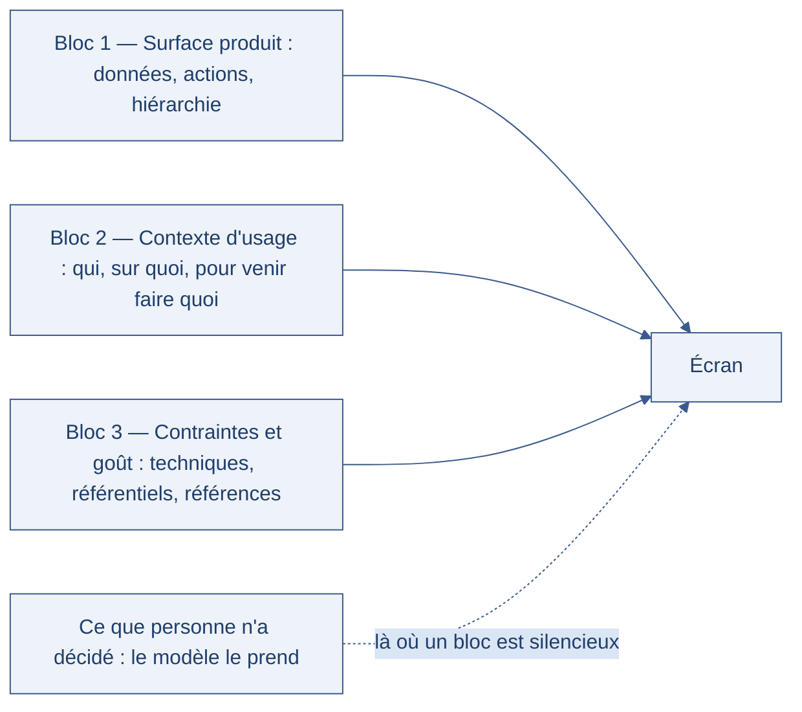

[← Chapitre précédent](01-maquette-finie-risque.md) · [Sommaire](Readme.md) · [Chapitre suivant →](03-ecran-par-la-machine.md)

# 02 - Écrire une spec d'écran

> Vous décrivez l'écran que vous voulez. On vous rend autre chose, de très fini, et vous
> êtes incapable de dire si cela répond à votre demande ou à une autre.
> Le problème n'est pas dans la réponse : il est dans la question. Une spec d'écran ne
> décrit pas un goût, elle écrit **ce qui doit être vrai** — et se vérifie.

## Objectifs

À l'issue de ce chapitre, vous serez capable de :

- **Distinguer** les trois blocs d'une demande d'interface — surface produit, contexte d'usage, contraintes et goût — et dire ce que chacun empêche la machine d'inventer.
- **Rédiger** en fichier la spec d'un écran réel, en trois blocs.
- **Convertir** un adjectif de style en artefact : un croquis, une capture, un écran qui existe déjà.
- **Formuler** les critères d'acceptation d'un écran et une « définition de fini » dont au moins un critère s'évalue par une commande.
- **Comparer** deux rendus obtenus sur la même demande, et nommer ligne par ligne ce qui a été inventé.

**Accroche (sondage) :** levez la main si vous avez déjà reçu d'un générateur un écran qui avait l'air juste et qui ne l'était pas. Gardez-la levée si, ensuite, vous avez passé plus de temps à réparer le résultat qu'à écrire la demande. La mesure du § II porte exactement sur ce couple de durées.

## I. Le triptyque : ce que votre demande doit couvrir

Un générateur d'interfaces — une IA (intelligence artificielle) entraînée sur une masse d'interfaces existantes — ne devine pas : il **remplit**. Ce que vous laissez vide ne reste pas vide. Il se remplit avec ce que le modèle a le plus souvent rencontré, c'est-à-dire avec **ses** hypothèses, pas les vôtres.

C'est la première chose à intégrer, et elle déplace le problème. Une demande incomplète ne produit pas un écran incomplet, que l'on reconnaît comme tel. Elle produit un écran **complet**, bien typographié, dont chaque manque est devenu une décision prise sans vous. Revenir dessus ne se fait pas en ajoutant ce qui manquait : cela se fait en défaussant ce qui a été décidé à votre place.

Une demande d'écran se tient en trois blocs. Pas trois documents, pas trois pages : trois blocs, dans cet ordre.

| Bloc | Ce qu'il contient | Ce qu'il coupe — ce que la machine ne peut plus inventer |
| --- | --- | --- |
| **1. Surface produit** | ce qui est à l'écran : les données affichées, leur provenance, les actions possibles, l'ordre et la hiérarchie de lecture, ce qui est visible sans faire défiler | un modèle de données qui n'existe pas, un champ que vous n'avez pas demandé, un ordre de priorité entre deux actions |
| **2. Contexte d'usage** | qui utilise l'écran, sur quel type de matériel, dans quelle situation, à quelle fréquence ; la première chose que cette personne vient faire | un public, une taille d'écran, une urgence, un usage intensif ou occasionnel |
| **3. Contraintes et goût** | les contraintes dures (techniques, référentiels, composants déjà là, ce qui est interdit) et les références de style : un écran qui existe, une densité, une capture datée | un design system, une palette, une bibliothèque, un niveau d'accessibilité, un style |

Le schéma ci-dessous montre ce que chacun des trois blocs retire au hasard. Les trois ne se recouvrent pas : ils coupent chacun dans une couche différente de la décision.



Retenez la dernière flèche. Un bloc absent ne rend pas l'écran plus simple : il rend **une décision orpheline**. Et une décision orpheline, dans un projet, cela a un nom : c'est celle que vous reprochera celui qui la découvre, alors que personne ne l'a prise.

Une dernière précision, parce qu'elle est le faux pas le plus courant : **le triptyque n'est pas une longueur**. Une demande courte qui couvre les trois blocs est plus serrée qu'une page entière qui ne parle que du premier. La page n'est muette que sur ce qu'elle croit évident, et l'évident est précisément l'endroit où le modèle choisit à votre place.

Voici la même demande, dans les deux formes.

La première, telle qu'on l'écrit tous les jours :

```text
Fais-moi une page e-commerce moderne et épurée pour des produits locaux.
```

La seconde, en trois blocs :

```text
SURFACE PRODUIT
- Recherche par nom de produit ; le champ est l'action principale de l'écran.
- Résultats : une ligne par produit — nom, producteur, prix et unité de vente,
  bouton d'ajout au panier. Le panier est accessible depuis l'en-tête, en permanence.
- Filtres à gauche : mode de production, zone de production. Rien d'autre.

CONTEXTE D'USAGE
- des clients d'une plateforme de commande auprès de producteurs locaux ;
- surtout sur mobile, souvent en extérieur, connexion moyenne ;
- ils viennent chercher un produit qu'ils connaissent déjà, pas se promener dans un catalogue.

CONTRAINTES ET GOÛT
- on continue l'écran existant de la catégorie « produits » : même en-tête, mêmes cartes ;
- aucun composant graphique nouveau, on réutilise ceux du projet ;
- accessibilité : le niveau attendu est celui du RGAA (référentiel général d'amélioration
  de l'accessibilité), version 4.1.2 en vigueur ;
- référence de style : la capture jointe, datée et nommée.
  Ce que j'en garde : la densité de la liste. Ce que je n'en veux pas : les filtres en haut.
```

Une page à peine, et presque toutes les hypothèses sont tombées.

## II. Ce qu'une contrainte interdit d'inventer

Passons à une mesure. Elle est publiée par **Vercel en décembre 2025**, sur ses propres outils de génération, dans un texte qui sert son argumentaire. C'est une **mesure de fournisseur, pas une mesure indépendante** : sa méthode n'est pas publiée, on ne peut pas la reproduire, et elle a intérêt à conclure ce qu'elle conclut. Ce qu'on en retient tient à un ordre de grandeur, pas à une vérité.

| | demande explicite | demande vague |
| --- | --- | --- |
| Temps de génération | ≈ 1 min 19 s | ≈ 1 min 38 s |
| Lignes produites | ≈ 443 | ≈ 595 |
| Défauts relevés ensuite | — | recherche non fonctionnelle, panier mort, pas de responsive |
| Rattrapage | — | 1 à 2 prompts |

Trois lectures, dans cet ordre.

**La demande vague n'est ni plus rapide ni plus légère.** Elle prend plus de temps et produit davantage de lignes. Ce que l'on croyait gagner à l'aller se paie au retour, et le retour est rarement compté.

**Les lignes en plus sont l'invention.** Ce surplus n'est pas du travail en plus : ce sont des décisions que personne n'a prises, écrites dans du code qui les rend durablement réelles. Supprimer une hypothèse coûte moins cher que de relire une génération complète pour la débusquer.

**Le vrai coût n'est pas dans la génération, il est dans le rattrapage.** Regardez ce que sont ces prompts de correction : *une contrainte que vous écrivez après coup*. Vous finirez donc par écrire votre spec — mais sous pression, écran par écran, sans l'avoir eue en main au moment où les décisions se prenaient, et en réparant au lieu de demander.

D'où la règle de ce chapitre, qui tient en une question à poser à chaque ligne de votre spec :

> **Si je retire cette ligne, qu'est-ce que la machine aurait choisi à la place ?**

Trois réponses possibles, et elles se traitent différemment. Si vous répondez « à peu près la même chose », la ligne est décorative : elle ne coûte rien mais ne protège rien. Si vous répondez « autre chose, et je sais quoi », la ligne est une contrainte : gardez-la, elle vaut son poids. Si vous ne savez pas répondre, ce n'est pas la machine que vous ne connaissez pas — **c'est votre propre écran**. Cette troisième réponse est la plus utile des trois, et c'est la seule que la plupart des demandes laissent passer.

Quelques exemples de contraintes qui travaillent, c'est-à-dire qui suppriment un choix à la place de quelqu'un :

| Ce que vous écrivez | Ce que cela interdit |
| --- | --- |
| « les largeurs auxquelles l'écran doit rester utilisable sont nommées, et ce qui se déplace à chacune est écrit » | inventer un point de rupture, ou n'en faire aucun |
| « l'ajout au panier se fait sans quitter la liste et le panier reste visible » | inventer une navigation, une fenêtre modale, ou un panier qui ne répond pas |
| « aucun composant graphique nouveau » | inventer une bibliothèque, un style, une dépendance |
| « niveau attendu : RGAA 4.1.2 », adossé aux WCAG (Web Content Accessibility Guidelines) | laisser le modèle au niveau de soin moyen de son corpus |
| « la liste est vide : voilà l'écran » | inventer un état vide, ou n'en montrer aucun |

La dernière ligne mérite un arrêt : c'est la seule du tableau qui ne limite pas la machine, elle **l'oblige à produire quelque chose qu'elle n'aurait pas produit**. Une contrainte peut interdire ; elle peut aussi prescrire ce qui, sans elle, n'existerait jamais.

## III. Un artefact vaut mieux qu'un adjectif

« Moderne », « épuré », « aéré », « propre », « dans l'air du temps » : ces mots ne sont pas de l'information, ce sont des **directions**. Chacun les résout avec sa propre moyenne, et vous n'avez aucun moyen de savoir avec laquelle la machine l'a résolue. Le tableau suivant montre le même mot, reçu par trois personnes différentes.

| Adjectif | Ce que la machine entend le plus souvent | L'artefact qui remplace le mot |
| --- | --- | --- |
| « moderne » | grands blancs, coins arrondis, ombres douces, une seule police | une capture d'un écran que vous trouvez réussi, datée, avec ce que vous en gardez |
| « épuré » | peu d'éléments à l'écran, donc des informations déplacées hors du champ de vision | la liste nommée de ce qui doit rester visible sans défiler |
| « aéré » | espacements larges, donc moins de lignes utiles par écran | le croquis de la densité voulue, avec ce que tient un écran |
| « dans la continuité de l'existant » | une palette qui ressemble | le fichier, le composant ou la fiche de style qui font foi |

Trois artefacts, par ordre d'effort croissant, et chacun bat n'importe quel adjectif.

**Le croquis.** Au feutre sur papier, ou en ASCII (caractères de texte) directement dans le fichier de spec. Pas dans une application de dessin : quatre boîtes n'ont pas besoin d'un logiciel, et un croquis en ASCII a un avantage décisif — il vit dans le même fichier que le reste de la spec, il se relit dans un diff, il se versionne avec elle.

```text
+------------------------------------------------+
| [ rechercher un produit ]           [ panier ] |
+------------------------------------------------+
| filtres     | tomme de vache — producteur A     |
| [ ] bio     | prix et unité         [ ajouter ] |
| [ ] région  | --------------------------------- |
|             | tomme de brebis — producteur B    |
|             | prix et unité         [ ajouter ] |
+------------------------------------------------+
```

Ce croquis ne dit rien des couleurs, et c'est très bien : il dit **l'ordre de lecture, la place de la recherche, ce qui est visible d'emblée, et le fait que la liste est la vedette**. Ce sont là des décisions, et elles se vérifient à l'œil nu contre le rendu.

**La capture.** Un écran qui existe — le vôtre, celui d'un concurrent, celui d'un tout autre métier — collé dans la spec, **daté et nommé**, avec deux lignes : ce que j'en garde, ce que je n'en veux pas. Sans ces deux lignes, la capture est une invitation à copier ; avec, elle est un contrat. On date toute capture : un style de référence a une date, et un écran de référence peut changer sous vos yeux.

**L'écran existant du produit.** Le plus fort des trois, et le plus négligé. Quand votre application a déjà un écran dont le style doit continuer, ne le décrivez pas : **donnez le fichier**. Le nom du composant, la feuille de style qui fait foi. Un chemin est vérifiable, un adjectif ne l'est jamais — et un chemin engage aussi celui qui relit : il peut aller voir.

## IV. Les critères d'acceptation d'un écran, et une définition de fini

Vous savez déjà faire cela pour une fonctionnalité : une histoire utilisateur, ses critères d'acceptation, parfois en *Étant donné / Quand / Alors*. Ce qui n'existe presque jamais, c'est la même chose **pour l'écran**. Un écran entre donc dans le développement sans droit d'entrée, et c'est pour cette raison que personne, jamais, ne dit de lui « ce n'est pas fini ».

Cinq familles de critères rendent un écran vérifiable. Ce sont exactement les cinq points sur lesquels vous comparerez deux rendus dans l'atelier : elles ne sont pas une grille de lecture venue après coup, elles sont la matière de la spec.

| Famille | Ce que le critère doit dire | Exemple de critère écrit |
| --- | --- | --- |
| **Données affichées** | ce qui apparaît, d'où cela vient, ce qui s'affiche quand ça manque | « le prix est lu sur la fiche produit, avec son unité de vente ; jamais calculé par l'écran » |
| **Actions possibles** | ce que l'on peut faire, et ce qui se passe immédiatement après | « l'ajout au panier garde l'utilisateur sur la liste et met l'en-tête à jour » |
| **Responsive** | les largeurs visées et **ce qui se déplace** à chacune, pas « c'est responsive » | « sous la largeur étroite, les filtres deviennent un bouton qui ouvre un panneau » |
| **États** | les quatre : vide, chargement, erreur, cas limites de données | « recherche sans résultat : message nommant ce qu'on a cherché et proposant de lever un filtre » |
| **Ce qui a été inventé** | la liste explicite des décisions que la spec ne couvrait pas | « la machine a ajouté un tri par pertinence : non demandé, à valider ou retirer » |

Les quatre états méritent d'être nommés une fois ici, parce qu'ils sont le point aveugle de toute génération : **un rendu ne montre jamais qu'un seul état, toujours celui où tout marche**. Vide (rien à afficher), chargement (pas encore affiché), erreur (impossible à afficher), cas limites (un seul résultat, une liste qui n'en finit pas, un nom de produit à rallonge, un prix nul). Le chapitre 04 de cette journée les reprend un par un ; ici, ils entrent dans la spec, faute de quoi ils n'existeront jamais nulle part.

Une spec qui couvre les cinq familles se termine par une **définition de fini** : la liste des choses qui doivent être vraies pour que vous disiez « c'est bon » sans avoir à le plaider. Sa forme idéale est une commande qui rend zéro erreur ou n'en rend pas — et l'on pilote le code HTML (HyperText Markup Language) d'un écran comme on pilote n'importe quel code :

```bash
# 1. Le rendu passe le validateur HTML (capteur installé au chapitre 06)
npx html-validate rendu/index.html      # attendu : aucune erreur

# 2. Toute image porte une alternative textuelle
grep -o '
<summary>Voir la correction</summary>

**Éléments attendus.** À quoi ressemble une grille remplie sur cet écran — vos mots comptent plus que ceux-ci, mais les deux colonnes doivent se distinguer :

| Point comparé | Rendu de la demande vague | Rendu de la demande en trois blocs |
| --- | --- | --- |
| Données affichées | produits avec prix, photo, quelques mentions de vente ; l'unité de vente a disparu ou a été inventée | nom, producteur, prix avec son unité ; ce qui manque à l'écran est écrit dans la spec |
| Actions possibles | bouton d'ajout présent, souvent sans effet visible ; la recherche est un champ décoratif | la recherche nomme ce qu'elle filtre, l'ajout garde l'utilisateur sur la liste, le panier reste visible |
| Responsive | une colonne unique par habitude, ou rien du tout ; aucune largeur visée n'est nommée | les largeurs visées sont nommées et l'on sait ce qui se déplace à chacune : filtres en panneau |
| États | l'état par défaut seulement : une liste pleine et connectée | vide, chargement, erreur et cas limites demandés ; au moins deux des quatre apparaissent |
| Ce qui a été inventé | long : promotions, avis clients, tri par pertinence, comptes, newsletter, paiement | court : ce qui reste non demandé est listé, et cela devient une décision à prendre |

**Erreurs fréquentes.**

- **Réécrire la même phrase en plus long.** Trois fois plus de mots, toujours un seul bloc : la demande dit à quoi l'écran doit *ressembler*, jamais ce qu'il doit *contenir*. Le test de la ligne retirée, au § II, la démasque immédiatement.
- **Remplir la grille d'après la spec, pas d'après le rendu.** La colonne de gauche se remplit en regardant l'écran affiché, pas en se rappelant ce qu'on avait demandé. C'est le seul moment de la journée où l'on est forcé de constater l'écart : ne le ratez pas en le théorisant.
- **Laisser vide « ce qui a été inventé » dans la colonne de gauche.** Case vide = vous n'avez pas cherché. Sur une demande vague, la liste est toujours longue : tout ce que vous n'aviez pas dit et qui est pourtant à l'écran.
- **Compter le croquis comme un ornement.** Un croquis qui ne montre ni l'ordre de lecture ni ce qui reste visible sans défiler n'a rien coupé : il a illustré.
- **Chercher à gagner le concours de la plus belle spec.** Le critère n'est pas la complétude, c'est : *quelle invention cette ligne a-t-elle empêchée ?* Un texte qui n'en empêche aucune perd contre une ligne qui en empêche trois.

**Ce qu'il faut retenir.** La colonne de gauche n'est pas un échec de la machine : elle est l'inventaire de vos silences. La colonne de droite n'est pas un écran plus joli : c'est le même écran sur lequel **moins de gens ont décidé à votre place**. Et l'écart entre les deux ne s'est pas joué au moment du rendu — il s'est joué avant, à l'écriture.

</details>

## V. La spec est un fichier versionné, pas un message

Reste un choix qui n'en a pas l'air, et qui décide de tout le reste : **où vit votre spec**.

Dans une conversation, elle meurt. Elle vit dans un fil, avec un outil, un compte, une date — et trois semaines plus tard plus personne ne peut répondre à la seule question qui compte quand un écran pose problème : **qui a décidé ça ?**

Dans un fichier du dépôt, elle devient trois choses à la fois.

- **Un objet relisible.** On la montre, on la commente, on la discute avant que la génération n'ait coûté quoi que ce soit. Une relecture de spec se fait à plusieurs, calmement ; la même relecture sur un rendu prend beaucoup plus longtemps et finit en malentendu, parce qu'il faut d'abord décider si ce que l'on voit est un défaut ou une intention.
- **Un objet à différentiel.** Modifier une ligne de spec se lit comme se lit une modification de code : ce qui a changé, quand, par qui. Personne ne relit une conversation ; tout le monde relit un diff.
- **Une trace.** Le fichier atteste ce que vous aviez demandé, et à quelle date. Quand l'écran dérive, la spec dit si c'est la machine qui a dévié ou si la demande a changé — et si elle a changé, quand et pourquoi.

Concrètement, la spec vit à côté du code qu'elle commande :

```text
specs/
  02-recherche-produits.md      # la spec en trois blocs + sa définition de fini
rendus/
  02-recherche-produits/        # ce que la machine a produit, en l'état
```

et elle voyage en deux commits distincts, un pour la demande, un pour la sortie :

```bash
git add specs/02-recherche-produits.md
git commit -m "spec: recherche produits, etats et definition de fini"

git add rendus/02-recherche-produits/
git commit -m "gen: rendu brut recherche produits (sortie d'outil, non relu)"
```

Le second message n'est pas une politesse. Écrire *sortie d'outil, non relu* sépare ce que vous avez décidé de ce que la machine a produit : six mois plus tard, cette ligne sera la seule preuve que le code généré n'a pas été avalé tel quel. Et si votre spec s'appuie sur des captures, elles entrent dans le même commit, datées et nommées — une spec dont la référence a disparu n'est plus vérifiable.

Une dernière chose, qui relie ce chapitre à la thèse de la journée. La spec n'est pas un document que l'on écrit avant de travailler et que l'on n'ouvre plus : **elle est l'entrée de la génération et la preuve de ce qui a été demandé**. Toute relance envoyée ensuite à la machine partira d'elle, et tout désaccord sur le rendu se réglera contre elle. C'est parce qu'elle est un fichier qu'elle peut jouer ce double rôle. Un message ne le peut pas.

## Aller plus loin

> Facultatif — rien ici n'est exigé pour la journée.

- **Écrire en *Étant donné / Quand / Alors*.** Vous connaissez cette forme pour les règles de gestion ; elle s'applique mot pour mot aux comportements d'un écran : « étant donné un panier vide, quand j'ajoute un produit, alors l'en-tête affiche un article et je reste sur la liste ». Ceux qui l'écrivent ainsi n'ont plus à débattre de ce que « fini » veut dire.
- **Tenir une ligne de décision pour le style.** Une phrase par arbitrage de goût, datée, dans le même dépôt : *pourquoi* cette densité, *pourquoi* pas ces filtres en haut. Le style devient une décision relisible, au lieu d'une préférence révisée à chaque génération.
- **Le vocabulaire complet du cours est dans l'annexe A** (Vocabulaire, outils et ressources) : sigles, termes, fiches des deux outils. Tout ce que ce chapitre emploie y est défini, sans rien avoir à aller chercher ailleurs.

## Points clés

- Une machine ne devine pas, elle **remplit** : tout silence de votre demande est devenu une décision prise sans vous, et finie sous vos yeux.
- Une demande d'écran tient en trois blocs — **surface produit, contexte d'usage, contraintes et goût** — et chacun coupe une couche différente de l'invention. Ce n'est pas une question de longueur.
- Une contrainte se juge à ce qu'elle supprime d'hypothèses. Test : *si je retire cette ligne, qu'aurait choisi la machine ?* Si vous ne savez pas répondre, vous ne connaissez pas votre écran.
- **Un artefact bat un adjectif** : un croquis en ASCII, une capture datée avec ce qu'on garde et ce qu'on n'en veut pas, ou le fichier de l'écran à continuer.
- Un écran se reçoit sur des **critères**, pas sur une impression : données, actions, responsive, les quatre états, et la liste de ce qui a été inventé — avec au moins un critère qui s'évalue par une commande.
- La spec **vit dans le dépôt**, en fichier, en deux commits : cela fait un diff, une relecture, une trace. Un message ne laisse rien de tout cela.

## 🧠 Vérifiez vos acquis

*Formatif, jamais noté. Répondez sans relire le chapitre : ce qui compte est de repérer où vous vacillez, pas de faire un sans-faute. Les réponses se déplient plus bas.*

**1.** À quoi sert le bloc « contexte d'usage » d'une spec d'écran ?

- A. À décrire l'environnement technique autorisé : composants déjà là, bibliothèques admises, interdits
- B. À dire qui l'utilise, sur quel matériel, dans quelle situation, et ce qu'il vient faire en premier
- C. À consigner les adjectifs de style attendus et les captures d'écrans de référence
- D. À recenser les contraintes du projet : référentiels d'accessibilité, niveaux de service, langages interdits

**2.** Sur une demande vague, à quoi correspond l'excédent de lignes produites par rapport à une demande explicite ?

- A. À du travail utile que la demande explicite aurait de toute façon demandé, ailleurs dans le projet
- B. À la génération des états vide, chargement, erreur et des cas limites de données
- C. À des décisions que personne n'a prises et que le code rend durablement réelles
- D. Au rattrapage qu'il a fallu ajouter, prompt après prompt, pour rendre l'écran utilisable

**3.** Lequel de ces éléments transforme un adjectif de style en information vérifiable ?

- A. Un adjectif de plus, et plus précis : « minimaliste » plutôt que « moderne »
- B. Une phrase expliquant l'ambiance recherchée, avec deux ou trois références de style
- C. Une capture d'un écran existant, datée, avec ce que l'on garde et ce que l'on écarte
- D. Une consigne demandant de rester dans la continuité de l'existant, sans autre précision

**4.** Quelle est la bonne définition d'une « définition de fini » pour un écran ?

- A. Des critères dont on peut dire, sans discussion, s'ils sont vrais ou faux
- B. Le moment où le formateur déclare l'écran acceptable pour la suite de la journée
- C. Une description aussi complète que possible de l'écran attendu, relue par un pair
- D. L'accord du demandeur sur le rendu obtenu, une fois les corrections demandées à la machine

**5.** *Question ouverte (2-3 lignes).* Prenez une ligne de votre spec de l'atelier EX-02 et dites ce qui serait arrivé sans elle : quelle invention de la machine cette ligne a-t-elle empêchée ?

<details>
<summary>Vérifier ses réponses</summary>

### Réponses

**1. B.** Le contexte d'usage nomme l'utilisateur, son matériel, sa situation et sa première intention.
**Pourquoi :** ce sont exactement les hypothèses que le modèle prendrait sans vous — une taille d'écran, une situation pressée, une priorité entre deux actions. Le matériel autorisé et les composants relèvent des contraintes, c'est-à-dire du bloc 3.

**2. C.** Les lignes en trop sont des décisions prises par le modèle et inscrites dans du code.
**Pourquoi :** elles ne sont pas un travail gagné ailleurs, elles sont une dette : il faudra relire la génération pour les trouver, puis les défaire. C'est le sens de l'écart relevé dans la mesure du § II — davantage de lignes, et moins de précision.

**3. C.** Une capture datée, accompagnée de ce que l'on garde et de ce que l'on écarte, s'évalue à l'œil nu contre le rendu.
**Pourquoi :** un adjectif, même plus rare, reste une direction que chacun résout avec sa moyenne. Sans les deux lignes « je garde / je n'en veux pas », la capture invite à copier ; avec, elle fait contrat.

**4. A.** Une définition de fini est un critère dont la vérité ne se discute pas ; la forme idéale est une commande.
**Pourquoi :** le but n'est pas l'élégance du dispositif, c'est la fin de l'argument d'impression. Un critère que l'on peut contester — « c'est beau », « c'est propre » — n'arrête rien, pas même une machine.

**5.** Attendu : une ligne précise de votre spec, et l'invention qu'elle a bloquée — par exemple « l'ajout au panier garde l'utilisateur sur la liste » empêche la fenêtre modale ou la navigation de retour qu'une demande vague a produites.
**Pourquoi :** c'est le critère de ce chapitre entier. Une spec ne se juge ni à sa complétude ni à sa longueur, mais à ce qu'elle a rendu impossible.

</details>

---

[← Chapitre précédent](01-maquette-finie-risque.md) · [Sommaire](Readme.md) · [Chapitre suivant →](03-ecran-par-la-machine.md)
