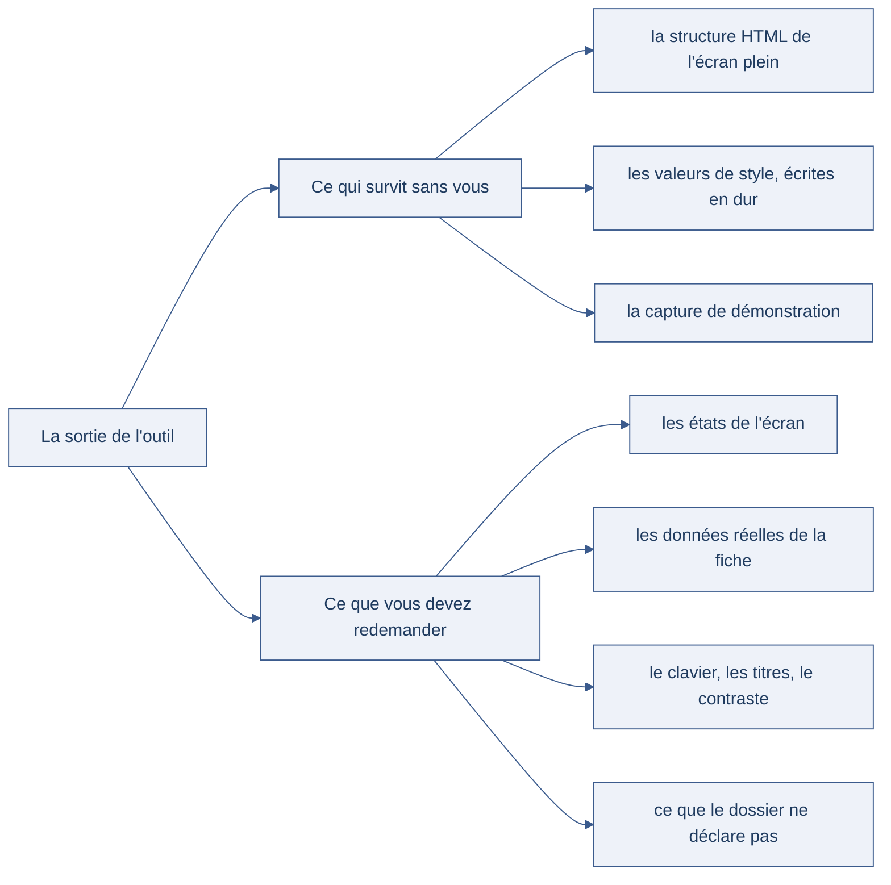

[← Chapitre précédent](02-ecrire-spec-ecran.md) · [Sommaire](Readme.md) · [Chapitre suivant →](04-etats-et-acces.md)

# 03 - L'écran par la machine

> Vous avez écrit la demande : trois blocs, des critères, une frontière. La machine, elle, ne lit
> pas une demande — elle produit un écran. Et elle le produit bien : typographie soignée,
> alignements justes, données crédibles. Ce qui sort d'ici n'est pas un résultat, c'est **une
> hypothèse très bien présentée**. Il reste à la donner, à la regarder, à la faire bouger — et à ne
> jamais acheter ce qu'elle ne veut pas donner.

## Objectifs

À l'issue de ce chapitre, vous serez capable de :

- **Vérifier** un service en ligne avant de s'appuyer dessus : le compte du jour, ce qu'il autorise réellement, ce qu'on y tape — et dater ce qu'on a relevé.
- **Conduire** une génération à partir de la spec écrite au chapitre 02 et d'un fichier de règles de style, en sachant ce que chaque apport décide à votre place.
- **Relire** une sortie en quatre axes — composants, données, états, accès — et nommer ce qui y manque au lieu de le trouver beau.
- **Rédiger** des relances qui ne demandent chacune qu'une seule chose, et juger le résultat sur ce qui est vérifiable, pas sur ce qui est annoncé.
- **Éprouver** un écran généré contre les contraintes de la fiche *Panier Local* et décider, ligne à ligne, ce qui reste à redemander.

## Sommaire

- [I. Ce qu'on vérifie avant d'ouvrir l'outil](#i-ce-quon-vérifie-avant-douvrir-loutil)
- [II. Ce qu'on lui donne](#ii-ce-quon-lui-donne)
- [III. Ce qui en sort](#iii-ce-qui-en-sort)
- [IV. Itérer avec des preuves](#iv-iterer-avec-des-preuves)

## I. Ce qu'on vérifie avant d'ouvrir l'outil

On n'ajoute pas une dépendance à un projet sans regarder ce qu'elle pèse et ce qu'elle tire du réseau. Un service en ligne qui fabrique votre travail à votre place mérite la même lecture — avec une difficulté de plus : il est chez quelqu'un d'autre, il change sans vous prévenir, et vous ne pouvez pas en épingler la version.

### A. Le compte est le vôtre, et on le teste la veille

Le centre ne fournit pas de compte : chacun arrive avec le sien. C'est le prérequis du cours, écrit dans son sommaire, pas une organisation de salle. Le geste se fait **la veille** : ouvrir l'outil avec le compte exact que vous aurez devant vous en séance — pas celui qui est déjà ouvert sur le poste — et vérifier qu'un écran se **génère** réellement, pas seulement que la page d'accueil s'affiche.

Le risque est assumé, et il vaut mieux le lire ici que le découvrir en début de matinée :

- une adresse qui n'est pas sur `gmail.com` peut être **refusée** par l'outil de maquettage ;
- un compte professionnel rattaché à l'espace d'une entreprise peut **ne pas charger l'application** ;
- ces deux refus ne ressemblent pas à une panne de l'outil : ils ressemblent à une panne de votre compte, et c'est ce qui fait perdre le quart d'heure le plus coûteux de la séance.

### B. Le repli n'est pas une consolation

Si votre poste n'ouvre pas l'outil, vous ne sortez pas de l'atelier les mains vides : **vous travaillez sur la sortie d'un autre binôme.** Vous menez la relecture en quatre axes, vous remplissez la fiche de contrôle, vous écrivez les relances — le binôme qui a l'outil les joue sur son compte, et vous gardez chacune d'elles dans votre dépôt.

Ce n'est pas un lot de secours, c'est l'objet du chapitre : relire une sortie générée et conduire une relance. L'avoir produite de ses propres clics ne garantit rien — le chapitre 01 a montré une salle votant sur un écran que personne n'avait décidé.

### C. Ce que le compte autorise réellement

Aucun support, aucune page commerciale, aucun souvenir de septembre ne dit ce qu'un compte gratuit permet un matin de novembre. **Ce relevé se fait, il ne se récite pas.** Concrètement :

- avant la séance, le formateur ouvre l'outil **avec un compte non payant** et note ce que ce compte autorise pour une journée : ce qu'une génération consomme, ce qu'une retouche ciblée consomme aussi, et ce qui s'affiche quand il ne reste plus rien. Ce relevé est fait pour la séance ; il n'est pas recopié dans ce support, où il vieillirait plus vite que le reste ;
- à l'entrée de l'atelier, chaque binôme relève **son** état de compte, et note ce que l'outil annonce lorsqu'il est à sec.

Et la règle qui tranche d'avance toute discussion : **une barrière payante se remplace, elle ne se contourne pas.** Personne n'achète de quoi alimenter une séance, personne n'ouvre un second compte pour franchir un quota — ce serait changer l'exercice pour sauver l'outil. Si l'un des deux logiciels du cours passait derrière un paiement ou un quota bloquant en salle, on en prendrait un autre : les gestes de ce chapitre se transfèrent sans être réécrits, et rien de ce que vous rendez ici n'exige un compte ouvert — tout tient dans des fichiers que vous pouvez écrire sans lui.

### D. Ce que vous y tapez

Ce support ne dit **rien** de ce que devient ce que vous écrivez dans un générateur. Ce n'est pas une réserve de langage : une page de politique de données se lit à une date, et une phrase recopiée dans un cours devient fausse le jour où la page change. Le geste, lui, ne bouge pas :

1. ouvrez **vous-même** la page de politique de données de l'outil, avant d'y avoir écrit quoi que ce soit ;
2. notez la date de cette lecture dans votre dépôt — une ligne suffit ;
3. posez la règle de salle : **rien de réel, rien de nominatif** dans un générateur.

*Panier Local* est inventé de bout en bout, du catalogue aux trois personnes qui s'en servent : c'est l'entrée idéale, précisément pour ça. Le catalogue d'un vrai client, une liste de participants, une clé API ou un fichier qui ne vous appartient pas n'y entrent pas — pas par superstition, mais parce qu'on ne peut pas écrire ce qu'on n'a pas lu.

| Ce qu'on vérifie | Le geste, daté | Ce qu'on en retient |
|---|---|---|
| Ce que le compte autorise | ouvrir l'outil la veille avec le compte du jour, produire un écran | ce que la journée peut consommer, et ce qui se passe quand c'est à sec |
| Où vont ce que vous tapez | lire soi-même la page de politique de données | la règle de salle : rien de réel, rien de nominatif |
| Ce que l'archive contient | ouvrir le `.zip` ailleurs que dans le dossier de téléchargements | section D de ce chapitre, et annexe A, II.C |

Vous savez sur quoi vous vous appuyez. Passons à la demande.

## II. Ce qu'on lui donne

La différence entre « fais-moi une belle page » et une demande ne se mesure pas à la politesse : elle se mesure au **nombre de décisions que vous laissez ouvertes**. Chaque décision que vous n'avez pas prise est prise quand même — vous avez seulement perdu le droit de la discuter.

### A. Des objets, pas des adjectifs

Un adjectif ne se vérifie pas sur un rendu : « moderne », « épuré », « chaleureux » décrivent votre envie, pas l'écran. Un objet se vérifie : ou il est là, ou il n'y est pas. On donne donc des objets, et voici ce que chacun décide.

| Ce qu'on donne | Ce que ça décide | Comment ça se vérifie sur le rendu |
|---|---|---|
| La spec en trois blocs, collée telle quelle (chapitre 02) | ce qui est à l'écran, dans quel ordre, jusqu'où | chaque ligne affichée a un propriétaire : la spec, ou rien |
| Les huit contraintes de la fiche *Panier Local*, § V | ce qui est interdit | une ligne de contrainte, un verdict, pas une impression |
| Le fichier `DESIGN.md` | la façon dont c'est fait, et ce qu'on n'a pas le droit de faire | ce que le fichier CSS contient — chapitre 06, III |
| Le croquis : ASCII dans le fichier de spec, ou feutre | l'ordre et le nombre | l'ordre à l'écran est-il celui que vous avez tracé ? |
| Une référence de style nommée et datée | le goût, sans laisser la machine choisir une mode | ce qui y ressemble, ce qui s'en écarte |

La spec est déjà écrite : vous ne la réécrivez pas pour l'occasion, vous la **collez**. Vous y ajoutez ce qu'elle ne contient pas — le style et les interdits, qui tiennent dans le fichier suivant.

### B. `DESIGN.md`, le contrat de style

Un design system est normalement un site entier de composants documentés que personne n'ouvre. Réduisez-le à ce qui est **dur**, dans un fichier versionné à côté de la spec : des valeurs, des composants autorisés, des interdits, une référence datée. Il se relit **avant chaque demande**, pas après la déception.

```markdown
# DESIGN.md - Panier Local, écran recherche / resultats / panier
# Relu le 23/11/2026 avant la generation. Reference : page catalogue d'une
# epicerie en ligne, capture du 23/11/2026.

Couleurs : une seule couleur d'accent, deux neutres pour le texte, une pour
  les etats signaletiques. Pas de degrade, pas de troisieme accent.
Espacements : une seule echelle, 4 / 8 / 16 / 24. Aucune autre valeur.
Typographie : une famille, trois tailles - nom de produit, aide, corps.
Composants autorises : champ de recherche, liste de resultats, filtre par
  categorie, panier, message d'etat.
Interdits : note en etoiles, badge de promotion, photo produit, jauge de
  stock, avis, avatar, champ code promo, tout ce qui suppose un compte.
```

*Exemple de fabrication.* Ces valeurs sont celles d'un contrat d'exercice, pas une charte à recopier : ce qui compte est la **forme** du fichier — des règles qui se vérifient, pas des intentions.

Les interdits, eux, ne sortent pas de nulle part : ce sont ceux de la fiche *Panier Local*, § V, traduits en lignes que la machine peut lire. C'est ce qui distingue un fichier de style d'un fichier de vœux.

Et il sert : la dette que vous contractez à la sortie de la machine se mesure précisément comme l'écart entre **ce que `DESIGN.md` dit et ce que le CSS contient** (chapitre 06, III). Sans contrat, cette dette n'est pas une faute — c'est une opinion.

### C. Trois formulations, trois écrans

| Formulation | Ce qui sort le plus souvent | Combien de décisions vous appartiennent |
|---|---|---|
| « Fais une belle page pour vendre des produits locaux. » | une place de marché générique : photos, étoiles, « en stock », bandeau de promotion, un compte en haut à droite | aucune — tout ce que la fiche interdit s'y trouve, et rien ne se discute |
| « Voici la spec : recherche, résultats, panier, voilà les champs. » | votre ordre et vos champs, plus les hypothèses de la machine sur les visuels, les notes, les quantités et les états | celles que la spec nomme explicitement |
| « La spec, `DESIGN.md`, les huit contraintes, et rien qui ne soit pas là. » | votre ordre, vos champs, et **tout ce qui dépasse est signalable** | tout ce que vous avez écrit, plus une liste courte de ce qui reste à retirer |

La troisième ligne n'est pas deux fois plus longue à écrire que la deuxième. Elle ne rend pas la machine obéissante : elle rend **chaque élément de l'écran accusable**, c'est-à-dire identifiable comme venant de vous ou de nulle part. C'est tout ce qu'on lui demande.

### D. Ce que la meilleure demande ne fabrique pas

À force de préciser, on finit par croire que la formulation suffit. Quatre choses lui résistent, et elles ne se discutent pas en salle :

- **les quatre états.** Vide, chargement, erreur, cas limites ne viennent pas d'une demande mieux tournante : le chapitre 04 explique pourquoi la machine ne les produit que si on les exige ;
- **la finition.** C'est ce que la machine fabrique le mieux. Vous en aurez besoin comme appât — jamais comme sujet de vos remarques ;
- **le comportement.** Vous obtenez un écran, avec des liens qui fonctionnent **dans l'outil** ; le jour où ils doivent fonctionner dans du code, c'est le chapitre 05 ;
- **la largeur réelle.** Le responsive d'une sortie est réglé à l'œil pour la largeur de la capture. On le vérifie à la largeur étroite que votre spec nomme, avec vos données — pas en regardant la capture.

## III. Ce qui en sort

Vous avez cliqué. Voici un écran, et une archive. Regardez-les dans cet ordre : la grille, ce qui manque, ce qui brille, ce que le dossier contient.

### A. La grille, en quatre axes

Quatre questions, une par axe, remplies **le rendu ouvert sous les yeux**. Les deux premiers axes sont les vôtres aujourd'hui ; les deux derniers sont la matière du chapitre suivant, et vous les laissez vides à dessein — une case vide n'est pas un oubli de la grille, c'est une information sur l'écran.

| Axe | La question | Où l'on apprend à y répondre |
|---|---|---|
| **Composants** | y a-t-il un morceau par rôle, nommé avec le mot du métier — ou tout tient-il dans l'écran racine, avec le même bloc copié trois fois ? | chapitre 05, III.D et III.E |
| **Données** | chaque valeur affichée vient-elle d'un état ou d'un appel — ou est-elle écrite en dur dans le fichier, et qu'emporte-t-elle avec elle ? | chapitre 02, IV ; chapitre 05, III.D |
| **États** | vide, chargement, erreur, cas limites : écrits quelque part, obtenus à l'écran ? | **chapitre 04, I** — c'est son objet |
| **Accès** | les six points mesurables sont-ils tenus dans le code, ou seulement dessinés ? | **chapitre 04, III.B et IV.C** |

La version complète et rédigée de cette grille est en annexe A, § IV : elle se remplit en quelques minutes avant de dire « c'est bon », et ses quatre réponses se gardent dans le dépôt.

### B. Ce qui manque, et ce qui arrive à la place

Ce qui manque à une sortie n'est pas un hasard : c'est ce que la machine a peu vu, et à la place elle repose ce qu'elle a le plus vu (chapitre 01, II). Confrontez le rendu aux huit contraintes de la fiche, § V, ligne par ligne. Les deux colonnes de droite sont des exemples de fabrication, pas des constats sur votre écran.

| Contrainte de la fiche | Ce que la machine adore reposer | Verdict à rendre |
|---|---|---|
| Aucune quantité en stock, seulement une période de vente | « En stock », « plus que 3 », une jauge, un compte à rebours | à retirer, une ligne à la fois |
| Pas de compte, donc pas de visiteur reconnaissable | « Votre panier reprenait », un avatar, une liste d'envies | à retirer : personne ne peut le vérifier |
| Rien ne note, ne promeut, ne classe | étoiles, « Les plus populaires », « tri par pertinence » | à retirer, ou à assumer en écrivant le critère |
| Aucune image n'est fournie | vignettes produits, galerie, visuel décoratif | à retirer : il n'y a rien à montrer |
| Le prix vient du producteur, avec son unité, parfois vide | un total qui additionne deux unités, un « à partir de » | une faute juste, pas un détail de style |
| Le paiement est hors champ | moyens de paiement, « livraison offerte », un créneau | hors champ : à retirer |
| Le pointeur n'existe pas partout | une action accessible au seul survol, un glisser-déposer | invisible sur la tablette de Youssef |
| Personne ne reprendra le code à la main | un composant que personne n'explique : « code promo », « favoris » | le plus coûteux — chapitre 06, III |

Une sortie se résume alors en une phrase qui se compte : **le nombre d'éléments à l'écran que votre spec ne nomme pas est le nombre de décisions prises sans vous.** Ce n'est pas un reproche adressé à l'outil. C'est le chiffre qui décide de la suite de la journée.

### C. Le piège de la finition, en version auteur

Au chapitre 01, la salle a voté sur l'écran de quelqu'un d'autre. Ici le piège se referme dans de bien meilleures conditions : c'est le vôtre. Vous avez écrit la spec, vous avez cliqué, l'écran est joli, il vous appartient. Trois symptômes, classiques en fin de matinée :

- vous discutez de la couleur avant d'avoir compté ce qui manque ;
- vous avez déjà dit « on nettoiera après » — l'adverbe le plus coûteux du métier ;
- vous songez à le montrer en réunion, alors que la fiche exige un écran **présentable** aux producteurs, ce qui n'est pas la même chose.

Deux défenses, et aucune ne demande d'avoir du goût : **relire l'écran contre la spec, jamais contre le rendu** — un rendu ne se compare qu'à lui-même ; et **dire à voix haute ce que l'écran n'est pas encore**, la phrase que vous avez écrite au chapitre 02, § II.A, avant de générer, est faite pour être redite maintenant.

Un dernier mot sur la durée de vie de tout ceci. L'outil est **déclaré en bêta** par son éditeur, ses libellés d'interface bougent plus vite qu'un support écrit, et un export que vous ne pouvez pas dater ne se discute plus. Datez tout — nom de fichier, commit, déclaration — et gardez les sorties dans le dépôt (chapitre 06, IV et V) : ce qui ne survivrait pas à la disparition de l'outil doit être chez vous.

Ce qui ne se date pas non plus, c'est un nom de bouton. Si l'interface n'affiche plus le mot que vous cherchiez, ce n'est pas une panne : cherchez la **fonction** — ce qui produit un écran, ce qui télécharge un dossier — et non le mot qu'un support, celui-ci ou un autre, aurait employé.

### D. Ce que le dossier contient vraiment

Ce que vous téléchargez, par écran : un document HTML avec ses styles Tailwind — une bibliothèque de classes utilitaires CSS, écrites dans le HTML — et une capture, le tout dans une archive `.zip`. C'est complet **pour l'outil**, pas pour le projet.



Ce que l'archive ne contient pas, et qu'il faut redemander ou écrire : rien qui serve de vraies données, rien qui survive à un rafraîchissement, rien qui refuse une saisie fausse, et aucun serveur. Les liens entre écrans qui marchent dans l'outil ne sont pas encore du code de navigation.

Le geste de contrôle est toujours le même : ouvrez l'archive **ailleurs que dans le dossier de téléchargements**, cherchez ce qui fait projet plutôt que ce qui fait bel objet, et si ce que le fichier de scripts déclare refuse de s'installer, ouvrez le fichier d'entrée directement — vous venez de mesurer, en une minute, tout ce qui dépendait du serveur de l'outil (annexe A, II.C). Le chapitre 05 fait la même relecture, mais sur le dossier qui contient du code.

### E. Ce que la sortie dit de votre spec

Reprenez le tableau du chapitre 01, § II — « ce que vous n'aviez pas dit / à qui appartient la décision » — et appliquez-le à votre écran. Chaque élément que la machine a inventé désigne un trou de votre spec : pas une faute d'écriture, une décision que personne n'a prise.

| Ce que la sortie invente | Le trou qu'elle montre dans la spec |
|---|---|
| des visuels que personne n'a fournis | la spec ne disait pas ce qu'on affiche quand il n'y a pas d'image |
| un ordre dans la liste des résultats | la spec laissait l'ordre des informations ouvert |
| des quantités, un total | la spec ne rattachait pas chaque montant à une unité de vente |
| un message après la validation | la spec s'arrêtait au bouton, sans dire ce qui vient ensuite |

Deux choses en découlent, et c'est le vrai rendement de ce chapitre :

- un écran généré n'est jamais « trop peu » : il est **trop** de ce que vous n'avez pas demandé, et **trop peu** de ce à quoi vous n'avez pas pensé ;
- la liste de ce qu'il invente est une **liste de trous dans votre spec**. Vous l'écrivez maintenant, à chaud, tant que vous savez ce que vous aviez demandé — les deux chapitres qui suivent la consommeront.

## IV. Itérer avec des preuves

Une relance n'est pas une seconde chance offerte à la machine : c'est un correctif que vous pilotez. La différence tient en une règle — **une relance, une chose à vérifier.**

### A. Ce qu'une relance contient

Une relance du type « refais-moi ça mieux » renvoie un écran neuf : vous avez tout à rejuger, y compris ce qui était bon. Une relance qui porte contient quatre choses, dans cet ordre :

1. **ce qui ne va pas, localisé** — « la ligne "Noix fraîches décortiquées" affiche un prix » ;
2. **ce qui est attendu, écrit comme vous l'auriez fait** — « cette ligne n'affiche aucun prix : le catalogue n'en a pas » ;
3. **le périmètre figé** — « ne modifie ni la mise en page, ni les autres lignes, ni les textes » ;
4. **ce que je regarderai après** — « le rendu de la liste, à la largeur de ma spec ».

Le quatrième point est celui que l'on saute, et c'est le seul qui distingue une relance d'une envie. Notez la nuance avec le chapitre 04 : là-bas, la relance se construit à partir d'un rapport d'audit. Ici, **aucun capteur n'est encore branché** — la relance sort de votre fiche de contrôle, et elle se vérifie contre la spec et contre la fiche, pas contre un numéro de critère.

Pourquoi trois relances à l'atelier, et pas dix ? Parce qu'une relance ne compte que si elle est **consignée**. Au-delà de trois, on ne pilote plus, on explore — et une exploration sans fiche ne laisse rien à montrer. Trois relances dont vous pouvez dire ce qu'elles ont changé valent mieux que dix dont il ne reste que le souvenir vague d'« à un moment, ça a marché ».

### B. La fiche de contrôle

Un fichier, à côté de la spec, cinq colonnes, une ligne par chose que vous voulez voir changer.

| Ce qui doit changer | Ce que je regarde pour le savoir | Attendu | Obtenu | Verdict |
|---|---|---|---|---|
| la ligne sans prix affiche un prix | rendu de la liste, à la largeur de ma spec | aucun prix sur cette ligne | | |
| des étoiles de note apparaissent dans les résultats | la même liste | aucune note nulle part | | |
| les résultats s'obtiennent au clavier | tabuler une fois, sans souris | recherche, résultat, panier atteignables | | |

Trois règles d'écriture, qui sont l'exercice entier :

- **une ligne, une chose.** Deux choses dans une relance, et un échec ne se lit plus : vous ignorez laquelle des deux n'a pas pris ;
- **ce que vous ne pouvez pas regarder n'est pas une ligne.** « Que ce soit plus clair » ne se remplit pas dans la colonne *Obtenu* ;
- **on vérifie le rendu, pas la réponse.** La machine peut annoncer une correction qu'elle n'a pas faite : ce qui décide est ce que l'écran affiche après, pas ce qu'elle écrit à propos de ce qu'elle a fait (chapitre 04, V.E).


### C. Une capture prouve, ou elle décore

Une capture n'est pas une preuve parce qu'elle montre quelque chose. Elle en est une si elle répond à trois questions :

- **quelle affirmation porte-t-elle ?** « après la relance 2, la ligne sans prix n'affiche aucun prix » est une affirmation ; « voilà le résultat » n'en est pas une ;
- **quel état montre-t-elle ?** une capture de l'écran plein ne dit rien de l'écran vide, et personne ne le saura après coup ;
- **à quelle date, avec quel outil ?** un fichier nommé `AAAAMMJJ-HHMM-relance-02-largeur-etroite.png` répond à la question ; `Capture 2026-11-23 114722.png` n'y répond pas.

Rangez-les dans le dépôt, à côté de la spec et de la fiche de contrôle : une capture collée dans une messagerie n'est pas une trace (chapitre 06, IV). Le geste tient en une ligne : **une capture ne prouve que ce qu'elle nomme.**

### EX-03 - Générer, confronter, relancer trois fois (25 min, binôme, débrief 5 min)

**Contexte.** Vous avez votre spec, écrite au chapitre 02, et votre compte, vérifié la veille. On ne produit **qu'un seul écran** : celui de la fiche *Panier Local* — la recherche, ses résultats, le panier. La consigne qui règle tout le reste : **jamais « refais-moi ça mieux »**.

**Déroulé (25 min).**

1. **3 min — ce qu'on donne.** Collez la spec telle quelle, ajoutez les quelques lignes de votre `DESIGN.md` (interdits compris) et la liste des contraintes de la fiche, § V. Vous relevez l'état de votre compte et vous le notez. **Si votre poste n'ouvre pas l'outil, vous prenez la sortie du binôme d'à côté** et vous faites tout le reste avec lui : relecture, fiche, relances — qu'il jouera sur son compte.
2. **4 min — la première sortie.** Générez. Ouvrez le rendu. Nommez et datez la capture : elle porte l'affirmation « première sortie, écran plein, largeur par défaut ».
3. **6 min — la confrontation.** Les huit contraintes de la fiche, § V, une par une, avec un verdict à chaque ligne : présent, absent, ou absent de la spec. Vous complétez les deux premiers axes de la grille — composants et données. Les deux autres restent vides : c'est le chapitre suivant.
4. **7 min — les trois relances, jouées dans l'ordre.** Chacune ne demande **qu'une chose** et dit ce que vous regarderez après. Vous remplissez la fiche de contrôle au fil de l'eau. Si le temps manque avant la troisième, vous la rendez **écrite**, avec ce que vous en attendiez et la mention « non jouée » : une relance écrite et non jouée est une trace, une relance jouée sans être consignée n'est rien.
5. **5 min — débrief** avec le binôme d'à côté, puis la trace : fiche de contrôle remplie, les trois relances telles qu'écrites, la capture de la troisième sortie, et **une ligne sur ce qui reste à redemander**. Cette dernière ligne nourrit le chapitre 04 : ce n'est pas un aveu d'échec.

**Livrables, rendus en fin d'atelier :** la fiche de contrôle avec ses verdicts, les trois relances, la capture datée de la troisième sortie, la ligne « reste à redemander ».

**Contraintes.** On ne régénère pas l'écran entier « pour voir ce que ça donne » : une régénération efface vos repères et vide le compte sans rien prouver. On ne corrige pas le HTML à la main — ce serait s'empêcher de mesurer l'effet de la relance. On ne met rien de réel dans l'outil.

<details>
<summary>Voir la correction</summary>

**Éléments attendus.**

- La première sortie est **pleine** : elle montre des produits, avec au moins un élément que la fiche interdit (note, photo, stock, promotion, compte), et un total dont on ne peut pas dire quelles unités s'y additionnent.
- La fiche de contrôle contient une ligne par chose à faire changer, et chacune porte un verdict. Une ligne sans verdict est une ligne non vérifiée.
- Les trois relances sont **distinctes et séparées** : la première retire typiquement un élément inventé, la deuxième attaque un comportement ou un état, la troisième porte sur les données de la fiche ou sur la largeur étroite. Chacune dit ce qu'on regarde après.
- Le périmètre est figé dans les trois relances, et rien n'est corrigé à la main dans le code.
- La ligne « reste à redemander » nomme typiquement les états — vide, chargement, erreur, cas limites. Ils n'ont été demandés à aucun moment, et c'est voulu.

**Erreurs fréquentes.**

- **Retoucher la spec au vol pendant la génération.** Chaque retouche détruit la comparaison : vous ne savez plus si ce qui a bougé vient de vous ou de la machine. La spec ne bouge pas aujourd'hui.
- **Une relance à trois demandes.** Un seul des trois points passe, la sortie est « à moitié bonne », et l'atelier n'apprend plus rien : on ignore laquelle des trois a marché.
- **Confondre l'annonce et la vérification.** « C'est corrigé ! » occupe deux lignes ; la colonne *Obtenu* en occupe une, et c'est la seule qui compte.
- **S'en prendre à l'outil** (« il n'a rien compris »). Un écran ne déroute pas un outil : il révèle ce qu'on lui a montré à apprendre.
- **Passer les dernières minutes à embellir.** Un élément de plus, joliment placé, sans ligne dans la fiche de contrôle, n'est pas du travail — c'est de la finition, exactement ce que le chapitre 01 a appris à suspecter.

**Ce qu'il faut retenir.** Vous repartez avec une sortie, une grille, trois relances et un reste. La boucle est complète, et elle tient en une ligne : **donner des objets, compter ce qui manque, relancer une chose à la fois, consigner ce qui a bougé.**

</details>

## Aller plus loin

*Facultatif — rien de ceci n'est exigé pour les livrables de la journée.*

- **Écrire le contrat avant la demande, systématiquement.** Chez vous, une page `OUTILS.md` par dépôt : l'outil, la date du relevé, ce que le compte autorisait ce jour-là. Dans un an, ce fichier remplacera avantageusement le souvenir de quelqu'un (annexe A, Aller plus loin).
- **Garder une sortie avec sa fiche.** Une sortie sans fiche de contrôle ne se rejoue pas : dans six mois, vous ne saurez plus ce qu'elle était censée prouver.
- **Comparer deux outils sur la même spec**, un soir, hors séance : la même spec, la même demande écrite, deux outils. Ce qui change n'est pas la beauté des rendus, c'est la liste de ce que chacun invente — et cette liste seule se compare.

## Points clés

- Un service en ligne qui produit votre travail se vérifie **la veille** : le compte du jour, ce qu'il autorise réellement, la politique de données lue par vous et datée.
- **Une barrière payante se remplace, elle ne se contourne pas** : aucun achat, aucun second compte, aucune séance otage d'un quota.
- On donne des **objets, pas des adjectifs** : la spec collée, `DESIGN.md`, les contraintes de la fiche. Ce que vous ne nommez pas est décidé à votre place, sans signe distinctif.
- La relecture se conduit en **quatre axes** — composants, données, états, accès. Les deux derniers sont l'objet du chapitre suivant, et leur vide est une information, pas un oubli.
- **Une relance, une chose à vérifier** ; une capture prouve ce qu'elle nomme, ou elle décore. Ce qui décide est le rendu après la relance, jamais la réponse de la machine.

## 🧠 Vérifiez vos acquis

*Formatif, jamais noté. Répondez sans relire le chapitre : ce qui compte est de repérer où vous vacillez, pas de faire un sans-faute.*

**1.** Avant de taper votre première demande dans un générateur d'interfaces, qu'avez-vous vérifié ?

- A. Que le compte que vous utiliserez en séance ouvre bien l'outil, relevé la veille avec ce compte-là
- B. Que vous avez lu la page de politique de données de l'outil, et noté la date de cette lecture
- C. Que le catalogue de votre client de la semaine dernière est prêt à être collé
- D. Les deux premières réponses, et la troisième est à proscrire : rien de réel ni de nominatif

**2.** Votre spec décrit recherche, résultats et panier. Le rendu affiche en plus des étoiles de note sur chaque produit. Comment qualifier cette ligne ?

- A. Une finition : elle relève de l'apparence et se règle dans le CSS
- B. Une décision qui ne vient pas de vous, et qu'une contrainte de la fiche interdit
- C. Un enrichissement utile, tant qu'il ne touche pas aux données du catalogue
- D. Un défaut d'accessibilité, puisqu'une note se porte surtout par la couleur

**3.** Quelle relance a une chance d'être vérifiable à la sortie ?

- A. « Refais l'écran en tenant compte de mes contraintes, en mieux. »
- B. « Ajoute tout ce qui manque pour que l'écran fasse professionnel. »
- C. « Retire les étoiles de note des lignes de résultat ; ne modifie rien d'autre ; je vérifie sur la liste. »
- D. « Améliore la présentation des résultats et corrige les problèmes de données. »

**4.** Une capture vaut preuve quand elle répond à trois questions. Laquelle ne fait **pas** partie des trois ?

- A. Quelle affirmation elle porte
- B. Quel état de l'écran elle montre
- C. À quelle date elle a été faite, avec quel outil
- D. Combien de temps l'outil a mis à produire l'écran

**5.** *Question ouverte (2-3 lignes).* Vous avez joué vos trois relances : la troisième n'a rien changé. Que consignez-vous, et qu'est-ce que cela change pour la suite de la journée ?

<details>
<summary>Vérifier ses réponses</summary>

### Réponses

**1. D.** Les deux gestes de vérification sont attendus, et rien de réel n'entre dans l'outil.
**Pourquoi :** ce sont les deux seules choses que vous puissiez savoir avant d'avoir écrit quoi que ce soit. La troisième est l'exact contre-exemple : une donnée nominative envoyée à un générateur ne se rattrape pas, et aucune relecture ultérieure ne la retire.

**2. B.** La fiche *Panier Local*, § V, interdit tout ce qui aurait été noté, promu ou voté — et l'écran affiche une ligne que personne n'a écrite.
**Pourquoi :** ce n'est ni une finition (A), ni un enrichissement neutre (C), ni un point d'audit (D) : c'est une décision sans auteur. Le chapitre 06, III en fait une dette — une dette dont l'existence doit d'abord être écrite quelque part.

**3. C.** Une seule chose, localisée, périmètre figé, et l'indication de ce qu'on ira vérifier.
**Pourquoi :** les trois autres options demandent « mieux », « complet », « professionnel » — des mots que la machine remplira avec sa propre fréquence, et qui vous laissent tout à rejuger.

**4. D.** Le temps de mise à jour n'est pas une affirmation : il ne porte sur rien de vérifiable à l'écran.
**Pourquoi :** une capture est une preuve parce qu'un autre, qui n'était pas devant l'écran, peut la relire — affirmation, état, date et outil. Le reste est du décor.

**5.** Attendu : on consigne les trois relances avec leur colonne *Obtenu*, la mention « joué, sans changement », et l'on reporte ce point dans la ligne « reste à redemander », qui sera reprise au chapitre 04 avec un capteur branché, cette fois.
**Pourquoi :** un échec consigné est une information — sur la demande, ou sur l'outil ; un échec que l'on retape en espérant mieux est une dépense, et elle se paie en quota comme en temps.

</details>

---

[← Chapitre précédent](02-ecrire-spec-ecran.md) · [Sommaire](Readme.md) · [Chapitre suivant →](04-etats-et-acces.md)
