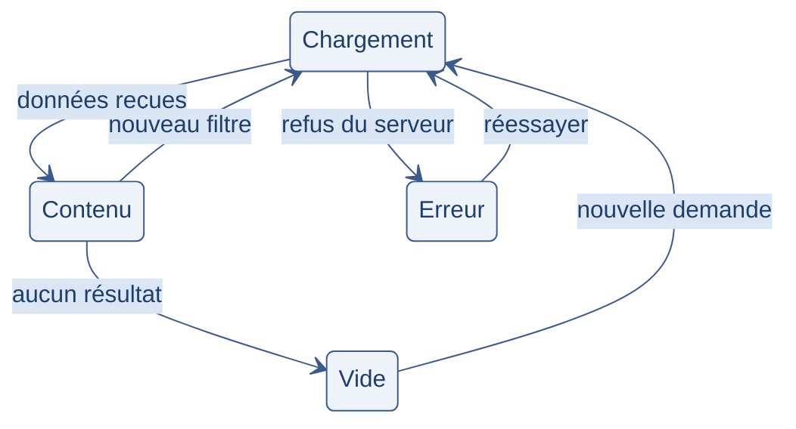

[← Chapitre précédent](02-ecrire-spec-ecran.md) · [Sommaire](Readme.md) · [Chapitre suivant →](05-prototype-qui-devient-code.md)

# 04 - Les états et l'accès

> L'écran que la machine vient de produire est parfait. Il montre une douzaine de
> produits photographiés, des prix bien alignés, un panier déjà rempli. Il ne
> ressemblera à rien dès la première minute de réalité : le compte sans commande, la
> connexion qui traîne, le serveur qui refuse, le libellé trois fois plus long que la
> place prévue. Personne n'a dessiné ces quatre écrans-là. Ce sera à vous de les demander.

## Objectifs

À l'issue de ce chapitre, vous serez capable de :

- **Compléter** un écran généré en exigeant ses quatre états — vide, chargement, erreur, cas limites — et en les traitant comme quatre problèmes distincts.
- **Expliquer** pourquoi la machine ne produit que l'état par défaut, et ce que ce blanc change dans votre demande.
- **Contrôler** six points d'accessibilité contre un référentiel nommé, pas contre un goût : nom accessible, focus, ordre de tabulation, contraste, taille de cible, hiérarchie des titres.
- **Conduire** un premier audit d'accessibilité et distinguer ce qu'il trouve de ce qu'il ne peut pas trouver.
- **Relancer** avec la liste des violations et mesurer l'écart entre la première et la seconde passe.

## Sommaire

- [I. Un écran n'est pas un écran, c'est quatre](#i-un-écran-nest-pas-un-écran-cest-quatre)
- [II. Pourquoi la machine ne génère que l'état par défaut](#ii-pourquoi-la-machine-ne-génère-que-létat-par-défaut)
- [III. L'accessibilité n'est pas une opinion](#iii-laccessibilité-nest-pas-une-opinion)
- [IV. Le premier audit, et ses angles morts](#iv-le-premier-audit-et-ses-angles-morts)
- [V. La relance change le résultat](#v-la-relance-change-le-résultat)
- [VI. L'atelier — deux passes sur l'écran d'un autre](#vi-latelier--deux-passes-sur-lécran-dun-autre)
- [Aller plus loin](#aller-plus-loin)
- [Points clés](#points-clés)
- [Vérifiez vos acquis](#-vérifiez-vos-acquis)

## I. Un écran n'est pas un écran, c'est quatre

Le dossier que vous avez récupéré au chapitre précédent contient **un** écran. Le même écran, dans l'application réelle, s'affiche dans au moins quatre situations qui n'ont rien à voir les unes avec les autres.

### A. Le même écran, quatre problèmes

| État | Ce qui se passe | Ce que l'écran doit dire | Ce qu'il faut prévoir |
|---|---|---|---|
| **Vide** | il n'y a encore, ou plus, rien à afficher | pourquoi il n'y a rien, et par où commencer | une action qui remplit l'écran |
| **Chargement** | l'information n'est pas encore arrivée | que quelque chose est en cours | une action neutralisée le temps de la réponse |
| **Erreur** | le serveur a refusé, ou la saisie n'est pas valable | ce qui a échoué, si c'est rattrapable, et quoi faire maintenant | réessayer, ou revenir au champ fautif |
| **Cas limites** | la donnée est là, mais elle n'a pas la forme de la maquette | rien de spécial — mais tout doit tenir | l'écran reste utilisable |

Quatre questions différentes, donc quatre décisions différentes. « Prévoir les états » n'est pas une case à cocher en fin de maquette : c'est quatre contenus, quatre actions de sortie, quatre tonalités. Un écran peut très bien avoir un bel état vide et un état d'erreur muet.

Deux pièges de confusion, fréquents :

- **vide ≠ zéro résultat.** Le compte nouveau-né n'a rien commandé : on l'invite à découvrir le catalogue. La recherche « fromage de chèvre » n'a rien donné : on l'invite à élargir ou à corriger le mot. Le même écran vide pour les deux dit « il ne se passe rien » à l'un et laisse l'autre sans issue.
- **erreur ≠ vide.** Une panne affichée comme un écran vide envoie l'utilisateur se croire seul en cause. Elle doit dire que le refus vient du serveur et qu'il est normalement rattrapable.

### B. L'état vide — dire quoi faire, pas qu'il n'y a rien

Un état vide utile contient trois choses : un fait, une explication courte, une sortie.

```html
<!-- ce que la machine produit si on ne lui demande que « l'écran de mes commandes » -->
<section class="empty">
  <h3>Aucune commande</h3>
</section>

<!-- ce qu'on obtient en exigeant un état vide -->
<section class="empty">
  <h3>Aucune commande pour le moment</h3>
  <p>Une commande apparaît ici dès que le producteur l'a confirmée.</p>
  <a href="/catalogue">Parcourir le catalogue</a>
</section>
```

Le premier cas n'est pas une faute de goût : c'est une information manquante. L'utilisateur qui arrive sur « Aucune commande » ne sait pas s'il a mal cherché, si la plateforme est en panne, ou s'il doit attendre. Le second cas lui rend une décision.

### C. L'état de chargement — rassurer, et ne pas laisser cliquer deux fois

Trois règles, toutes vérifiables à l'œil :

- **dire ce qui est en cours**, avec la forme de ce qui arrive. Un *squelette de chargement* (les formes grises de ce qui va se remplir) annonce mieux le résultat qu'un rotor tournant sans contexte.
- **neutraliser l'action le temps de la réponse.** Un bouton « Valider » qui reste cliquable pendant l'envoi produit deux commandes. C'est un défaut d'interface, pas un défaut réseau.
- **prévoir le cas où ça traîne.** Au-delà de quelques secondes, il faut une échappatoire : réessayer, ou reprendre plus tard. Un écran qui attend sans rien dire est un écran que l'on quitte.

### D. L'état d'erreur — trois informations, une action

« Une erreur est survenue » n'est pas un message d'erreur, c'est un constat sans suite. Un message qui travaille en contient trois :

1. **ce qui a échoué**, dans les mots de l'utilisateur : « Votre adresse de livraison n'a pas pu être enregistrée », pas `HTTP 500`.
2. **si c'est rattrapable par lui**, et comment : le champ en cause est signalé, la correction est possible sans tout ressaisir.
3. **une seule action principale** : réessayer, ou corriger. Deux actions principales concurrentes dans un écran d'erreur, c'est un écran où l'on reste.

Une réponse technique brute recopiée à l'écran ne remplit aucune de ces trois lignes : elle expose du détail interne et elle ne dit rien de ce que l'utilisateur doit faire.

### E. Les cas limites — quand la donnée réelle arrive

La maquette est dessinée avec des données décoratives : un nom court, un prix rond, une photo carrée. La donnée réelle arrive autrement. Testez l'écran avec :

- un libellé beaucoup plus long que celui de la maquette (nom de producteur, titre d'article, message de retour) ;
- un montant plus long que la colonne qui doit le contenir, ou avec des décimales ;
- une image absente ou ratée ;
- zéro résultat, un seul résultat, une liste longue qui défile ;
- un texte de confirmation long, dans une langue plus longue que le français.

Ce n'est pas une étape de finition : c'est une donnée de conception. Un écran qui tient avec des données décoratives et qui casse avec les données réelles n'a jamais été vérifié — il a été regardé.

### F. Voyez-le comme une machine à états

Vous codez des machines à états toute la journée. Un écran d'application en est une, et le blanc de la maquette est simplement une transition non décrite.



Écrivez la condition de fini correspondante, noir sur blanc, dans le fichier de spec :

> L'écran est fini quand ses quatre états existent, que chacun propose une sortie, et que la donnée la plus laide qu'il puisse recevoir y tient.

Cette phrase se vérifie. C'est ce qui la distingue de « l'écran est beau ».

## II. Pourquoi la machine ne génère que l'état par défaut

### A. Le cas favorable est le plus représenté

Un modèle de génération d'interfaces a été entraîné sur des millions d'écrans publiés : des accueils, des pages de démonstration, des captures marketing, des composants en vitrine. Sur ces écrans, **il y a toujours des données** : le panier contient trois articles, la liste en contient douze, le tableau de bord est plein.

Les états vide, de chargement et d'erreur existent dans le logiciel réel, mais ils ne se photographient pas. Ils sont rarement publiés, donc rarement vus. La machine ne les « oublie » pas : elle reproduit une fréquence. Quand rien ne lui demande autre chose, elle sert le cas le plus probable de son corpus, qui est le cas favorable.

C'est aussi pour cela qu'elle remplit les blancs avec ses propres hypothèses : ces douze produits que vous n'avez jamais listés ne sont pas une réponse à votre demande, ce sont les vôtres complétées par les siennes.

### B. La finition rend le blanc invisible

Voici ce que l'assemblage produit : une typographie soignée, une palette cohérente, des données crédibles. Le résultat est plus convaincant qu'un croquis, et c'est précisément ce qui le rend difficile à critiquer — on ne conteste pas volontiers ce qui est bien présenté.

Le défaut n'est pas dans ce que l'écran montre. Il est dans ce que ses bordures laissent penser : qu'un écran, c'est cet objet-là. Les douze produits inventés ne coûtent rien à croire et cachent qu'aucun des trois autres états n'existe.

### C. Ce que ça change dans votre demande

Tant que les états ne sont pas demandés, ils ne sont pas absents par erreur : ils sont absents par défaut. Trois formulations, trois résultats différents.

| Ce que vous demandez | Ce que vous obtenez le plus souvent | Ce qui manque |
|---|---|---|
| « L'écran de mes commandes » | le cas favorable, joliment rempli | les trois autres états |
| « … avec un état vide et un état d'erreur » | deux blocs gris, un texte générique | le contenu, l'action de sortie, le cas où ça traîne |
| « … et pour chaque état, le texte exact, l'action de sortie, et ce qui est neutralisé pendant l'attente » | un écran décliné, discutable mais complet | rien d'automatique : c'est à vous de juger le texte |

La troisième ligne n'est pas plus longue à écrire que la première. Elle déplace seulement la décision : au lieu de laisser la machine choisir ce qu'elle a le plus vu, vous lui dites ce que vous voulez.

## III. L'accessibilité n'est pas une opinion

Aucune des personnes dans cette salle n'a de formation de design, et ce n'est pas nécessaire ici : les six points qui suivent se mesurent. Ils ne se discutent pas.

### A. Deux référentiels nommés, avec leur version

- **Le RGAA 4.1.2** (Référentiel général d'amélioration de l'accessibilité) est le référentiel **opposable en France** : arrêté du 18 décembre 2024, 106 critères, 258 tests, adossé au WCAG (Web Content Accessibility Guidelines, les règles d'accessibilité des contenus web publiées par le W3C) version 2.1, niveaux A et AA. C'est lui qui sert de base à un audit légal dans notre contexte.
- **WCAG 2.2** est la version suivante de ces mêmes règles : c'est le **référentiel international**, et la référence la plus courante des outils d'audit.
- La **v5 du RGAA est en rédaction**, avec une publication annoncée pour fin 2026. Tant qu'elle n'est pas parue, on travaille avec la 4.1.2, et on date la version qu'on a utilisée.

Le référentiel bouge, et c'est une raison de plus pour le nommer avec sa version plutôt que de dire « les règles d'accessibilité ». La taille minimale d'une cible tactile, par exemple, n'existe pas dans WCAG 2.1 : elle est apparue avec WCAG 2.2.

### B. Six points qui se vérifient

| Point | Ce qui doit être vrai | Le geste qui vérifie | Ce que l'export produit souvent |
|---|---|---|---|
| **Nom accessible** | tout champ a un nom annoncé, autre que son exemple | inspecter le champ : un `<label>` associé, ou un `aria-label` explicite | le `placeholder` pris pour étiquette — il disparaît dès la saisie |
| **Focus visible** | on voit à tout moment où l'on est au clavier | tabuler sans souris sur toute la page | `outline: none` dans le CSS exporté, par esthétique |
| **Ordre de tabulation** | le clavier traverse la page dans l'ordre logique, et sort des boîtes ouvertes | tabuler jusqu'au bout, une seule fois | ordre du code ≠ ordre visuel ; une boîte modale qui retient le clavier |
| **Contraste** | 4,5:1 pour un texte courant, 3:1 pour un gros texte (WCAG 2.2, critère 1.4.3) | lire le ratio mesuré et le ratio attendu dans le rapport d'audit | texte gris clair sur fond très clair, hérité du thème |
| **Taille de cible** | 24×24 pixels CSS minimum (WCAG 2.2, critère 2.5.8, niveau AA) | sélectionner l'élément et lire sa taille rendue dans les outils de développement | icône dessinée sans aire de clic élargie |
| **Hiérarchie des titres** | un seul titre de niveau 1, pas de niveau sauté, de vrais titres | lister les titres de la page, ou les lire dans l'inspecteur | titre « visuel » en paragraphe gras ; saut du niveau 1 au niveau 4 |

Chaque ligne a le même schéma : une exigence écrite dans un référentiel, un geste qui la mesure, un verdict. Rien de tout cela ne demande un avis.

### C. Ce que le clavier voit

Le test du clavier prend quelques minutes et remplace une journée de discussion. Sans toucher la souris : atteignez-vous chaque action de l'écran, voyez-vous où vous êtes, l'ordre est-il celui de la lecture, pouvez-vous refermer ce que vous avez ouvert ?

Un lecteur d'écran ajoute une deuxième couche : il annonce **le nom, le rôle et l'état** de ce qui reçoit le focus. Un champ sans nom accessible devient « champ de saisie » sans plus ; un bouton dessiné avec une `<div>` reste du texte. Inversement, un bon `aria-label` peut être un mauvais mot : « Sélectionnez une option » sur un champ de quantité est techniquement conforme et parfaitement inutilisable. Ce dernier point, aucun outil automatique ne le verra — mais vous pouvez l'entendre.

### D. Deux écritures du même bouton

```html
<!-- passe le contrôle de style, rate l'utilisateur -->
<div class="btn" onclick="valider()">Valider</div>
<input placeholder="Quantité">

<!-- ce que vous exigez -->
<button type="submit">Valider</button>
<label for="quantite">Quantité</label>
<input type="number" id="quantite" name="quantite" min="1" value="1">
```

La première version peut être celle que vous avez récupérée dans le dossier exporté : elle est visuellement correcte. La seconde coûte deux lignes et elle est atteignable au clavier, annoncée par un lecteur d'écran, et acceptée par l'audit. Devant une interface générée, c'est cette relecture-là qui compte, et vos yeux de développeurs y suffisent.

## IV. Le premier audit, et ses angles morts

### A. Lancer l'audit sur un rendu

Vous disposez déjà d'un capteur — appelons ainsi un contrôle mécanique, lancé par une machine, qui rend un verdict lisible : l'audit d'accessibilité intégré aux outils de développement de Chrome et Edge (**Lighthouse**). Aucune installation, et c'est pourquoi on l'utilise dès maintenant ; le chapitre 06 installe le second capteur, une fois pour toutes.

Le geste est toujours le même : ouvrir le rendu, lancer l'audit, **lire les items un par un** — pas la note. Une note globale flatteuse pendant que trois items restent ouverts ne dit rien ; la liste des items, si.

### B. Ce qu'un rapport trouve

Sur un export d'interface générée, les items qui remontent le plus souvent sont exactement ceux du tableau précédent : contrastes insuffisants, champs sans nom accessible, images sans texte alternatif, hiérarchie de titres incohérente, cibles trop petites, focus rendu invisible par le CSS. Ce sont des violations **objectives, localisées, corrigeables une par une**. C'est déjà beaucoup, et c'est précisément ce qui rend la relance possible.

### C. Ce qu'il ne trouvera jamais

Les outils automatiques laissent passer **environ 30 % des barrières d'accessibilité** : c'est une donnée du Government Digital Service, le service du gouvernement britannique chargé des services publics numériques, reprise dans la documentation de l'outil de test `jest-axe`. Retenez-la telle quelle : un rapport vert n'est pas un écran accessible, c'est un rapport vert.

Ce qui reste dans l'angle mort n'est pas anecdotique :

| Ce que la machine ne juge pas | Pourquoi elle passe à côté |
|---|---|
| un message d'erreur muet (« Une erreur est survenue ») | le texte est bien contrasté, bien balisé, correctement annoncé |
| un ordre de tabulation correct mais illogique | l'ordre est valide ; seul un humain sait ce qui devrait venir après |
| un texte alternatif présent et faux (`alt="image"`) | l'attribut existe, donc le contrôle est satisfait |
| un nom accessible exact mais inutilisable | le nom est un nom ; le sens échappe au contrôle automatique |
| un état vide sans sortie | l'audit ne connaît que ce qui est affiché |
| **tout écran que vous n'affichez pas** | l'audit audite le document courant, dans l'état courant |

Cette dernière ligne est la plus importante de la section : **l'audit ne porte que sur l'état où vous le lancez**. Un rapport lancé sur l'écran plein ne dit rien de l'écran vide. Vous avez donc quatre fois intérêt à lancer le même audit — un par état.

### D. Un rapport vert ne prouve rien, un rapport lu prouve beaucoup

Ce que le rapport ne peut pas trouver, vous ne le découvrirez pas en le relançant : vous le découvrirez en tabulant, en lisant les messages à voix haute, en affichant les quatre états. Le rapport n'est pas la fin de l'inspection, il en est la première moitié.

Reste à en faire quelque chose. Un rapport qu'on regarde ne change pas l'écran ; un rapport qu'on **rend à la machine, item par item**, si.

## V. La relance change le résultat

### A. Ce que dit l'étude

Ce n'est pas une intuition de salle. Doush et Kassem (2025, *Universal Access in the Information Society*, vol. 24, p. 3483-3506) ont fait produire des composants d'interface par **quatre modèles**, sur **onze composants**, puis les ont évalués au clavier et au lecteur d'écran. Deux résultats retiennent l'attention :

- le code produit est **sémantiquement valide** : de vraies balises, une structure cohérente, rien qui choque un relecteur pressé ;
- il **échoue fréquemment à la conformité complète tant qu'on ne relance pas**, et les prompts de suivi l'améliorent nettement.

Nous ne gardons de ces chiffres que ce qu'ils disent sur le geste, pas leur valeur exacte : les nôtres, vous allez les compter. Ce que l'étude installe, c'est une asymétrie — entre une première sortie « correcte en apparence » et une seconde sortie mesurée.

### B. La liste n'est pas une politesse, c'est un capteur

« Je te liste ce qui ne va pas » n'est pas une façon douce de critiquer. C'est le geste qui transforme un rapport en correctif :

- une **liste numérotée** d'items indépendants, un item = une violation relevée par l'audit ou par votre relecture ;
- pour chaque item, **l'écart mesuré** (ce que l'outil affiche) et **ce qu'exige le référentiel** (le seuil, le critère) ;
- **la correction attendue**, formulée comme ce que vous auriez écrit vous-même ;
- **le périmètre figé** : « ne modifie rien d'autre ».

À cette liste, la machine répond sur un terrain où elle est bonne : appliquer des correctifs locaux. À « améliore l'accessibilité », elle répond à sa manière : elle revient avec sa version préférée de l'écran, c'est-à-dire celle que lui dicte la fréquence — et vous avez tout à rejuger.

### C. Écrire une relance qui porte

> **Ce qui ne produit rien —** « Améliore l'accessibilité de cet écran. »
>
> **Ce qui produit un correctif —** « Corrige les six points suivants. Ne modifie ni la mise en page, ni les textes, ni les données.
> 1. Le champ de quantité n'a pas de nom accessible : ajoute un `<label>` associé, libellé « Quantité » (pas « Sélectionnez une option »).
> 2. Le texte `#9ca3af` sur fond `#f9fafb` échoue au contraste : il faut 4,5:1 en texte courant (WCAG 2.2, critère 1.4.3).
> 3. Le bouton de suppression n'a pas de cible assez grande : 24×24 pixels CSS minimum (WCAG 2.2, critère 2.5.8).
> 4. Le focus est invisible sur les liens : retire `outline: none` et remplace-le par un style de focus visible contrasté.
> 5. Le titre de section est un paragraphe en gras : remplace-le par un titre de niveau 2, sans sauter de niveau.
> 6. Une image de producteur est sans texte alternatif : décris ce qu'elle montre, ou décris son rôle. »

Six items, six verdicts. Après la sortie, vous ne demandez pas « as-tu tout corrigé ? » : **vous relancez l'audit**. C'est la seconde passe, et c'est elle qui décide.

### D. Mesurer la différence

Le tableau ci-dessous est celui que vous remplirez à l'atelier EX-04. Il n'a de valeur qu'avec **vos** chiffres, sur **votre** écran : personne ne peut le préremplir à votre place, et c'est très exactement la leçon.

| | Passe 1, sans capteur | Passe 2, avec capteur | Après la relance |
|---|---|---|---|
| Violations relevées par l'audit | — | | |
| Défauts relevés à la main seulement | | | |
| Violations restées après correction | — | — | |

Trois lectures à en tirer : l'écart entre la colonne 1 et la colonne 2 dit ce que l'œil ne voit pas ; le nombre restant dit si la relance a suffi ; et la ligne « relevés à la main seulement » rappelle que le capteur n'est pas le juge — il est l'un des deux.

### E. Ce que la relance ne garantit pas

- **Une sortie « sémantiquement valide » n'est pas un écran accessible.** C'est même le piège documenté par l'étude : la validité rassure, la conformité est ailleurs.
- **La machine peut annoncer une correction qu'elle n'a pas faite.** On ne vérifie pas la réponse, on vérifie le rendu : second audit, même écran, même état.
- **Un rapport à zéro item laisse les barrières invisibles** (les 30 % de tout à l'heure). Après le vert, on tabule encore.
- **La relance ne remplace pas la décision humaine** sur le contenu : un message d'erreur bien balisé mais muet reste muet tant que vous n'avez pas écrit ce qu'il doit dire.

---

## VI. L'atelier — deux passes sur l'écran d'un autre

### EX-04 - Auditer en deux passes (35 min, binômes croisés, débrief 8 min)

**Contexte.** Chaque binôme a récupéré au chapitre précédent le dossier d'export d'un écran de *Panier Local*, avec ses quatre états plus ou moins demandés. Vous n'allez pas auditer votre écran : vous auditez **celui du binôme d'à côté**. Ce n'est pas une consigne de confort — on juge plus froidement l'écran qu'on n'a pas fait soi-même, et c'est cette froideur que l'audit exige.

**Déroulé (35 min).**

1. **4 min — échange.** Chaque binôme ouvre le rendu du voisin dans le navigateur. On note quelle donnée on a sous les yeux : le rendu n'est peut-être pas l'écran vide.
2. **7 min — passe 1, sans capteur.** À l'œil, au clavier, et avec les quatre états autant que possible. Vous produisez une liste numérotée de défauts. Il est interdit de lancer l'audit pendant cette passe : c'est elle qui sert de référence.
3. **7 min — passe 2, avec capteur.** Même écran, audit lancé. Vous ajoutez ce que la machine signale et vous **barrez** ce que vous aviez écrit et qu'elle ne confirme pas. Vous entourez ce que vous avez trouvé et qu'elle ne dit pas.
4. **6 min — la relance.** Vous rédigez la liste à rendre à la machine : un item par violation, la valeur mesurée, le critère, la correction attendue, et la phrase de périmètre figé. Vous la donnez à l'outil qui a produit l'écran, ou à celui que le formateur indique. **Personne ne corrige le code à la main** : si vous corrigez vous-même, vous ne mesurez plus l'effet de la relance.
5. **3 min — re-mesure.** Nouvel audit sur la nouvelle sortie, même écran, même état. Vous reportez les trois colonnes du tableau de la section V.D.
6. **8 min — débrief**, les deux binômes ensemble : qui a trouvé quoi sans le capteur, combien de violations restaient, et quelle formulation de relance a le mieux marché.

**Livrables, rendus en fin d'atelier :** la liste de la passe 1, celle de la passe 2 (avec ce qui a été barré et entouré), la relance **telle qu'elle a été écrite**, et le tableau à trois colonnes rempli.

**Contraintes.** On n'échange pas un écran déjà corrigé. On n'audite pas l'état qu'on préfère : si l'écran n'a qu'un seul état, ce blanc est un défaut, et il se note comme tel. Si un item de la machine est incompréhensible, on le garde dans la liste et on le marque comme tel — c'est une information sur l'outil.

<details>
<summary>Voir la correction</summary>

**Éléments attendus.**

- La passe 1 contient des défauts que l'audit ne signalera jamais : message d'erreur muet, état vide sans action de sortie, libellé techniquement correct mais faux, ordre de tabulation illogique.
- La passe 2 ajoute des items mesurés : contrastes, cibles, noms accessibles, hiérarchie de titres. Elle retire parfois un défaut « d'école » qui était en fait conforme.
- La relance est une liste numérotée, avec pour chaque item une valeur mesurée, un critère nommé et une correction attendue, et elle fige le périmètre.
- La re-mesure baisse, et ne descend presque jamais à zéro : les items restants sont soit techniques et mal formulés, soit hors de portée du capteur.

**Erreurs fréquentes.**

- Relance vague (« améliore l'accessibilité ») : la sortie est un nouvel écran, pas une correction, et il faut tout rejuger.
- Corriger soi-même dans le code, puis attribuer le progrès à la relance.
- Compter la passe 2 sans avoir compté la passe 1 : sans premier chiffre, il n'y a pas de différence, seulement une impression.
- Conclure d'un rapport sans item que l'écran est accessible.
- Auditer un seul état, puis généraliser à l'écran.
- Rendre une relance qui demande en plus un changement de design (« et rends-le plus moderne ») : le périmètre n'est plus figé, la sortie est imprévisible.

**Ce qu'il faut retenir.** Le capteur trouve ce que l'œil ne voit pas, l'œil trouve ce que le capteur ne peut pas voir, et la relance ne vaut que si on la remesure. Les trois gestes tiennent en une phrase : compter, rendre la liste, recompter.

</details>

## Aller plus loin

Tout ceci est facultatif, et ne change rien aux livrables de la journée.

- **Relire le RGAA dans son référentiel de tests** : la DINUM (direction interministérielle du numérique) le publie, test par test. Pour les critères du contraste et de la taille de cible, le référentiel décrit le *test* autant que la règle. C'est ce qui permet de dire « non conforme » sans se demander qui a raison.
- **Parcourir WCAG 2.2 sur le site du W3C**, en regardant ce que la version 2.2 a ajouté par rapport à la 2.1 : cibles, focus, glisser-déposer. On comprend mieux pourquoi la version du référentiel se cite.
- **Suivre la v5 du RGAA**, en rédaction à la date de ce support, sans l'anticiper dans un rapport : on audite avec la version en vigueur et on la date.
- **Une habitude, dix minutes par semaine** : finir une de vos interfaces au clavier seul, sans souris. Vous y trouverez plus de défauts qu'avec n'importe quel rapport.
- **Tenir les listes dans un fichier versionné**, à côté de la spec. Une liste de violations est à la fois une relance et une trace : elle prouve ce qui a été trouvé, ce qui a été demandé, et ce qui a été corrigé entre les deux passes.

## Points clés

- Un écran n'est pas un écran, c'est quatre : vide, chargement, erreur, cas limites. Chacun a son contenu, sa sortie, son ton — et le blanc n'est pas un oubli, c'est un défaut.
- La machine sert l'état par défaut parce que c'est le plus représenté dans ce qu'elle a appris. Ne pas demander les états, c'est les supprimer.
- L'accessibilité se lit dans un référentiel nommé : RGAA 4.1.2 en vigueur en France (arrêté du 18 décembre 2024, 106 critères, 258 tests), WCAG 2.2 en référence internationale. Contraste 4,5:1 en texte courant, cible 24×24 pixels CSS — et un geste de contrôle pour chaque seuil.
- Les outils automatiques laissent passer environ 30 % des barrières : un rapport vert n'est pas un écran accessible, et un audit lancé sur un seul état n'audite qu'un état sur quatre.
- « Je te liste ce qui ne va pas » est un capteur, pas une politesse : la relance fait baisser le chiffre, et c'est le chiffre — pas la promesse de la machine — qui le dit.

## 🧠 Vérifiez vos acquis

*Cinq questions pour vous-même, aucune n'est notée. Répondez avant de déplier les corrections.*

**1.** Quatre états doivent être demandés à la machine. Lequel n'en fait **pas** partie ?

- A. Le panier vide
- B. L'écran pendant l'attente
- C. Le message de confirmation
- D. L'écran refusé par le serveur

**2.** Un audit automatique ne signale aucun item. Qu'en concluez-vous ?

- A. L'écran est accessible
- B. Une partie des barrières lui échappe
- C. Il faut relancer l'audit dans un autre navigateur
- D. Le contraste est nécessairement conforme

**3.** Quelle relance a le plus de chances de faire bouger le résultat ?

- A. « Améliore l'accessibilité de cet écran. »
- B. « Régénère l'écran en respectant le RGAA et le goût du client. »
- C. « Corrige ces six violations, sans rien changer d'autre. »
- D. « Ajoute des attributs aria-label sur tous les champs et tous les boutons de la page, y compris ceux qui en ont déjà. »

**4.** Pourquoi la machine ne produit-elle que l'état par défaut ?

- A. Les autres états ne sont pas conformes au référentiel
- B. C'est l'état le plus représenté dans ce qu'elle a appris
- C. Le format d'export ne permet de produire qu'un seul écran
- D. Elle attend une seconde consigne pour ajouter les autres

**5.** Votre écran affiche « Une erreur est survenue » quand le serveur refuse la requête, et l'audit ne signale rien. Que doit-on exiger de plus, et pourquoi ce message passe-t-il un audit ?

<details>
<summary>Vérifier ses réponses</summary>

**1. C.** Les quatre états à exiger sont vide, chargement, erreur, cas limites de données. Le message de confirmation est un élément du parcours, pas un des quatre états qui manquent à un écran généré.
**Pourquoi :** ce sont les situations où l'écran n'a plus rien de décoratif qui disparaissent — et ce sont elles qui décident si l'application paraît fiable.

**2. B.** Les outils automatiques laissent passer environ 30 % des barrières (donnée du Government Digital Service, reprise par la documentation de `jest-axe`).
**Pourquoi :** un audit juge un document dans un état donné. Un message muet, un ordre illogique ou un libellé sans sens le traversent. Le vert est un début d'argument, jamais une fin.

**3. C.** Une liste numérotée de violations mesurées, avec périmètre figé.
**Pourquoi :** la machine est à l'aise sur les correctifs locaux décrits ; elle revient avec sa propre version préférée dès qu'on lui demande de « améliorer » ou de régénérer. L'option D est le faux ami classique : multiplier un attribut ne crée pas du sens.

**4. B.** Le cas favorable est le plus publié, donc le plus appris.
**Pourquoi :** ce n'est ni une limite technique du format ni une intention. La conséquence est pratique : ce que vous ne demandez pas est remplacé par la fréquence, et cette substitution ne s'annonce pas.

**5.** Réponse attendue en deux ou trois lignes : le message doit dire **ce qui a échoué** dans les mots de l'utilisateur, **si c'est rattrapable** et comment, et proposer **une action** (réessayer, corriger le champ). Il passe un audit parce que l'audit vérifie la forme — balisage, contraste, annonce — et jamais le sens d'une phrase.

</details>

[← Chapitre précédent](02-ecrire-spec-ecran.md) · [Sommaire](Readme.md) · [Chapitre suivant →](05-prototype-qui-devient-code.md)
