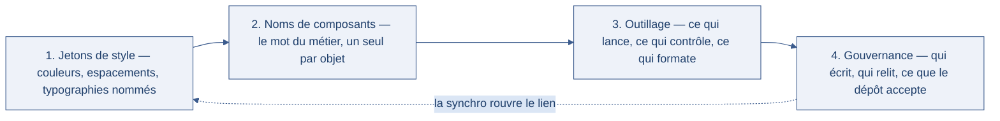

[← Chapitre précédent](04-etats-et-acces.md) · [Sommaire](Readme.md) · [Chapitre suivant →](06-tenez-ecran.md)

# 05 - Le prototype qui devient du code

> Un écran tout seul ne dit pas s'il est juste : il dit qu'il est joli.
> Tant qu'il est seul, vous ignorez d'où l'on revient, ce qui doit survivre
> quand on part, et ce qui s'affiche quand la page suivante n'arrive pas.
> Le jour où trois écrans se tiennent par un clic, et où le dossier s'ouvre
> dans votre éditeur, la moitié des cachotteries tombe — l'autre se voit.

## Objectifs

À l'issue de ce chapitre, vous serez capable de :

- **Distinguer** ce qu'un prototype teste d'un livrable qu'il livre, et écrire la question avant de cliquer.
- **Enchaîner** des écrans et lire dans la navigation ce que l'écran tout seul cachait.
- **Récupérer** le dossier de code, l'ouvrir en local, le relire sur trois points : composants, données, états.
- **Organiser** le passage de l'écran à ceux qui vont le coder : jetons de style, noms de composants, outillage, gouvernance.
- **Trier** ce qui survit au passage et ce qui meurt.

## Sommaire

- [I. Un prototype est une hypothèse](#i-un-prototype-est-une-hypothèse)
- [II. Le clic : relier les écrans](#ii-le-clic--relier-les-écrans)
- [III. Récupérer le dossier, et le relire](#iii-récupérer-le-dossier-et-le-relire)
- [IV. Le handoff n'est pas un envoi](#iv-le-handoff-nest-pas-un-envoi)
- [V. Ce qui survit, ce qui meurt](#v-ce-qui-survit-ce-qui-meurt)

## I. Un prototype est une hypothèse

Une hypothèse se formule **avant** l'expérience. C'est ce qui la distingue d'un brouillon : un brouillon attend qu'on le regarde pour savoir s'il est bon ; une hypothèse sait déjà ce qui la contredira.

Un prototype, dans ce cours, n'est jamais « un livrable en moins bien ». C'est une **question posée à un objet**. Et chaque cran de la chaîne ne pose pas la même question :

| Cran | L'objet | La question qu'il teste | Ce qu'il ne teste pas |
| --- | --- | --- | --- |
| L'écran généré | une maquette | l'idée est-elle juste ? | l'ordre, la donnée réelle |
| L'enchaînement cliquable | des écrans reliés | l'ordre tient-il ? | ce que la charge fait apparaître |
| Le dossier qui tourne en local | un projet | est-ce un projet, ou une page déguisée ? | le parc de postes, la durée |
| L'écran branché sur les données | une fonctionnalité | ce qu'on a dessiné existe-t-il dans les données ? | c'est le livrable : il teste tout |

### A. Écrire la question avant de cliquer

Avant de relier vos écrans ou de télécharger quoi que ce soit, écrivez trois lignes dans le fichier de spec :

- **la question** que ce cran est censé trancher — « est-ce que l'usager retrouve son panier après avoir consulté un producteur ? » ;
- **ce qui y répondra** — ce que vous devrez voir, ou entendre, pour avancer ;
- **ce que vous ne ferez pas** avec ce cran — un prototype ne prouve ni la performance, ni la donnée vraie, ni la maintenance.

Ces trois lignes vous donnent ce que la finition ne donne jamais : un **critère d'arrêt**. Sans lui, vous arrêtez de travailler quand l'écran *ressemble* à ce que vous aviez en tête, ce qui n'est pas un critère, c'est une humeur.

### B. Ce qui transforme une hypothèse en livrable

Une hypothèse devient livrable quand trois choses sont vraies :

- la question a reçu une **réponse**, et cette réponse est écrite quelque part ;
- la réponse se **vérifie sans vous** — quelqu'un d'autre peut la refaire ;
- ce qui a été décidé est **dans le dépôt**, pas dans votre mémoire de la démonstration.

Tant que ce n'est pas vrai, le bel objet que vous avez sous les yeux est une promesse. Le passage au code n'est pas ce qui la tient : c'est ce qui la **rend visible**.

## II. Le clic : relier les écrans

Le mot du référentiel est exactement le nôtre. Les deux titres sur lesquels ce cours s'appuie — RNCP37873 (Concepteur développeur d'applications) et RNCP37674 (Développeur web et web mobile) — ne demandent pas seulement de « réaliser les maquettes des interfaces utilisateur » : ils demandent de **modéliser leur enchaînement**, et le premier y ajoute le RGAA « dans la réalisation des maquettes des interfaces utilisateur et leur enchaînement ».

Le lien entre deux écrans est donc une matière de travail, au même titre qu'un écran. Le relier, c'est répondre à une question que l'écran n'a jamais eue à traiter.

### A. Ce que la navigation révèle

| Ce que l'écran seul laissait croire | Ce que l'enchaînement montre |
| --- | --- |
| l'action principale est évidente | elle est à tant d'écrans de l'intention, et vous les comptez maintenant |
| le bouton « Continuer » fonctionne | il fonctionne quand le panier est rempli ; vide, il mène à une impasse sans message |
| la page est autonome | quelque chose doit **survivre** au départ : le contenu du panier, le filtre en cours, la saisie à moitié faite |
| la page se termine proprement | rien ne dit **où l'on revient**, ni si l'on revient au même endroit après une erreur |
| le chargement est un détail | c'est un écran que l'usager traverse à chaque transition, pas une fois |
| le focus est une affaire de style | sur un changement d'écran qui ne recharge pas la page, le focus reste où il était et rien n'annonce le déplacement |

Ce que vous notez ici n'est pas une liste de défauts : c'est la liste des **décisions que la maquette a prises pour vous** en silence.

### B. Relier sans retravailler

- Ne reliez que le **chemin principal** : le chemin que la spec a écrit, pas les variantes de confort. Un prototype qui a toutes les sorties possibles ne teste plus l'ordre, il décore.
- Annoncez à l'outil de maquette — Google Stitch — ce que vous voulez obtenir en **termes d'écrans**, pas en termes d'effets : « d'ici, un clic sur le producteur mène à sa fiche, et de là on revient à cette liste ».
- Repérez, à chaque lien, **l'état de départ** de l'écran d'arrivée : vide ou plein ? c'est la réponse du chapitre précédent, et c'est elle qui casse en premier.
- Faites le trajet **à l'envers** une fois sur deux, et une fois **au clavier** seulement. Ce que la souris pardonne, la tabulation le note.

## III. Récupérer le dossier, et le relire

> ⚠️ **Ce que l'archive ne dit pas.** Ce que l'outil vous donne à télécharger est complet **pour lui** : il contient ce qu'il faut pour que la page s'affiche, pas ce qu'il faut pour que le projet vive. La relecture n'est pas une formalité de fin — c'est le seul endroit de la journée où vous vérifiez quelque chose avec vos propres outils.

### A. Deux façons de récupérer le dossier

| Ce que vous récupérez | Ce que ça contient | Ce que ça ne contient pas | Ce qu'on vérifie à la réception |
| --- | --- | --- | --- |
| L'archive de l'outil de maquette | par écran, un document HTML avec ses styles (Tailwind) et une capture | serveur, dépendances, liens entre écrans durables | les liens entre écrans tiennent-ils hors de l'outil ? |
| L'archive de l'outil d'application (Google AI Studio, mode Build) | un projet : entrée HTML, dossier de code source, fichier de dépendances et de scripts, petit serveur | vos décisions, vos données, vos clés | ce que le fichier de scripts sait lancer — et ce qui lui manque pour ça |
| Le dépôt Git | le projet **et son historique**, donc ses reprises | ce qui n'a jamais été commité : commentaires de l'outil, captures, discussions | la branche et le commit que vous avez sous les yeux, et qui les a écrits |

Deux points de méthode, parce que ces surfaces bougent :

- **Le geste, pas le libellé.** Pour sortir du code, cherchez ce qui **fait projet** — un fichier qui déclare dépendances et scripts, un dossier de code source — et non ce qui fait bel objet. Les noms des menus changent tous les trois mois : relevez celui que vous avez sous les yeux et datez le relevé (celui de ce chapitre : 23/11/2026).
- **Ce qui reste disponible se vérifie, ça ne se suppose pas.** Avant de relancer une génération, regardez l'état de votre compte, notez-le et datez-le. Un chapitre qui énoncerait un droit d'usage serait faux dans un mois ; un geste daté reste utile.

### B. Ouvrir le dossier en local

- Décompressez **ailleurs** que dans le dossier de téléchargement : un projet qui démarre depuis son archive n'est jamais relu.
- Lisez d'abord le fichier de dépendances et de scripts. Il dit deux choses : **ce qui est requis** et **ce que l'on peut lancer**. C'est lui qui fait du dossier un projet.
- Lancez ce qu'il déclare. Si l'installation ne peut pas se faire — réseau de salle, version de l'environnement —, **ouvrez le fichier d'entrée directement** : la page s'affiche, et vous venez de mesurer ce qui dépend du serveur que l'outil avait ajouté pour vous.
- Les appels qui ont besoin d'une clé ne fonctionneront pas chez vous : l'outil garde ces clés **de son côté**, dans un coffre, et ne les met pas dans le code que vous téléchargez. C'est une bonne nouvelle, et c'est aussi un piège — voir plus bas.

### C. L'arborescence annotée

Archive d'exemple téléchargée un 23/11/2026, commentaires ajoutés pour la lecture. Les noms exacts bougent d'une version à l'autre : c'est précisément le travail de les relever, pas de les retenir.

```
proto-panier/                 ← racine reçue, telle quelle
├── index.html                ← ce que le navigateur charge en premier
├── package.json              ← dépendances + scripts : c'est lui qui dit « projet »
├── metadata.json             ← ce que l'outil gardait pour lui : à garder ou à retirer
├── server/                   ← le petit serveur que l'outil a ajouté
│   └── index.js              ← là où vivent les appels qui ont besoin d'une clé
└── src/
    ├── main.tsx              ← où l'on monte l'application dans la page
    ├── App.tsx               ← l'écran racine : lequel des trois ? les autres sont-ils venus après ?
    └── components/
        ├── ProductList.tsx   ← un écran ? un morceau d'écran ? les deux se ressemblent
        ├── CartPanel.tsx     ← « Cart » ici, « Panier » dans la spec : même objet, deux noms
        └── ui/
            └── Button.tsx    ← le composant que vous allez garder, et nommer vous-même
```

### D. Trois questions à poser aux fichiers

Ces trois questions sont l'atelier, et c'est aussi la checklist que vous emporterez. Elles se posent avec vos outils à vous : recherche dans les fichiers, lecture, exécution. Elles ne demandent de connaître ni l'outil, ni son vocabulaire.

| Question | Où on la pose | Ce qu'on veut lire | Ce que ça veut dire sinon |
| --- | --- | --- | --- |
| **Quels composants ?** | le dossier des composants et l'écran racine qui les appelle | un fichier par écran, un fichier par morceau réutilisé, des noms qui disent le métier | tout est dans l'écran racine : vous avez une page, pas une application |
| **D'où viennent les données ?** | le corps des composants, valeur par valeur | les valeurs viennent d'un état ou d'un appel, jamais d'un texte collé dans la page | ce qui est écrit dans le fichier est une donnée de démonstration : elle voyagera jusqu'en production |
| **Où sont les états ?** | la même zone, et le rapport du chapitre précédent | chargement, vide et erreur écrits quelque part dans le code | les états ont été dessinés, pas écrits : ils n'ont pas fait le voyage |

### E. Ce qui cloche typiquement dans du code généré

| Signe dans le fichier | Ce que ça veut dire | Le geste |
| --- | --- | --- |
| une `div` avec un gestionnaire de clic à la place d'un `button` | le clic marche à la souris, plus au clavier ni au lecteur d'écran | remplacer par l'élément qui porte le rôle |
| une couleur écrite en dur, une seule fois, à un seul endroit | le jeton de style n'a pas survécu au passage | le remplacer par le jeton, ou créer le jeton |
| le même composant recopié avec une classe de différence | la machine a produit ce qui ressemblait, pas ce qui se réutilise | extraire, nommer, vérifier les deux usages |
| un nom de client, un prix, une date figés dans le corps | donnée de démonstration sans permission | la déplacer là où vivent les données, et le dire |
| `TODO`, « bientôt disponible », un bouton sans effet | fonctionnalité fantaisie : l'écran promet ce que le code ne tient pas | le bouton part, ou la fonction arrive |
| une clé recopiée dans un fichier du client | elle est lisible dans le navigateur de n'importe qui | elle repasse côté serveur, et on la traite comme compromise |
| aucun état de chargement, aucun traitement d'erreur | l'écran n'existe que dans le monde où tout marche | reporter ici les états du chapitre précédent |
| `Component1`, `NewFile`, `test2` | les noms ne portent aucune information | renommer avec le mot du métier, dès maintenant |

### EX-05 - Trois écrans, un dossier, une relecture (35 min, binôme, débrief au tableau)

Vous reprenez les écrans de *Panier Local* produits aux chapitres précédents et vous les menez jusqu'au code, en binôme.

**Votre tâche :**

1. **Reliez trois écrans** et faites le trajet dans les deux sens, une fois au clavier. Notez ce que la navigation a révélé (section II).
2. **Téléchargez le dossier de code**, décompressez-le ailleurs que dans le dossier de téléchargement, et **ouvrez-le en local** : lisez le fichier de dépendances et de scripts, lancez ce qu'il déclare, ou le fichier d'entrée à défaut.
3. **Commentez-le à deux, ligne à ligne, sur trois points seulement** : composants, données, états. Chaque ligne commentée reçoit un marqueur : à garder, à renommer, à retirer.

**Livrable du binôme, déposé avant le débrief :** une copie de l'arborescence avec vos annotations en face de chaque fichier, et une ligne de conclusion par question : *quels composants*, *d'où viennent les données*, *où sont les états*.

<details>
<summary>Voir la correction</summary>

**Éléments attendus**

- Un trajet complet, dans les deux sens, avec **au moins une note née du trajet** et pas de l'écran : un retour qui n'existe pas, un filtre qui se perd, un bouton qui mène à une page vide.
- Une arborescence annotée : pour chaque fichier, soit un rôle (« écran », « morceau réutilisé », « décor »), soit une question explicite.
- Trois conclusions qui citent **des fichiers et des lignes**, pas des impressions : « les données viennent de `ProductList.tsx`, lignes du haut, ce sont des valeurs de démonstration ».
- Le chargement, le vide et l'erreur, cherchés **dans le code** : soit ils y sont, soit la conclusion dit **où ils devraient être**.

**Erreurs fréquentes**

- **Lire le rendu, pas le dossier.** L'application s'affiche, on dit « c'est bon ». C'est l'inverse : le fait qu'elle s'affiche ne dit rien des trois questions.
- **Commenter l'apparence.** Le style a été réglé plus tôt dans la journée ; ici on interroge la structure, la donnée, l'état.
- **Vouloir tout comprendre.** Trois questions en trente-cinq minutes, pas l'architecture. Ce qui dépasse se note pour plus tard, et se note vraiment.
- **Corriger en relisant.** On ne corrige pas pendant la relecture : on marque. Sinon on ne sait plus ce qui a été vu.
- **Oublier que les clés ne viennent pas.** Le composant qui appelle le modèle ne marche plus en local : ce n'est pas un défaut du code, c'est le coffre de l'outil qui est resté de son côté.

**Ce qu'il faut retenir**

Le téléchargement n'est pas la fin du travail, c'est le début de la seule vérification de la journée qui ne dépend pas d'une machine : **vous relisez avec vos yeux de développeur**. Ce qui n'a pas été relu n'est pas récupéré, seulement reçu.

</details>

## IV. Le handoff n'est pas un envoi

Le mot anglais dit « passer par-dessus ». C'est exactement le contresens à éviter : on ne **balance** pas un dossier par-dessus une cloison. Ce que l'équipe de développement reçoit, ce n'est pas un `.zip`, ce sont quatre couches, et trois d'entre elles ne sont pas dans l'archive.



| Couche | Ce qu'on transmet | Ce qui casse si rien n'est dit | La pratique qui tient |
| --- | --- | --- | --- |
| **Jetons de style** | les valeurs nommées : couleurs, espacements, tailles, et où elles vivent | chaque reprise réinvente une valeur, la charte dérive écran par écran | une seule source de valeurs, relue avant chaque génération |
| **Noms de composants** | le mot du métier pour chaque objet d'écran | trois noms pour le panier, deux composants pour la même carte produit | la liste des noms, écrite au moment de la spec, tenue ensuite |
| **Outillage** | ce qui lance le projet, ce qui le contrôle, ce qui le formate | chacun redémarre à sa façon, personne ne sait ce qui est « passé » | les commandes écrites dans le dépôt, pas dans une conversation |
| **Gouvernance** | qui a la main, qui relit, ce que la branche accepte | la machine écrit directement dans ce qui se publie | une relecture avant l'endroit qui compte, toujours la même |

**« Le handoff est un instant, la synchro est une pratique. »** L'envoi a une date, un destinataire, une archive. La synchro n'a ni début ni fin : c'est un lien **ouvert dans les deux sens**, que l'on entretient. Un outil qui sache pousser **et** tirer votre dossier ne vous donne pas un gain de temps : il vous donne une responsabilité, celle de relire ce qui entre comme ce qui sort.

Trois pratiques, et elles suffisent pour une journée :

- ce que l'outil écrit porte un **signe** qui dit que ce n'est pas vous ;
- une personne **relit** avant l'endroit où le code devient public ou publié, et cette personne est nommée ;
- les décisions d'écran — noms, valeurs, ce qui a été écarté — vivent dans un **fichier du dépôt**, pas dans l'historique de la conversation avec la machine.

## V. Ce qui survit, ce qui meurt

Le passage de la maquette au code n'est ni une perte ni un gain : c'est un **tri**. Le tableau suivant est celui que l'on remplit en binôme à la fin de l'atelier, avant de passer au chapitre suivant.

| Objet | Survit si | Meurt si |
| --- | --- | --- |
| La structure de l'écran | oui, presque toujours | jamais — c'est la seule chose que l'archive est sûre de rendre |
| Les jetons de style | vous les nommez une fois, dans un seul fichier | ils ont été écrits en dur, écran par écran |
| Les noms de composants | le mot du métier a été écrit avant la génération | la machine a nommé, et chacun renomme dans son coin |
| Les états (vide, chargement, erreur) | vous les redemandez **en code**, pas en image | vous comptez sur la maquette pour les avoir transmis |
| L'accessibilité | ce que le chapitre précédent a corrigé est reparti dans le dossier | le dossier a été relu sans capteur, et la finition a tout recouvert |
| Les données | elles viennent d'un état ou d'un appel | elles étaient écrites dans la page, et elles y sont restées |
| Le responsive | les points de rupture sont nommés et réutilisables | ils ont été ajustés à l'œil pour la capture |
| Les liens entre écrans | ils sont devenus du code de navigation | ils vivaient dans la fonction « lecture » de l'outil |

Ce qui meurt n'est pas un accident : c'est ce que la maquette **simulait**. Une transition, un chargement, un panier qui se remplit, une donnée qui change — la maquette les joue, le code doit les faire. C'est tout le chapitre, dit en une phrase : **le code ne récupère pas une apparence, il récupère des engagements**.

## Aller plus loin

*Note de lecture, pas une étape de plus.* Il existe des outils de maquette libres où l'on voit, à l'écran et en continu, **le CSS que la machine a écrit** au fur et à mesure qu'on pose un calque, une couleur, un espacement (Penpot est le plus connu). Vous n'en ferez rien aujourd'hui, et ce n'est pas demandé. C'est une bonne façon de comprendre ce que vous récupérez : quand le style reste visible sous la maquette, on ne découvre pas la même chose qu'en ouvrant une archive le lendemain. À regarder un soir, pour la culture, en vous rappelant une règle qui vaut aussi pour ces outils : ce que la machine écrit joliment reste à relire.

## Points clés

- Un prototype répond à **une question écrite avant** ; sans elle, vous vous arrêtez quand ça ressemble, pas quand c'est juste.
- Relier deux écrans est une décision, pas un réglage : le référentiel a un mot pour ça, **enchaînement**, et ce mot engage le RGAA.
- Le fichier qui déclare dépendances et scripts est ce qui fait **projet** ; avant de lire autre chose, lisez-le.
- Trois questions au dossier : **quels composants, d'où viennent les données, où sont les états**. Elles se répondent avec vos outils, pas avec ceux de l'outil.
- **Le handoff est un instant, la synchro est une pratique.** Une archive s'envoie ; un lien s'entretient, dans les deux sens, avec une relecture nommée.

## 🧠 Vérifiez vos acquis

*Formatif, jamais noté. Quatre questions à choix unique, une question ouverte : répondez avant de dérouler.*

**1. Vous venez de relier trois écrans et tout se clique. Qu'est-ce que ce prototype est, exactement ?**
- A. Un livrable allégé, qu'il reste à finir de styliser.
- B. Une maquette de haute finition, donc un point de départ fiable pour la suite.
- C. Une hypothèse sur l'ordre des écrans, qui se juge sur la question qu'elle devait trancher.
- D. Un brouillon qu'on reprendra plus tard, quand le vrai développement commencera.

**2. Qu'est-ce que l'enchaînement des écrans vous apprend que l'écran tout seul ne pouvait pas dire ?**
- A. La palette de couleurs à adopter pour les états de la page.
- B. Ce qui doit survivre au départ de l'écran, et ce qui se perd au retour.
- C. Le nombre de lignes de code que la page va représenter.
- D. L'ordre dans lequel les fichiers du dossier seront lus par le navigateur.

**3. Dossier récupéré, décompressé. Quel fichier vous dit que vous tenez un projet et pas une page ?**
- A. Le fichier que le navigateur charge en premier.
- B. Celui qui portait le titre et le modèle côté outil.
- C. Le dossier de code source, quand il est bien rangé.
- D. Celui qui déclare les dépendances et les commandes à lancer.

**4. « Le handoff est un instant, la synchro est une pratique. » Qu'est-ce que ça impose ?**
- A. Un lien ouvert dans les deux sens, avec une relecture nommée avant ce qui est publié.
- B. Un envoi unique, mais parfaitement documenté, à la fin du projet.
- C. Que le dossier parte vers le développement dès que la maquette est validée.
- D. Que la synchronisation automatique remplace la relecture du code généré.

**5. Question ouverte.** Le dossier téléchargé s'ouvre chez vous, la page s'affiche, les trois écrans se cliquent. En deux ou trois lignes, dites deux choses qu'il vous reste à vérifier avant d'écrire « c'est bon », et pourquoi l'affichage ne vous dispense pas de le faire.

<details>
<summary>Vérifier ses réponses</summary>

**1 — Réponse : C.** Un prototype teste une question, et une seule à la fois. Le critère n'est pas la finition ni l'état d'avancement : c'est la réponse obtenue.

Pourquoi pas les autres : « livrable allégé » est le contresens que tout le chapitre défait — une hypothèse ne se facture pas ; « point de départ fiable » est le piège de la finition, qui persuade son auteur ; « brouillon pour plus tard » est exactement ce qui rend le passage au code invisible, donc non relu.

**2 — Réponse : B.** Un écran isolé n'a jamais eu à traiter le départ ni le retour : la survie d'un filtre, d'un contenu, d'une saisie à moitié faite, c'est le trajet qui le pose.

Pourquoi pas les autres : la palette se décide sur l'écran ; le nombre de lignes n'est pas une question d'usage ; l'ordre de chargement des fichiers se lit dans le code, pas dans le prototype.

**3 — Réponse : D.** Le fichier de dépendances et de scripts dit **ce qui est requis** et **ce que l'on peut lancer** : c'est la définition opérationnelle d'un projet. Les autres fichiers peuvent exister sans lui.

Pourquoi pas les autres : le fichier d'entrée s'ouvre aussi sans projet ; le fichier de métadonnées appartient à l'outil, pas à votre code ; un dossier bien rangé n'exécute rien.

**4 — Réponse : A.** Un lien ouvert dans les deux sens veut que ce qui **entre** se relise autant que ce qui sort, et la relecture ne vaut que si quelqu'un est nommé pour la faire.

Pourquoi pas les autres : l'envoi unique, même parfaitement documenté, est précisément ce que la formule dénonce ; attendre la validation de la maquette ne crée pas la pratique ; aucune synchronisation ne lit le code à votre place — la relecture reste la vôtre.

**5. Attendu, en deux ou trois lignes.** Deux vérifications parmi : les **données** affichées viennent-elles d'un état ou d'un appel, ou sont-elles écrites dans la page ; les **états** vide, chargement et erreur sont-ils écrits en code ou seulement joués par la maquette ; les **appels qui demandent une clé** ne marchent pas en local, et il faut savoir où est passée la clé. Ce que l'affichage ne prouve pas : il prouve que ce que l'outil a produit s'exécute avec ce que l'outil a fourni — pas que vos décisions ont fait le voyage.

</details>

---

[← Chapitre précédent](04-etats-et-acces.md) · [Sommaire](Readme.md) · [Chapitre suivant →](06-tenez-ecran.md)
