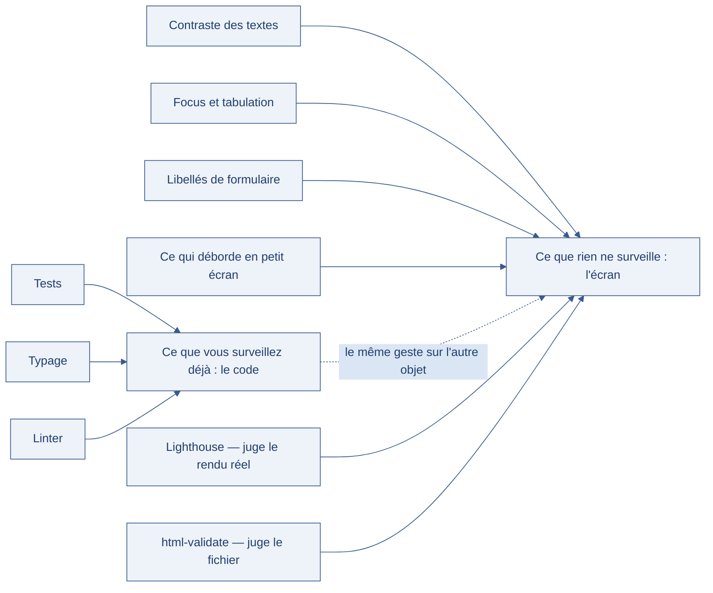

[← Chapitre précédent](05-prototype-qui-devient-code.md) · [Sommaire](Readme.md) · [Chapitre suivant →](A-Vocabulaire-outils-et-ressources.md)

# 06 - Tenez l'écran

> Vous savez faire relire du code par une machine : des tests, un typage, un linter refusent d'enregistrer n'importe quoi. Un écran, vous l'avez contrôlé à l'œil — et l'œil est exactement ce que sa finition a été fabriquée pour tromper. Il reste une question, et c'est la dernière de la journée : qui surveille l'écran ?

## Objectifs

À l'issue de ce chapitre, vous serez capable de :

- **Justifier** le choix d'un capteur d'écran par ce qu'il mesure, ce qu'il pèse et ce qu'il installe, plutôt que par sa réputation.
- **Lancer** Lighthouse et html-validate sur un rendu, et lire leurs sorties jusqu'à la ligne à corriger.
- **Repérer** la dette que contracte une interface générée dès la sortie de la machine : valeurs de style qui dérivent, composants dupliqués, fonctions sans fonction.
- **Séparer** dans l'historique ce qui vient de la machine de ce que vous avez fait, et le dater.
- **Faire survivre** votre travail à l'outil qui l'a produit : dater, épingler, garder les sorties.

## Sommaire

- [I. Vous surveillez le code. Qui surveille l'écran ?](#i-vous-surveillez-le-code-qui-surveille-lécran-)
- [II. Deux capteurs, et voici pourquoi deux](#ii-deux-capteurs-et-voici-pourquoi-deux)
- [III. La dette immédiate d'une interface générée](#iii-la-dette-immédiate-dune-interface-générée)
- [IV. Déclarer l'usage, tenir les traces](#iv-déclarer-lusage-tenir-les-traces)
- [V. Et si l'outil disparaît](#v-et-si-loutil-disparaît)

## I. Vous surveillez le code. Qui surveille l'écran ?

**Accroche (sondage) :** levez la main si vous avez déjà écrit `npm test`, `mypy` ou `eslint`, ou laissé un pipeline rouge vous rattraper. Gardez la main levée si vous avez déjà lancé *quelque chose* sur un écran — une commande, un rapport, n'importe quoi qui ne soit pas vos yeux. L'écart entre les deux mains, c'est ce chapitre.

Un développeur de 2026 ne rend pas du code qu'il n'a pas fait contrôler. Personne ne propose de « livrer » une fonctionnalité sans que les tests soient passés ; si quelqu'un le propose, l'équipe refuse. Ce réflexe n'est pas du perfectionnisme, c'est une économie : un défaut rattrapé par un capteur coûte une correction, un défaut rattrapé par un utilisateur coûte un incident.

Maintenant, l'écran que vous avez produit aujourd'hui.

| Ce qui est surveillé | Par quoi | Ce que le capteur empêche |
| --- | --- | --- |
| La logique | les tests | un calcul faux qui passe inaperçu |
| Les formes des données | le typage | un champ manquant découvert à l'exécution |
| La forme du code | le linter | l'accumulation de styles et les erreurs connues |
| **L'écran** | **vos yeux, une fois, ce matin** | **rien de durable** |

Ce n'est pas un détail : l'écran est la partie du logiciel que vos utilisateurs touchent. Et il a un statut particulier, parce qu'il est **généré**. Le code que vous écrivez porte vos hypothèses ; celui que la machine produit porte les siennes, et il est beau. Sa finition lui donne l'air d'avoir été validé par quelqu'un. Personne ne l'a validé.



L'œil ne compte pas comme capteur, et ce n'est pas une pique, c'est une propriété de l'œil : il juge la finition en même temps que le contenu, il se lasse, et il ne revient pas tout seul demain matin vérifier que quelqu'un a touché au contraste. Un capteur, au sens où vous l'entendez déjà pour le code, est autre chose : une vérification **hors de vous**, qui rend un verdict **rejouable**. Le mot compte. Rejouable veut dire que si un collègue change une couleur dans trois semaines, le même capteur crie tout seul, sans que personne ait besoin d'y croire.

Retenez le geste, pas la liste : on ne surveille pas un écran en le regardant mieux, on le surveille en écrivant ce qui doit être vrai et en le faisant contrôler. C'est le geste du chapitre 02 posé sur l'objet qu'on croit le plus subjectif qui soit.

## II. Deux capteurs, et voici pourquoi deux

### A. Ce qu'un relevé a montré

La question « quels capteurs d'interface choisir ? » a une réponse par défaut : ceux dont tout le monde parle. Elle a aussi une réponse relevée sur le registre npm (le dépôt de paquets de Node) et les documentations officielles le 23/11/2026, et celle-là change le choix. Dix capteurs candidats ont été regardés ; deux faits décident.

**Premier fait : ils ne sont pas dix regards, ils sont à peine deux.** Quatre de ces dix outils reposent sur le même moteur d'accessibilité, `axe-core`, sous un capot différent. Lancer les quatre, c'est lire quatre fois le même rapport dans quatre habillages différents. Ils ne sont pas inutiles, ils sont **redondants** : ils ne voient pas plus, ils voient la même chose plus souvent.

**Deuxième fait : six des dix téléchargent un navigateur.** Entre 150 et 300 mégaoctets par poste, téléchargés par l'installation elle-même, en postinstallation. Le point de rupture n'est donc pas dans l'outil, il est dans la salle : vingt portables qui tirent chacun un navigateur complet derrière un seul point d'accès Wi-Fi, à l'heure où tout le monde installe en même temps. L'atelier ne rate pas parce que le capteur est mauvais, il rate parce que le réseau sature et que le temps d'atelier y est passé.

À noter, parce que ce point-là désarme une fausse inquiétude : `npm install` ne demande **aucun** droit administrateur sur Windows. Le réseau et la version de Node sont des obstacles réels ; « je n'ai pas les droits » n'en est pas un.

| Ce que le relevé a trouvé | Conséquence en salle |
| --- | --- |
| Quatre candidats sur dix : même moteur `axe-core` | les cumuler n'ajoute aucune détection |
| Six candidats sur dix : navigateur de 150 à 300 Mo téléchargé à l'installation | réseau saturé, atelier mort avant d'avoir commencé |
| Six candidats sur dix : Node 22 ou plus exigé | installation qui réussit, puis plantage au lancement |

### B. Les deux retenus

**Lighthouse** est déjà dans les outils de développement de votre navigateur (`DevTools` — touche `F12`, ou clic droit sur la page puis **Inspecter**) : aucune installation, aucun téléchargement, aucun réseau. C'est aussi le seul des candidats à juger **le rendu réel** : il charge la page, qui se comporte comme un utilisateur la verrait, et il répond sur ce qui s'affiche — contraste réellement calculé, focus réellement atteignable, libellés réellement associés. Un capteur qui ne lit que le fichier ne peut pas savoir qu'un texte gris clair s'est retrouvé posé sur un fond gris clair par deux feuilles de style concurrentes.

**html-validate** est l'autre versant : une ligne de commande, environ 11 mégaoctets, qui lit le fichier et rend `fichier:ligne:colonne`. Il ne voit pas le rendu, il voit la structure — et il la voit **à la ligne où vous devez taper**, ce qui change tout quand on corrige.

```bash
npx html-validate rendus/02-recherche-produits/index.html

rendus/02-recherche-produits/index.html
  14:7  error  Form field requires an associated label  input-req-label
  21:9  error  Element "img" requires alternative text  wcag/h37

✖ 2 problems (2 errors, 0 warnings)
```

Trois choses à lire dans cette sortie, et elles font tout l'intérêt du format : le **fichier** et la **ligne**, vous savez où taper ; la **règle**, vous savez quoi chercher ; le **code de sortie**, non nul quand ça échoue, qui permet à une chaîne d'intégration continue de refuser la modification toute seule. La sortie est écrite pour être lue par une machine : demandez-la en JSON (`--formatter json`) si vous voulez la traiter.

Lighthouse, lui, rend un rapport par catégorie. En salle, retenez la catégorie **Accessibilité** et la manière dont elle désigne l'élément fautif : c'est ce qui permet de passer du verdict à la correction. Exemple reformé, sur un écran d'emprunt :

```text
Lighthouse · Accessibilité
  Libellés et noms             Échoue
    Un champ ne porte pas de nom accessible
      <input name="quantite" ...>       panier.html
  Contraste                    Échoue
    Élément sans rapport de contraste suffisant
      <span class="prix-barre">         panier.css
  Hiérarchie des titres        Réussite
```

Un point de salle, sans lequel l'atelier ne démarre pas : **Lighthouse se lance sur une page servie en HTTP**, pas sur un fichier ouvert en `file://`. Une commande : `cd rendus/02-recherche-produits && python -m http.server 8000`, et la page s'ouvre à `http://localhost:8000` — sous Windows, `py -m http.server 8000` si `python` ne répond pas ; prenez un autre port si le 8000 est déjà pris et ouvrez l'adresse qui va avec. Le kit distribué en salle dit ce qui est installé sur les postes. En `file://`, le navigateur refuse une partie des ressources : Lighthouse travaille alors sur une page qui ne s'affiche pas comme elle s'affichera une fois hébergée, et un rapport faux est pire qu'aucun rapport.

> ⚠️ **Un rapport vert n'est pas un écran accessible.** Les outils automatiques laissent passer environ 30 % des barrières d'accessibilité : donnée du Government Digital Service (le service numérique du gouvernement britannique), reprise par le README de `jest-axe`. Un capteur qui ne trouve rien n'a pas prouvé qu'il n'y a rien — il a épuisé ce qu'il sait voir. C'est la raison pour laquelle ce chapitre ne vous demande pas un rapport à coller, mais une **correction à justifier**.

### C. Trois pièges consignés

**Le cap de version Node.** Six des dix candidats exigent Node 22 ou plus. Ils **s'installent quand même** — l'écart de version ne produit qu'un simple avertissement pendant l'installation — puis plantent au lancement sur une erreur de syntaxe que rien ne rend lisible quand on ne connaît pas le langage. Le message ne dit pas « votre Node est trop ancien » : il montre du code que l'outil n'a pas su lire. C'est pour cela qu'en salle vous n'installez rien : le kit de capteurs vous est distribué **déjà installé**, `node_modules` (le dossier des dépendances) compris. Votre geste d'installation est un geste d'extraction, et la version de Node est relevée à l'accueil.

**`eslint-plugin-jsx-a11y`.** Piège relevé au 23/11/2026 : ce greffon est bloqué en dépendance sur ESLint 9 au plus, alors que la branche courante est déjà la 10, et sa dernière publication date de 2024. Il ne voit de toute façon que du JSX, le langage des composants React — pas le HTML et le CSS que vous produisez ici. On ne l'emploie pas.

**Les tests visuels.** Capturer l'écran en image et comparer à une référence promet de surveiller le rendu : c'est le faux positif garanti d'une salle multi-postes. Le rendu dépend du système d'exploitation, des polices installées, du mode sans interface graphique et jusqu'à l'état d'alimentation du poste — les outils qui font cela le documentent eux-mêmes. Le rapport vous annoncera « l'image a changé » alors que seule la machine a changé, et vous passerez l'atelier à justifier du bruit.

### EX-06 - Deux capteurs, une correction (20 min, binôme, avec débrief)

**Contexte.** Vous avez votre écran, votre code et vos critères d'acceptation. Vous n'avez plus votre objectivité : vous regardez ce rendu depuis ce matin. Le binôme d'à côté, lui, n'a pas écrit ce code — c'est la seule objectivité disponible en salle.

**Consigne.**

1. Récupérez le dossier de rendu du binôme voisin — celui que vous avez téléchargé au chapitre 05, pas une capture d'écran.
2. Servez-le en HTTP et lancez **Lighthouse** sur la page, catégorie Accessibilité.
3. Lancez **html-validate** sur les fichiers du dossier.
4. Rassemblez ce que les deux capteurs ont trouvé, et **ne rendez qu'une seule correction** : la violation que vous jugez la plus grave pour la personne qui utilisera l'écran, la ligne où elle se trouve, ce que vous changez, ce qui sera différent après. Une, justifiée — pas dix listées.
5. Ajoutez une ligne pour dire ce que **aucun** des deux capteurs n'a trouvé sur cet écran, mais que vous avez vu, vous.

**Avant de rendre**, vérifiez que :

- [ ] Les deux capteurs ont tourné sur le rendu **du binôme voisin**, servi en HTTP.
- [ ] Ma correction cite le fichier et la ligne, tels que la sortie les a donnés.
- [ ] Je dis **pourquoi** celle-ci plutôt qu'une autre, et non seulement « c'est une erreur ».
- [ ] Ma ligne de l'étape 5 nomme un défaut qu'aucun rapport ne contient.

<details>
<summary>Voir la correction</summary>

**Éléments attendus.**

- Deux sorties obtenues, pas deux captures d'écran : la sortie texte du capteur de fichier, et la catégorie Accessibilité du capteur de rendu.
- Une correction qui tienne en trois phrases : ce qui ne va pas, où, ce qui est corrigé. Exemple : « le champ quantité n'a pas de nom accessible ; un lecteur d'écran annonce une zone de saisie sans dire ce qu'on y met ; on ajoute le `label` associé, pas un `title` qui règle le rapport et pas l'usage ».
- Une justification hiérarchique : ce qui empêche d'utiliser l'écran passe avant ce qui le rend moins joli. Un champ sans libellé ou un focus introuvable passent avant un contraste limite sur un texte décoratif.
- L'étape 5 doit rapporter quelque chose. Ce que les capteurs laissent passer le plus souvent ici : un bouton qui ne fait rien, un état vide absent, un message d'erreur qui accuse l'utilisateur, une même information donnée deux fois.

**Erreurs fréquentes.**

- Rendre dix lignes de rapport et appeler ça un audit. Le rapport n'est pas le travail ; la correction justifiée l'est.
- Choisir la violation la plus facile à corriger parce qu'elle arrive première dans la sortie. L'ordre de la sortie n'est pas un ordre d'importance.
- « Corriger » en supprimant l'élément signalé : le contraste était insuffisant, on retire le texte. Le rapport est vert, l'écran est plus pauvre.
- Conclure d'un rapport sans défaut que l'écran est accessible : les outils automatiques laissent passer environ 30 % des barrières.
- Confondre les deux capteurs, c'est-à-dire demander à Lighthouse ce qui ne va pas dans le fichier, ou à html-validate ce qui ne va pas à l'écran. Chacun est aveugle de l'aveuglement de l'autre, et c'est exactement pour cela qu'ils sont deux.

**Ce qu'il faut retenir.** Deux capteurs, une correction justifiée, une ligne sur ce qu'ils n'ont pas vu : c'est le format de travail que vous garderez après la journée. Il tient en quelques minutes par écran, il ne dépend pas de votre forme du jour, et il laisse une trace relisible.

</details>

## III. La dette immédiate d'une interface générée

La dette technique classique s'accumule avec le temps : on repousse, le code s'écarte, on paye plus tard. Une interface générée contracte une dette d'un autre type, qui est là **à l'instant où le dossier sort de la machine**, avant la première ligne que vous y touchez. Elle est invisible à l'écran, et c'est ce qui la distingue des défauts du chapitre 01 : elle ne se voit pas, elle se comptera.

**Les valeurs de style qui dérivent — les « tokens ».** Vous avez posé un bleu dans votre `DESIGN.md` ; l'outil en a écrit d'autres, un par composant, tous proches, aucun identique. À l'écran, personne ne voit la dérive. Dans le fichier, chaque valeur est une décision que vous n'avez pas prise et qu'il faudra retrouver une par une. Le `DESIGN.md` que vous avez écrit au chapitre 03 est le contrat : la dette est l'écart entre ce qu'il dit et ce que le CSS contient. Une recherche dans le dossier sur les valeurs de couleur et d'espacement donne le nombre de décisions prises sans vous, et c'est un chiffre qui se suit dans le temps.

**Les composants dupliqués.** La même fiche produit, recopiée plusieurs fois en des versions légèrement différentes, est le défaut le plus rentable d'un générateur : elle ne coûte rien à produire, et chaque copie est un endroit où un correctif n'ira pas. Vous corrigez le libellé du bouton sur la copie sous vos yeux ; les autres restent fausses, et rien ne vous a averti qu'elles existaient. Le contrôle est mécanique : cherchez les noms de classes et de blocs répétés, demandez-vous pourquoi il y en a plusieurs.

**Les fonctionnalités fantaisie.** Un bouton « Favoris » qui ne met rien en favori. Un champ « Code promo » que rien ne lit. Un lien « Voir plus » qui recharge la page. Ce ne sont pas des erreurs : le HTML est valide, le CSS est propre, les deux capteurs n'ont rien à signaler, l'écran est **muettement faux**. La machine a comblé un blanc de votre spec avec une hypothèse à elle, et elle l'a bien habillée. C'est le seul poste de ce chapitre qu'aucun des deux capteurs ne surveille ; lui fait face la liste de critères d'acceptation écrite au chapitre 02. Un bouton qui n'est pas dans la spec est une dette, un bouton de la spec qui ne fait rien est un défaut. Les deux se repèrent en relisant l'écran **contre la spec**, jamais contre le rapport.

Ce triptyque a un point commun : il ne casse rien aujourd'hui. C'est précisément pourquoi il se règle maintenant, à l'heure où vous pouvez encore tout relire et où vous savez ce que vous avez demandé.

## IV. Déclarer l'usage, tenir les traces

Au bout de la journée, vous tenez un dossier de code dont une partie n'est pas de vous. Cela se traite, et cela s'écrit — pas pour la forme, pour que quelqu'un sache où poser ses questions dans quelques mois.

**Le commit qui sépare.** Ne mélangez pas, dans un même dépôt, la sortie de la machine et vos corrections. Trois temps, dans l'ordre :

```text
spec(panier) : critères d'acceptation de l'écran panier

gen(panier) : export de l'outil de design, aucun fichier retouché
  outil : Google Stitch — export du jour, page unique, HTML + CSS
  statut : relu sur la structure, non relu sur le fond

fix(panier) : nom accessible du champ quantité, d'après la spec
fix(panier) : état vide de la liste, absent de l'export
```

Le deuxième bloc est le nœud : un commit qui ne contient **que** ce qui est sorti de la machine, sans retouche. Vous y gagnez trois choses d'un coup. Un `git diff` entre ce commit et le suivant donne votre travail réel, comptable. Quand un défaut apparaîtra, vous saurez dans quelle couche le chercher. Et à la question « ça sort d'où ? », vous répondez par une adresse de commit et une date, pas par un souvenir. Datez ce commit, nommez l'outil — pas le mode ni le réglage, qui bougent tous les trois mois.

**Ce que vous pouvez garantir.** Vous ne signez pas du code que vous n'avez pas lu : c'est la relecture du chapitre 05 vue de l'autre côté. Relire ne sert pas seulement à corriger, sert aussi à savoir de quoi vous répondez. La déclaration qui va avec tient en quelques lignes et se met dans le dépôt, pas dans une messagerie : ce qui a été généré, par quoi, ce que vous avez vérifié et avec quel capteur, **ce qui reste non vérifié**. Cette dernière ligne est la plus utile des quatre et la plus rare. Elle protège celui qui reçoit le travail, et elle vous protège.

**Les traces se gardent en fichiers.** Sorties de capteurs, exports téléchargés, spec, liste des défauts avant et après la relance : dans le dépôt, versionnés, datés. Une capture d'écran collée dans un fil de discussion n'est pas une trace, c'est une humeur. La journée produit un certain nombre de rapports : à la fin de l'atelier, ils sont soit dans le dépôt, soit perdus.

## V. Et si l'outil disparaît

Tout ce que vous avez utilisé aujourd'hui pour produire est **hébergé** chez un éditeur, gratuit, et déclaré bêta pour l'un des deux. Il peut changer de nom, remanier son offre, faire disparaître un mode, ou fermer. Ce n'est pas une hypothèse catastrophiste, c'est l'histoire ordinaire de ce marché : les libellés d'interface bougent tous les trois mois. Trois gestes rendent ce risque sans prise sur votre travail.

**Datez.** Chaque production porte l'outil et la date — dans le commit, dans le nom du fichier, dans la déclaration. Un export sans date ne se discute pas : on ne peut pas savoir à quel état de l'outil il correspond.

**Épinglez.** Pour ce qui tourne sur votre machine, la version est fixée dans le kit livré et dans le fichier de dépendances du dossier : ce que vous lancez mardi ne peut pas être autre chose que ce que vous avez lancé lundi. Pour ce qui tourne chez l'éditeur, vous ne pouvez rien épingler — c'est pourquoi l'épinglage du local compte double.

**Gardez les sorties.** Le `.zip` téléchargé est copié et versionné, pas laissé dans le dossier Téléchargements « au cas où ». La règle tient en une phrase : **ce qui ne survivrait pas à la disparition de l'outil doit être dans votre dépôt.** Une maquette qui n'existe que chez l'éditeur n'est pas à vous, elle est empruntée.

Ce qui ne se garde pas : les chiffres de l'offre, les noms de modes, les quotas. Ils bougent, et un support qui les recopie est faux dans un trimestre. Ce qui se garde : le geste — demander, vérifier ce que ça coûte, relire, faire contrôler, dater, transférer. Un support dont on peut retrouver les gestes dans un an a de la valeur ; un support dont on peut seulement relire les noms de boutons n'en a pas.

## Aller plus loin

> Facultatif, sans rapport avec la note de la journée.

- **Rendre le capteur collectif.** `html-validate` rend un code de sortie non nul : c'est ce qu'il faut à une chaîne d'intégration continue pour refuser d'elle-même une modification qui casse la structure. Un fichier à écrire une fois, et le capteur devient gardien au lieu de rester une intention.
- **Un dossier de rapports.** Donnez-vous un emplacement dans le dépôt où les sorties des capteurs atterrissent à chaque passage, nommées avec une date. Au bout d'un mois, ce dossier dessine une courbe — et une courbe se discute, alors qu'une opinion se subit.
- **La fiche des deux outils** est en annexe A : rôle de chacun, la limite qui casse, comment vérifier son quota la veille d'une session.

## Points clés

- Un écran que rien ne surveille est du code non surveillé qui se donne pour un livrable : le remède est le même geste que pour le code, pas un regard plus attentif.
- Deux capteurs choisis pour ce qu'ils mesurent, ce qu'ils pèsent et ce qu'ils installent valent mieux que dix qui partagent le même moteur et saturent le réseau de la salle.
- **Un rapport vert n'est pas un écran accessible** : les outils automatiques laissent passer environ 30 % des barrières d'accessibilité. Ce qu'ils ne trouvent pas reste votre responsabilité.
- La dette d'une interface générée est là dès la sortie de la machine : valeurs qui dérivent, composants dupliqués, fonctionnalités fantaisie. Elle se règle à l'heure où elle coûte peu.
- Un commit pour la machine, un commit pour vous : c'est une preuve, pas une politesse. Datez, épinglez, gardez les sorties — le seul avenir de l'outil en ligne, c'est votre dépôt.

## 🧠 Vérifiez vos acquis

*Formatif, jamais noté. Répondez sans relire le chapitre. Les réponses se déplient un peu plus bas : ce qui compte est de repérer où vous vacillez, pas de faire 5 sur 5.*

**1.** Quel est le point de rupture réel d'un atelier qui ferait installer dix capteurs sur vingt portables ?

- A. L'absence de droits administrateur sur les postes, qui bloque l'installation
- B. Le réseau de la salle et le cap de version de Node, pas l'outil lui-même
- C. Le coût des licences des capteurs d'accessibilité, gratuites seulement pour les formateurs
- D. L'absence de moteur d'accessibilité commun, qui rendrait les résultats incomparables

**2.** Pourquoi Lighthouse est-il retenu dans ce cours ?

- A. Il est le seul capteur capable de voir l'accessibilité, les autres ne lisant que le HTML
- B. Il est déjà dans les outils de développement du navigateur et il juge le rendu réel
- C. Il s'installe en une dizaine de mégaoctets et se lance par une seule ligne de commande
- D. Il corrige de lui-même les défauts qu'il relève sur la page servie en local

**3.** Vous lancez l'audit sur le fichier ouvert en `file://`. Que vaut le rapport ?

- A. Il est identique à celui obtenu en HTTP, le protocole ne changeant rien au rendu
- B. Il est plus fiable, puisque rien ne dépend plus du réseau ni d'un serveur
- C. Il porte sur une page qui ne se charge pas comme une page hébergée : il peut être faux
- D. Il est refusé par l'outil, qui n'accepte aucune adresse locale et exige une adresse publique

**4.** Un rapport d'accessibilité sans aucun défaut sur votre écran. Qu'en concluez-vous ?

- A. L'écran est accessible : le capteur est bâti sur les mêmes critères que l'audit humain
- B. Il reste ce que les outils automatiques laissent passer : environ 30 % des barrières
- C. L'écran est accessible au clavier, contraste et libellés restant hors de portée des outils
- D. Il faut relancer avec un second moteur, le premier étant partial par construction

**5.** *Question ouverte (2-3 lignes).* Le commit `gen(panier)` contient l'export de la machine sans retouche, et deux commits `fix` le suivent. Un collègue demande plus tard pourquoi le champ quantité n'a pas de libellé dans la première version. Que répond `git log`, et que ne dira jamais une capture d'écran du dossier ?

<details>
<summary>Vérifier ses réponses</summary>

### Réponses

**1. B.** Ce sont le réseau — six candidats sur dix téléchargent un navigateur de 150 à 300 Mo à l'installation — et le cap de version Node, pas l'administration des postes.
**Pourquoi :** `npm install` ne demande aucun droit administrateur sur Windows, et quatre candidats sur dix utilisent le même moteur, `axe-core` : les deux inquiétudes agitées par les propositions A et D ne tiennent pas.

**2. B.** Il est déjà dans les outils de développement du navigateur, et c'est le seul des candidats à juger le rendu réel et non le seul fichier.
**Pourquoi :** la dizaine de mégaoctets et la ligne de commande décrivent html-validate, l'autre versant. Un capteur qui ne lit que le fichier ne peut pas savoir qu'un texte est illisible à l'écran ; un capteur qui corrige tout seul ne vous laisse rien à justifier.

**3. C.** En `file://`, le navigateur refuse une partie des ressources : l'audit porte alors sur une page qui ne s'affiche pas comme elle s'affichera hébergée.
**Pourquoi :** un rapport faux est pire qu'aucun rapport — il pose un verdict vert sur une page que personne n'a réellement vue. D'où la page servie en HTTP local en salle.

**4. B.** Les outils automatiques laissent passer environ 30 % des barrières d'accessibilité : donnée du Government Digital Service, reprise par le README de `jest-axe`.
**Pourquoi :** un capteur qui ne trouve rien a épuisé ce qu'il sait voir, il n'a pas prouvé qu'il n'y a rien à voir. C'est pourquoi l'atelier rend une correction justifiée et non un rapport collé.

**5.** Attendu : `git log` répond que la première version vient de la machine — export nommé, daté, non retouché — et que le libellé a été ajouté ensuite, dans un commit `fix` dont on peut lire la raison ; une capture d'écran ne dirait ni qui a écrit quoi, ni ce qui a été vérifié, ni ce qui reste non vérifié.
**Pourquoi :** l'historique sépare les couches. On sait où poser la question, et on sait de quoi l'auteur du commit répond.

</details>

---

[← Chapitre précédent](05-prototype-qui-devient-code.md) · [Sommaire](Readme.md) · [Chapitre suivant →](A-Vocabulaire-outils-et-ressources.md)
