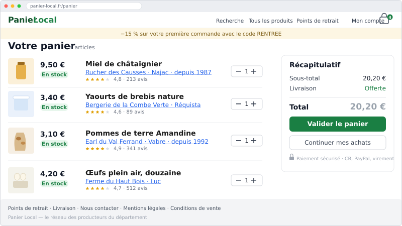

<!-- _class: lead -->

# Concevoir des interfaces avec l'IA

## Du besoin au prototype

Une journée · deux outils · un écran vérifié

---

<!-- _class: statement -->

> **Une maquette générée est plus dangereuse qu'un croquis.**

---

## Pourquoi c'est plus dangereux qu'un croquis

- Un croquis ne persuade personne ; une maquette bien typographiée persuade son auteur.
- Sa finition tient lieu de substance, et dispense de vérifier.
- Cette journée ne vous apprend pas un outil.
- Elle vous apprend à rendre l'écran vérifiable, en trois gestes.
- Écrire ce qui doit être vrai. Le faire contrôler par la machine.
- Itérer avec des preuves, puis transmettre en code.

---

## Le matin

| Créneau | Durée | Au programme |
|---|---|---|
| 09:00 | 10 min | Ouverture |
| 09:10 | 25 min | Une maquette finie est un risque |
| 09:35 | 15 min | Pause |
| 09:50 | 45 min | Écrire une spec d'écran |
| 10:35 | 15 min | Marge : ateliers qui débordent, questions |
| 10:50 | 45 min | L'écran par la machine |
| 11:35 | 15 min | Pause |
| 11:50 | 40 min | Reprise avec la salle |
| 12:30 | 60 min | Méridienne |

---

## L'après-midi

| Créneau | Durée | Au programme |
|---|---|---|
| 13:30 | 60 min | Les états et l'accès |
| 14:30 | 15 min | Pause |
| 14:45 | 45 min | Le prototype qui devient du code |
| 15:30 | 10 min | Marge : le dossier qu'on n'a pas fini d'ouvrir |
| 15:40 | 40 min | Tenez l'écran |
| 16:20 | 10 min | Pause |
| 16:30 | 30 min | Clôture : retour sur l'écran du matin |

55 minutes de pauses, 25 de marges annoncées, 40 de reprise, une méridienne d'une heure.

---

## Les deux outils, et rien d'autre

| Outil | Ce qu'il couvre | Ce qu'on en garde |
|---|---|---|
| Google Stitch | le besoin et le croquis en entrée, la maquette, le prototype cliquable | une archive `.zip` : du HTML, ses styles, une capture |
| Google AI Studio, mode Build | la reprise de ce code : une application qui se clique, un `.zip`, un dépôt Git | un dossier de code, relu hors de l'outil |

- Un seul changement de logiciel dans la journée, les deux viennent du même éditeur.
- Les capteurs du dernier chapitre ne sont pas un troisième outil : ce sont des contrôles.

---

## Le compte Google : une consigne, pas une note de bas de page

- Le CFA ne fournit pas de compte : chacun arrive avec le sien.
- Une adresse qui n'est pas une adresse @gmail.com peut être refusée.
- Un compte d'entreprise peut ne pas charger l'application.
- Testez la veille, avec le compte exact que vous utiliserez en séance.
- Ce que vous y tapez est du faux ou du déjà public : pas de client réel, pas de clé.

---

# Livrable, ou pas livrable ?

<div class="split">
<div class="split-media"></div>

Levez la main.
</div>

---

<!-- _class: lead -->

# 01 - Une maquette finie est un risque

> Un croquis ne persuade personne. Une maquette bien typographiée persuade son auteur,
> et son auteur est justement celui qui doit la vérifier.

---

<!-- _class: section -->

# I. Un écran, un vote

---

## Ce que la révélation montre, point par point

<!-- Le vote a eu lieu à l'ouverture, sur l'écran projeté. On ne le relance pas ici : on révèle, en montrant l'endroit précis. -->

- **La moitié de ce que vous lisez n'existe pas** : les prix viennent du catalogue, mais le stock, la note, le nombre d'avis et la ville du producteur, personne ne les a écrits.
- **Les deux boutons** : la forme de l'action, pas l'action.
- **Aucun état vide, erreur ni chargement** ; une seule largeur.
- **Aucun mot affiché ne vient de vous** : deux verbes, deux contrats.
- « Qui aurait pu dire à l'avance ce que cet écran affiche ? »
- Nom de l'outil et date de capture : écrits au tableau, pas dans le support.

**Le vote reprend, l'écran n'a pas changé : les mains bougent à peine.**

**La seule chose sur laquelle la salle avait de l'assurance était la moins vérifiable de toutes.**

---

<!-- _class: section -->

# II. Ce qu'un modèle remplit en silence

---

## Entre ce que vous avez dit et l'écran affiché, un trou

| Ce que vous n'aviez pas dit | Ce que l'écran affiche | À qui la décision |
|---|---|---|
| Quelles données afficher | quatre articles, 20,20 €, « en stock », « depuis 1987 » | la machine |
| Combien de choses à la fois | quatre lignes, un panier habituel en fait deux | la machine |
| L'ordre des informations | le prix avant le nom | la machine |
| Les mots | « Valider » à côté de « Continuer » | la machine |
| Ce qui manque à l'écran | rien : tout est rempli | la machine, par défaut |

**Un champ rempli n'est plus une question : c'est une réponse que personne n'a relue.**

**Le réflexe à installer :** je l'avais dit / je ne l'avais pas dit / je ne l'aurais pas dit comme ça.

---

<!-- _class: section -->

# III. La fidélité est un niveau de question

---

## Chaque niveau répond à une question, et à aucune autre

| Niveau | La question qu'il répond | Ce que les gens osent dire | Ce que coûte son abandon |
|---|---|---|---|
| Croquis (feutre, ASCII) | est-ce le bon écran ? | tout, y compris « ce n'est pas ça » | presque rien |
| Maquette léchée statique | est-ce bien présenté ? | de la finition : « j'aime bien » | quelque chose : on l'a montrée |
| Prototype cliquable | est-ce le bon chemin ? | sur le chemin, sans regarder la finition | beaucoup : du code en dépend |

**Une machine vous propose le plus coûteux à abandonner, dès la première demande.**

**Décidez du niveau avant de générer.**

---

<!-- _class: section -->

# IV. Quatre classes de défaut que la finition n'efface pas

---

## Quatre familles pour regarder un écran à deux et se comprendre

| Famille | Ce qu'on regarde | Ce qu'un écran généré fait typiquement |
|---|---|---|
| Hiérarchie et groupement | ce qui est premier, ce qui va ensemble | le prix et le nom à la même taille |
| Couleur et contraste | ce que l'œil lit vraiment | texte gris pâle sur fond blanc |
| Rythme des espacements | la régularité qui fait groupement | 13 px là, 21 px plus bas, 27 px plus loin |
| Parcours | le chemin de l'intention à l'action | le bouton visible ne mène nulle part |

**« C'est moche » ne se transmet pas : un défaut nommé devient une instruction, et une instruction ça se contrôle.**

---

<!-- _class: exercise -->

## EX-01 - Quatre défauts, quatre familles (10 min, binôme)

- L'écran projeté à l'ouverture, remis dans un fichier distribué aux binômes.
- Quatre défauts, un par famille, sur quatre lignes.
- Les quatre familles — hiérarchie et groupement · couleur et contraste · rythme des espacements · parcours.

```text
famille — ce que je vois (à quel endroit) — ce que ça empêche
```

- Il faut un endroit de l'écran et un effet : « c'est froid » ne passe pas.
- **Rien à corriger, rien à retoucher, rien à régénérer :** il s'agit de voir.

---

<!-- _class: correction -->

## EX-01 - Correction

La qualité ne se juge pas au nombre de défauts trouvés mais à la **forme** de chaque ligne.

| Famille | Exemple de ligne recevable |
|---|---|
| Hiérarchie et groupement | « le prix et le nom sont à la même taille : rien ne dit lequel on lit en premier » |
| Couleur et contraste | « le total est en gris pâle sur blanc : on ne le lit pas au premier coup d'œil » |
| Rythme des espacements | « l'écart entre les lignes du panier change à chaque ligne : les articles n'ont pas l'air d'appartenir au même bloc » |
| Parcours | « rien n'indique ce qui se passe après la validation : le chemin s'arrête au bouton » |

*Exemples de fabrication, à reporter sur l'écran qu'on vous a donné.*

**Erreur fréquente : quatre défauts de la même famille.** On ne voit que ce qu'on sait nommer.

---

<!-- _class: section -->

# V. Ce qu'une interface générée rate par construction

---

## Quatre absences qui ne sont pas des ratés

| Ce qui manque | Ce que l'écran laisse voir à la place | Face à un utilisateur |
|---|---|---|
| Les états : vide, chargement, erreur, cas limites | l'état « tout va bien, quatre articles avec photo » | le panier vide affiche une page blanche |
| La validation | un formulaire qui ne refuse rien | un code postal de onze caractères passe |
| La persistance | un écran qui a l'air de retenir | on revient : tout est perdu |
| Le comportement | une position de bouton, une ombre au survol | le bouton « Valider le panier » ne fait rien |

**Une image de logiciel, pas un logiciel :** ces absences ne se devinent pas, elles se décident.

**Elles s'écrivent, se complètent, se contrôlent, se prouvent par des traces.**

<!-- 13 diapositives · ~12 min de projection (25 min de créneau dont 10 d'atelier EX-01) · exercices projetés : EX-01 (énoncé + correction) · aucune diapositive statement : la ligne « la seule chose sur laquelle la salle avait de l'assurance était la moins vérifiable de toutes » tient en fin de diapo 3 pour rester dans le budget, à promouvoir en statement si l'assemblage a de la marge -->
---


## Panier Local, le sujet d'étude

- Des paniers composés par des producteurs du département, retirés le jeudi.
- Une vingtaine de producteurs, qui envoient leurs produits par courriel, photo, vocal ou papier.
- Six points de retrait tenus par des bénévoles.
- La refonte part d'une usure : deux producteurs ont cessé d'envoyer quoi que ce soit.
- Règle avant la réunion : l'écran ne promet que ce que la base sait tenir.

La fiche est fournie, on ne la refait pas — on l'ouvre quatre fois dans la journée.

---

## Trois personnes, trois contraintes que l'on peut vérifier

| Qui | Ce qui le bloque | Ce que ça rend vérifiable |
|---|---|---|
| Nadia, achète pour deux | ne distingue plus une ligne de la suivante | agrandissement et clavier : recherche, résultat, panier sans la souris |
| Youssef, tient un point de retrait | ne sait pas ce qui sort cette semaine | tablette posée, gants aux mains : rien au survol, un seul appui |
| Awa, commande depuis sa remorque | ne sait plus si sa commande est partie | réseau par coupures : dire si l'écran attend ou s'il a perdu |

---

## L'écran de la journée : recherche, résultats, panier

| Dans le champ | Hors champ |
|---|---|
| ce que l'on tape, et ce que cela donne | le paiement |
| la liste des résultats et ce que chaque ligne montre | les comptes |
| ce qui restreint ou ordonne cette liste | la fiche produit détaillée |
| le panier, et ce que l'écran dit quand il n'a rien à montrer | l'espace producteur |

- La base ne sait pas : quantités, avis, classements, comptes, images, localisation.
- Une ligne d'écran qui parle de l'une de ces choses est une ligne qui invente.
- Au moins trois objets devront se tenir par un clic, au clavier, dans les deux sens.

---

## Ce que la journée laisse derrière elle

- Une spec en trois blocs, dans un fichier versionné, avec sa frontière écrite.
- Un écran généré et ses quatre états : vide, chargement, erreur, cas limites.
- Un rapport d'audit d'accessibilité, et la relance qui l'a corrigé, valeurs relevées.
- Un prototype cliquable et le dossier de code, ouvert en local.
- Les traces : un commit pour la demande, un pour la sortie, les captures datées.

Un travail de binôme, mené en salle — et rien de tout cela ne porte sur l'apparence.

---

<!-- _class: lead -->

# 02 - Écrire une spec d'écran

---

## Avant d'écrire quoi que ce soit

- Levez la main si un générateur vous a rendu un écran **qui avait l'air juste**, et ne l'était pas.
- Gardez-la si vous avez ensuite passé plus de temps à **réparer** qu'à écrire la demande.
- C'est ce couple de durées que ce chapitre mesure.

---

<!-- _class: statement -->

Une spec d'écran ne décrit pas un goût : elle écrit ce qui doit être vrai — et se vérifie.

---

<!-- _class: section -->

## I. Le triptyque : ce que votre demande doit couvrir

---

## Une machine ne devine pas, elle remplit

- Ce que vous laissez vide ne reste pas vide : il se remplit de **ses** hypothèses.
- Une demande incomplète ne produit pas un écran incomplet : elle produit un écran **complet**.
- Bien typographié, et chaque manque devenu une décision prise sans vous.
- On ne rattrape pas en ajoutant ce qui manquait : on rattrape en défaussant ce qui a été décidé.

---

## Trois blocs, dans cet ordre

| Bloc | Ce qu'il contient | Ce qu'il coupe |
| --- | --- | --- |
| **1. Surface produit** | données affichées et leur provenance, actions, ordre de lecture | un modèle de données qui n'existe pas, un champ non demandé |
| **2. Contexte d'usage** | qui, sur quel matériel, dans quelle situation, ce qu'il vient faire d'abord | un public, une taille d'écran, une urgence |
| **3. Contraintes et goût** | contraintes dures, références de style : un écran qui existe, une capture datée | un design system, une palette, un niveau d'accessibilité |

Un bloc absent ne rend pas l'écran plus simple : il rend **une décision orpheline**.

---

## Le triptyque n'est pas une longueur

```text
Fais-moi une page e-commerce moderne et épurée pour des produits locaux.
```

- Une demande courte qui couvre les trois blocs bat une page qui n'en couvre qu'un.
- Un texte n'est muet que de ce qu'il **croit évident**.
- L'évident : l'endroit précis où le modèle choisit à votre place.

---

<!-- _class: section -->

## II. Ce qu'une contrainte interdit d'inventer

---

## La même demande, mesurée

Mesure publiée par **Vercel en décembre 2025**, sur ses propres outils : mesure de fournisseur, méthode non publiée.

| | demande explicite | demande vague |
| --- | --- | --- |
| Temps de génération | ≈ 1 min 19 s | ≈ 1 min 38 s |
| Lignes produites | ≈ 443 | ≈ 595 |
| Défauts relevés ensuite | — | recherche non fonctionnelle, panier mort, pas de responsive |
| Rattrapage | — | 1 à 2 prompts |

- La demande vague n'est **ni plus rapide ni plus légère**.
- Les lignes en plus **sont l'invention** : des décisions que personne n'a prises.
- Un prompt de correction est une contrainte que vous écrivez **après coup**.

---

## Si je retire cette ligne, qu'est-ce que la machine aurait choisi à la place ?

- « À peu près la même chose » → la ligne est **décorative** : elle ne protège rien.
- « Autre chose, et je sais quoi » → la ligne est une **contrainte** : gardez-la.
- « Je ne sais pas » → ce n'est pas la machine que vous ne connaissez pas, **c'est votre écran**.
- C'est la plus utile des trois réponses, et la seule que les demandes laissent passer.

---

## Des contraintes qui travaillent

| Ce que vous écrivez | Ce que cela interdit |
| --- | --- |
| les largeurs utilisables sont nommées, et ce qui bouge à chacune | inventer un point de rupture, ou n'en faire aucun |
| l'ajout au panier se fait sans quitter la liste, panier visible | une navigation, une fenêtre modale, un panier qui ne répond pas |
| aucun composant graphique nouveau | une bibliothèque, un style, une dépendance |
| niveau attendu : RGAA 4.1.2 (référentiel d'accessibilité) | laisser le modèle à la moyenne de soin de son corpus |
| la liste est vide : voilà l'écran | inventer un état vide, ou n'en montrer aucun |

La dernière ligne n'interdit pas : elle **prescrit** ce qui, sans elle, n'aurait jamais existé.

---

<!-- _class: section -->

## III. Un artefact vaut mieux qu'un adjectif

---

## Un adjectif n'est pas une information, c'est une direction

| Adjectif | Ce que la machine entend | L'artefact qui le remplace |
| --- | --- | --- |
| « moderne » | grands blancs, coins arrondis, ombres douces, une police | une capture d'un écran réussi, **datée**, + ce que vous en gardez |
| « épuré » | peu d'éléments, donc des informations hors du champ | la liste nommée de ce qui reste visible sans défiler |
| « aéré » | espacements larges, donc moins de lignes utiles | le croquis de la densité voulue |
| « dans la continuité de l'existant » | une palette qui ressemble | le fichier, le composant ou la fiche qui font foi |

Chacun résout le mot avec **sa propre moyenne** — et vous ignorez avec laquelle.

---

## Trois artefacts, par effort croissant

- **Le croquis** : au feutre, ou en ASCII directement dans le fichier de spec.
- Il vit dans la spec, se relit dans un diff, se versionne avec elle.
- **La capture** : datée, nommée, avec « ce que j'en garde » et « ce que je n'en veux pas ».
- Sans ces deux lignes la capture invite à copier ; avec, elle est un **contrat**.
- **L'écran existant** : ne le décrivez pas, **donnez le fichier**.
- Un chemin est vérifiable ; un adjectif ne l'est jamais.

---

<!-- _class: section -->

## IV. Les critères d'acceptation d'un écran, et une définition de fini

---

## La forme d'une assertion vérifiable

- **Ce qui doit être vrai** : une phrase qui se dit vraie ou fausse, jamais un goût.
- **Comment on le vérifie** : à l'œil sur le rendu, ou par une commande.
- **Ce qui le prouve** : une sortie de commande, une capture datée, un diff.

> Étant donné un panier vide, quand j'ajoute un produit, alors l'en-tête affiche un article et je reste sur la liste.

---

## Les cinq familles : écrites, ou pas

| Famille | Ce qui ne vérifie rien | Ce qui se vérifie |
| --- | --- | --- |
| **Données affichées** | un prix affiché | le prix est lu sur la fiche produit avec son unité, jamais calculé par l'écran |
| **Actions possibles** | l'action est listée, pas la suite | l'ajout garde l'utilisateur sur la liste et met l'en-tête à jour |
| **Responsive** | « c'est responsive » | les largeurs visées sont nommées, et **ce qui se déplace** à chacune |
| **États** | l'état où tout marche | vide, chargement, erreur, cas limites : demandés |
| **Ce qui a été inventé** | rien n'est listé | « tri par pertinence ajouté : non demandé, à valider ou retirer » |

Un rendu ne montre **jamais qu'un seul état**. Les quatre entrent ici, ou n'existeront jamais.

---

## Une définition de fini qui n'est pas une opinion

```bash
# le rendu passe le validateur HTML
npx html-validate rendus/02-recherche-produits/index.html   # attendu : aucune erreur

# toute image porte une alternative textuelle
grep -o '

## V. La spec est un fichier versionné, pas un message

---

## Où vit votre spec décide de tout le reste

- Dans une conversation elle meurt : trois semaines plus tard, **qui a décidé ça ?**
- Dans le dépôt elle devient un objet **relisible**, un objet **à différentiel**, une **trace**.
- Personne ne relit une conversation ; tout le monde relit un diff.
- Elle vit à côté du code qu'elle commande : `specs/02-recherche-produits.md`, `rendus/02-recherche-produits/`.

```bash
git add specs/02-recherche-produits.md
git commit -m "spec: recherche produits, etats et definition de fini"

git add rendus/02-recherche-produits/
git commit -m "gen: rendu brut recherche produits (sortie d'outil, non relu)"
```

*Sortie d'outil, non relu* : six mois plus tard, ce sera votre seule preuve.

---

<!-- _class: exercise -->

## EX-02 - La même demande, deux fois (25 min, binôme)

*Panier Local. L'écran : la recherche de produits et son panier.*

- **Étape 1 (5 min)** — la demande la plus naturelle du monde, sur une ligne. Vous ne la corrigez pas.
- **Étape 2 (10 min)** — la **même** demande, en trois blocs. Un croquis ASCII compte pour une ligne.
- **Étape 3 (5 min)** — les deux générations sont lancées au projecteur. Vous ne pilotez rien, vous notez.
- **Étape 4 (5 min)** — la grille, pour les deux rendus.

Vos deux demandes portent sur le **même** écran, au mot près. N'empruntez pas l'exemple du chapitre : c'est votre écran.

---

<!-- _class: exercise -->

## La grille — à remplir sur ce que vous voyez

| Point comparé | Rendu de la demande vague | Rendu de la demande en trois blocs |
| --- | --- | --- |
| Données affichées (lesquelles, d'où) | | |
| Actions possibles (et ce qui se passe après) | | |
| Responsive (quelles largeurs, ce qui se déplace) | | |
| États (vide, chargement, erreur, cas limites) | | |
| Ce qui a été inventé (décisions non demandées) | | |

Une case « inventé » se remplit **même si le résultat vous plaît** : la question n'est pas « est-ce joli », mais **qui a décidé**.

---

<!-- _class: correction -->

## Correction — deux colonnes qui se distinguent

- À gauche : des produits et des prix, mais l'**unité de vente** inventée ou disparue.
- Un bouton d'ajout sans effet visible, une recherche **décorative**.
- Une colonne unique par habitude : aucune largeur visée n'est nommée.
- L'état par défaut seulement : une liste pleine et connectée.
- Une longue liste d'inventions : promotions, avis, tri par pertinence, comptes, newsletter.
- À droite, ce qui reste non demandé est **listé** : cela devient une décision à prendre.

La colonne de gauche n'est pas un échec de la machine : c'est **l'inventaire de vos silences**.

---

<!-- _class: correction -->

## Les erreurs fréquentes

- **Réécrire la même phrase en plus long** : trois fois plus de mots, un seul bloc.
- **Remplir la grille d'après la spec**, pas d'après le rendu affiché.
- **Laisser vide « ce qui a été inventé »** à gauche : case vide = vous n'avez pas cherché.
- **Compter le croquis comme un ornement** : sans ordre de lecture ni ce qui reste visible, il a illustré.
- **Chercher la plus belle spec** : le critère est *quelle invention cette ligne a-t-elle empêchée ?*

<!-- 24 diapositives · ~20 min de projection (25 min d'atelier EX-02 en plus, créneau 45 min) · exercices projetés : EX-02 (énoncé 2 diapos : consignes + grille ; correction 2 diapos : attendu + erreurs fréquentes) -->
---

<!-- _class: lead -->

# 03 - L'écran par la machine

> Ce qui sort d'ici n'est pas un résultat, c'est **une hypothèse très bien présentée**.

---

<!-- _class: section -->

# I. Ce qu'on vérifie avant d'ouvrir l'outil

---

## Avant de toucher à l'outil

- Le compte est le vôtre : le chapitre se joue dessus, ou chez le voisin.
- Le service est chez quelqu'un d'autre : il change sans prévenir, sans version épinglable.
- On vérifie qu'un écran se **génère**, pas que la page d'accueil s'affiche.
- Ce qu'un compte autorise aujourd'hui ne se récite pas : **ça se relève**.
- L'état de votre compte se note à l'entrée de l'atelier, avec sa date.
- La politique de données se lit soi-même, avant d'avoir écrit, et se date.

---

## Le repli n'est pas une consolation

- Votre poste n'ouvre pas l'outil : vous travaillez **sur la sortie d'un autre binôme**.
- Vous menez la relecture en quatre axes et remplissez la fiche de contrôle.
- Vous écrivez les relances, le binôme qui a l'outil les joue.
- Vous gardez chacune d'elles dans votre dépôt.
- L'avoir produite de ses propres clics ne garantit rien : vu au chapitre 01.

**Une barrière payante se remplace, elle ne se contourne pas** : ni achat, ni second compte.

---

<!-- _class: section -->

# II. Ce qu'on lui donne

---

## Des objets, pas des adjectifs

Un adjectif ne se vérifie pas sur un rendu. Un objet, ou il est là, ou il n'y est pas.

| Ce qu'on donne | Ce que ça décide | Comment ça se vérifie |
|---|---|---|
| la spec, collée telle quelle (chapitre 02) | ce qui est à l'écran, dans quel ordre | chaque ligne affichée a un propriétaire |
| les huit contraintes de la fiche, § V | ce qui est interdit | une ligne de contrainte, un verdict |
| `DESIGN.md` | la façon dont c'est fait | ce que le fichier CSS contient |
| le croquis : ASCII dans la spec, ou feutre | l'ordre et le nombre | l'ordre à l'écran est-il le vôtre ? |
| une référence de style nommée et datée | le goût, sans laisser la machine choisir une mode | ce qui y ressemble, ce qui s'en écarte |

La spec est écrite : on ne la réécrit pas pour l'occasion, **on la colle**.

---

## DESIGN.md, le contrat de style

- Des règles **dures**, versionnées à côté de la spec, relues **avant chaque demande**.
- Les interdits viennent de la fiche *Panier Local*, § V, en lignes lisibles par l'outil.

```markdown
# DESIGN.md - Panier Local, écran recherche / resultats / panier
# Relu le 23/11/2026 avant la generation. Reference : page catalogue d'une
# epicerie en ligne, capture du 23/11/2026.

Couleurs : une seule couleur d'accent, deux neutres pour le texte, une pour
  les etats signaletiques. Pas de degrade, pas de troisieme accent.
Composants autorises : champ de recherche, liste de resultats, filtre par
  categorie, panier, message d'etat.
Interdits : note en etoiles, badge de promotion, photo produit, jauge de
  stock, avis, avatar, champ code promo, tout ce qui suppose un compte.
```

*Exemple de fabrication.* Ce qui compte est la forme du fichier : des règles qui se vérifient.

---

## Trois formulations, trois écrans

| La demande | Ce qui sort le plus souvent | Décisions qui vous appartiennent |
|---|---|---|
| « Fais une belle page pour vendre des produits locaux. » | place de marché générique : photos, étoiles, promotion, compte | aucune : tout ce que la fiche interdit s'y trouve |
| « Voici la spec : recherche, résultats, panier, voilà les champs. » | votre ordre et vos champs, plus ses hypothèses sur visuels, notes, états | celles que la spec nomme explicitement |
| « La spec, `DESIGN.md`, les huit contraintes, et rien qui ne soit pas là. » | votre ordre, vos champs, et **tout ce qui dépasse est signalable** | ce que vous avez écrit, plus une liste courte à retirer |

La troisième n'est pas plus longue à écrire : elle rend chaque élément **accusable**.

---

## Ce que la meilleure demande ne fabrique pas

- **Les quatre états** : ils ne viennent pas d'une demande mieux tournante — chapitre 04.
- **La finition** : ce qu'elle fabrique le mieux ; un appât, jamais un sujet de remarque.
- **Le comportement** : des liens marchent **dans l'outil** — chapitre 05 pour le code.
- **La largeur réelle** : le responsive est réglé à l'œil sur la capture, pas sur vos données.

---

<!-- _class: section -->

# III. Ce qui en sort

---

## La grille, en quatre axes

| Axe | La question |
|---|---|
| **Composants** | un morceau par rôle, nommé avec le mot du métier — ou le même bloc copié trois fois ? |
| **Données** | chaque valeur vient-elle d'un état ou d'un appel, ou est-elle écrite en dur ? |
| **États** | vide, chargement, erreur, cas limites : écrits quelque part, obtenus à l'écran ? |
| **Accès** | les six points mesurables sont-ils tenus dans le code, ou seulement dessinés ? |

- Les deux derniers axes restent **vides à dessein** : une case vide est une information.
- La grille rédigée se remplit en quelques minutes : annexe A, § IV.

---

## Ce qui manque, et ce qui arrive à la place

Ce qui manque n'est pas un hasard : c'est ce que la machine a peu vu (chapitre 01, II).

| Contrainte de la fiche | Ce que la machine adore reposer |
|---|---|
| rien en stock, seulement une période de vente | « En stock », une jauge, un compte à rebours |
| pas de compte, pas de visiteur reconnaissable | « Votre panier reprenait », un avatar |
| rien ne note, ne promeut, ne classe | étoiles, « Les plus populaires » |
| aucune image n'est fournie | vignettes produits, visuel décoratif |

*Deuxième colonne : exemples de fabrication, pas des constats sur votre écran.*

---

<!-- _class: statement -->

> **Le nombre d'éléments à l'écran que votre spec ne nomme pas est le nombre de décisions prises sans vous.**

---

## Le piège de la finition, en version auteur

- Vous discutez de la couleur avant d'avoir compté ce qui manque.
- Vous avez déjà dit « on nettoiera après » — l'adverbe le plus coûteux du métier.
- Vous songez à le montrer : la fiche exige un écran **présentable**, autre chose.
- Défense 1 : relire l'écran contre la spec, jamais contre le rendu.
- Défense 2 : dire à voix haute ce que l'écran **n'est pas encore** (chapitre 02, II.A).

---

## Un outil en bêta, des libellés qui bougent

- L'outil est **déclaré en bêta** ; ses libellés bougent plus vite qu'un support écrit.
- Un export non daté ne se discute plus : datez fichier, commit, déclaration.
- Un libellé introuvable n'est pas une panne : cherchez la **fonction**, pas le mot.
- Les sorties restent chez vous, dans le dépôt — chapitre 06, IV et V.

---

## Ce que l'archive contient vraiment

- Par écran : du HTML, ses classes Tailwind, une capture, le tout dans un `.zip`.
- Tailwind : une bibliothèque de classes utilitaires CSS, écrites dans le HTML.
- C'est complet **pour l'outil**, pas pour le projet.

| Ce qui survit sans vous | Ce que vous devez redemander |
|---|---|
| la structure HTML de l'écran plein | les états de l'écran |
| les valeurs de style, écrites en dur | les données réelles de la fiche |
| la capture de démonstration | le clavier, les titres, le contraste |
| | ce que le dossier ne déclare pas |

Ouvrez l'archive **ailleurs que dans les téléchargements** ; si ce qu'elle déclare refuse de s'installer, ouvrez le fichier d'entrée directement (annexe A, II.C).

---

## Ce que la sortie dit de votre spec

Chaque élément inventé désigne **un trou de votre spec** : pas une faute, une décision que personne n'a prise.

| Ce que la sortie invente | Le trou qu'elle montre |
|---|---|
| des visuels que personne n'a fournis | rien n'était dit sans image |
| un ordre dans la liste des résultats | l'ordre des informations restait ouvert |
| des quantités, un total | aucun montant rattaché à une unité de vente |
| un message après la validation | la spec s'arrêtait au bouton |

Écrivez cette liste de trous **maintenant, à chaud** : les deux chapitres suivants la consommeront.

---

<!-- _class: section -->

# IV. Itérer avec des preuves

---

<!-- _class: statement -->

> **Une relance, une chose à vérifier.**

---

## Anatomie d'une relance

- **Ce qui ne va pas, localisé** : « la ligne "Noix fraîches décortiquées" affiche un prix ».
- **Ce qui est attendu**, écrit comme vous l'auriez fait : « le catalogue n'en a pas ».
- **Le périmètre figé** : « ne modifie ni la mise en page, ni les autres lignes, ni les textes ».
- **Ce que je regarderai après** : « le rendu de la liste, à la largeur de ma spec ».

Le quatrième point est celui qu'on saute : c'est le seul qui distingue une relance d'une envie.

**Aucun capteur n'est encore branché** : la relance sort de votre fiche, pas d'un rapport d'audit.

---

## La fiche de contrôle : cinq colonnes

Un fichier, à côté de la spec — une ligne par chose que vous voulez voir changer.

| Ce qui doit changer | Ce que je regarde pour le savoir | Attendu | Obtenu | Verdict |
|---|---|---|---|---|
| la ligne sans prix affiche un prix | rendu de la liste, à la largeur de ma spec | aucun prix sur cette ligne | | |
| des étoiles de note apparaissent dans les résultats | la même liste | aucune note nulle part | | |
| les résultats s'obtiennent au clavier | tabuler une fois, sans souris | recherche, résultat, panier atteignables | | |

---

## Trois règles d'écriture, trois relances

- **Une ligne, une chose** : deux choses, et un échec ne se lit plus.
- **Ce que vous ne pouvez pas regarder n'est pas une ligne** : « plus clair » ne se remplit pas.
- **On vérifie le rendu, pas la réponse** : la machine annonce ce qu'elle n'a pas fait.
- **Trois, pas dix** : au-delà on explore, et une exploration sans fiche ne laisse rien.

---

## Une capture prouve, ou elle décore

- **Quelle affirmation** : « après la relance 2, la ligne sans prix n'affiche aucun prix ».
- **Quel état** elle montre : l'écran plein ne dit rien de l'écran vide.
- **À quelle date, avec quel outil** : le nom du fichier répond à cette question.

```text
AAAAMMJJ-HHMM-relance-02-largeur-etroite.png   prouve
Capture 2026-11-23 114722.png                  décore
```

**Une capture ne prouve que ce qu'elle nomme.** Rangée dans le dépôt, pas dans une messagerie.

---

<!-- _class: exercise -->

## EX-03 - Générer, confronter, relancer trois fois (25 min, binôme, débrief 5 min)

Un seul écran : celui de la fiche *Panier Local*. La consigne qui règle tout : jamais « refais-moi ça mieux ».

- **3 min — ce qu'on donne** : spec collée, lignes de `DESIGN.md`, contraintes § V ; état du compte noté.
- **4 min — la première sortie** : générez ; capture nommée et datée, « première sortie, écran plein ».
- **6 min — la confrontation** : les huit contraintes une par une, un verdict ; deux premiers axes de la grille.
- **7 min — les trois relances** : chacune **une seule chose**, et ce que vous regarderez après ; fiche remplie au fil de l'eau.
- **5 min — débrief** avec le binôme d'à côté, puis la trace.

---

<!-- _class: exercise -->

## EX-03 — Repli, rendu, dossier

**Poste bloqué à l'étape 1 ?** Vous prenez la sortie du binôme d'à côté et vous faites tout le reste avec lui.

**Rendu en fin d'atelier :** la fiche et ses verdicts, les trois relances, la capture datée de la troisième sortie, la ligne « reste à redemander ».

*Dossier de l'atelier : la spec du chapitre 02, la fiche Panier Local et ses huit contraintes (§ V).*

---

<!-- _class: correction -->

## EX-03 - Correction

**Éléments attendus**

- Une première sortie **pleine** : un élément que la fiche interdit, un total sans unités.
- Une ligne par chose à changer, **un verdict** par ligne — sinon elle n'est pas vérifiée.
- Trois relances distinctes, périmètre figé ; « reste à redemander » nomme les quatre états.

**Erreurs fréquentes**

- Retoucher la spec au vol : on ne sait plus qui a bougé.
- Une relance à trois demandes : on ignore laquelle a pris.
- Croire l'annonce plutôt que remplir *Obtenu* ; ou embellir les dernières minutes.

**Donner des objets, compter ce qui manque, relancer une chose à la fois, consigner ce qui a bougé.**

<!-- 25 diapositives · ~15 min de projection (créneau 45 min dont atelier EX-03 de 25 min avec son débrief de 5 min) · exercices projetés : EX-03 (énoncé + correction sur la diapositive suivante) -->
---


<!-- _class: statement -->

> **À la reprise, rien de nouveau n'est apporté.**

---

## 11:50 — la reprise, 40 minutes

- Ce qui n'est pas bouclé se débriefe avec la salle.
- Les points qui ont bloqué se rejouent en binômes, à deux sur le même écran.
- Ce que la marge du matin n'a pas absorbé se traite ici.
- Aucune matière nouvelle : l'après-midi repart de ce qui tient déjà.

---

<!-- _class: lead -->

# 04 - Les états et l'accès

## Vide · Chargement · Erreur · Cas limites

**Les quatre écrans que personne n'a dessinés**

---

<!-- _class: statement -->

# « Personne n'a dessiné ces quatre écrans-là. »

Ce sera à vous de les demander.

---

<!-- _class: section -->

# I. Un écran n'est pas un écran, c'est quatre

---

## Le même écran, quatre problèmes

Le dossier d'export que vous avez en main contient **un** écran.

| État | Ce qui se passe | Ce que l'écran doit dire | Ce qu'il faut prévoir |
|---|---|---|---|
| **Vide** | rien à afficher, encore ou plus | pourquoi il n'y a rien, et par où commencer | une action qui remplit l'écran |
| **Chargement** | l'information n'est pas arrivée | que quelque chose est en cours | l'action neutralisée le temps de la réponse |
| **Erreur** | le serveur a refusé, la saisie n'est pas valable | ce qui a échoué, si c'est rattrapable | réessayer, ou revenir au champ fautif |
| **Cas limites** | la donnée n'a pas la forme de la maquette | rien de spécial — mais tout doit tenir | l'écran reste utilisable |

Quatre questions différentes : quatre contenus, quatre sorties, quatre tonalités.

---

## L'état vide — un fait, une explication, une sortie

```html
<!-- ce que la machine produit si on ne lui demande que « l'écran de mes commandes » -->
<section class="empty">
  <h3>Aucune commande</h3>
</section>

<!-- ce qu'on obtient en exigeant un état vide -->
<section class="empty">
  <h3>Aucune commande pour le moment</h3>
  <p>Une commande apparaît ici dès que le producteur l'a confirmée.</p>
  <a href="/catalogue">Parcourir le catalogue</a>
</section>
```

Le premier bloc n'est pas une faute de goût : c'est une information manquante.

**Vide ≠ zéro résultat.** Le compte nouveau-né s'invite au catalogue ; la recherche sans résultat s'invite à élargir. Le même écran vide pour les deux laisse l'un sans issue.

---

## L'état de chargement — rassurer, et ne pas laisser cliquer deux fois

- **Dire ce qui est en cours** : un squelette vaut mieux qu'un rotor sans contexte
- **Neutraliser l'action** le temps de la réponse
- Un « Valider » resté cliquable pendant l'envoi produit deux commandes
- **Prévoir le cas où ça traîne** : une échappatoire au-delà de quelques secondes
- **Panier Local** (Awa) : dire si l'écran attend encore ou s'il a perdu

Un écran qui attend sans rien dire est un écran que l'on quitte. C'est un défaut d'interface, pas un défaut réseau.

---

## L'état d'erreur — trois informations, une action

1. **Ce qui a échoué**, dans les mots de l'utilisateur : « Votre adresse de livraison n'a pas pu être enregistrée », pas `HTTP 500`
2. **Si c'est rattrapable par lui**, et comment : le champ en cause est signalé, sans tout ressaisir
3. **Une seule action principale** : réessayer, ou corriger

« Une erreur est survenue » n'est pas un message d'erreur : c'est un constat sans suite. Deux actions principales concurrentes, c'est un écran où l'on reste.

**Erreur ≠ vide.** Une panne affichée comme un écran vide envoie l'utilisateur se croire seul en cause.

---

## Les cas limites — quand la donnée réelle arrive

- un libellé beaucoup plus long que celui de la maquette
- un montant plus long que sa colonne, ou avec des décimales
- une image absente ou ratée
- zéro résultat, un seul résultat, une liste qui défile
- un texte de confirmation dans une langue plus longue que le français

**À tester sur les données de Panier Local** : « Confiture extra de châtaigne et vanille Bourbon de Madagascar, pot familial à partager » — plus du triple du nom le plus court ; deux « Œufs plein air, douzaine » à deux prix ; une ligne sans prix ; aucune photo fournie.

Ce n'est pas une finition, c'est une donnée de conception. Un écran qui casse avec les données réelles n'a jamais été vérifié : il a été regardé.

---

## Voyez-le comme une machine à états

Vous codez des machines à états toute la journée : un écran d'application en est une.

- Chargement → Contenu (données reçues) ou Erreur (refus du serveur)
- Contenu → Vide (aucun résultat), ou Chargement (nouveau filtre)
- Vide → Chargement (nouvelle demande)
- Erreur → Chargement (réessayer)

Le blanc de la maquette est simplement une transition non décrite. Écrivez la condition de fini dans la spec :

> L'écran est fini quand ses quatre états existent, que chacun propose une sortie, et que la donnée la plus laide qu'il puisse recevoir y tient.

Cette phrase se vérifie. C'est ce qui la distingue de « l'écran est beau ».

---

## Pourquoi la machine ne sert que l'état par défaut

- Entraînée sur des écrans publiés : accueils, démos, captures marketing, composants en vitrine
- Sur ces écrans, **il y a toujours des données**
- Les états vide, de chargement et d'erreur ne se photographient pas : rarement publiés, rarement vus
- Elle n'oublie rien : elle **reproduit une fréquence**, celle du cas favorable
- Ses douze produits inventés complètent vos hypothèses par les siennes

Et la finition rend le blanc invisible : on ne conteste pas volontiers ce qui est bien présenté.

---

## Trois formulations, trois résultats

| Ce que vous demandez | Ce que vous obtenez | Ce qui manque |
|---|---|---|
| « L'écran de mes commandes » | le cas favorable, joliment rempli | les trois autres états |
| « … avec un état vide et un état d'erreur » | deux blocs gris, un texte générique | le contenu, l'action de sortie, le cas où ça traîne |
| « … et pour chaque état, le texte exact, l'action de sortie, et ce qui est neutralisé pendant l'attente » | un écran décliné, discutable mais complet | rien d'automatique : c'est à vous de juger le texte |

La troisième ligne ne coûte pas plus de mots que la première. Elle déplace la décision.

---

<!-- _class: section -->

# III. L'accessibilité n'est pas une opinion

---

## Deux référentiels nommés, avec leur version

- **RGAA 4.1.2** — le référentiel opposable en France : arrêté du 18 décembre 2024, 106 critères, 258 tests
- Adossé au **WCAG 2.1, niveaux A et AA** : c'est la base d'un audit légal dans notre contexte
- **WCAG 2.2** — le référentiel international, la référence la plus courante des outils d'audit
- **RGAA v5 en rédaction**, annoncée fin 2026 : on reste à la 4.1.2, on la date

On nomme le référentiel *avec sa version*, jamais « les règles d'accessibilité » : la taille minimale d'une cible tactile n'existe pas dans WCAG 2.1, elle est apparue avec la 2.2.

---

## Six points qui se vérifient

| Point | Ce qui doit être vrai | Le geste qui vérifie |
|---|---|---|
| **Nom accessible** | un nom annoncé, autre que son exemple | inspecter : un `<label>` associé ou un `aria-label` explicite |
| **Focus visible** | on voit à tout moment où l'on est au clavier | tabuler sans souris sur toute la page |
| **Ordre de tabulation** | ordre logique, et l'on sort des boîtes ouvertes | tabuler jusqu'au bout, une seule fois |
| **Contraste** | **4,5:1** en texte courant, **3:1** en gros texte (WCAG 2.2, critère 1.4.3) | lire le ratio mesuré et le ratio attendu du rapport |
| **Taille de cible** | **24×24 pixels CSS minimum** (WCAG 2.2, critère 2.5.8, niveau AA) | lire la taille rendue dans les outils de développement |
| **Hiérarchie des titres** | un seul niveau 1, aucun niveau sauté, de vrais titres | lister les titres de la page dans l'inspecteur |

Chaque ligne : une exigence écrite, un geste qui la mesure, un verdict. Aucun avis à recueillir.

---

## Ce que l'export produit souvent

- le `placeholder` pris pour étiquette — il disparaît dès la saisie
- `outline: none` dans le CSS exporté, par esthétique : le focus devient invisible
- ordre du code ≠ ordre visuel ; une boîte modale qui retient le clavier
- texte gris clair sur fond très clair, hérité du thème
- icône dessinée sans aire de clic élargie
- titre « visuel » en paragraphe gras ; saut du niveau 1 au niveau 4

Six défauts, six verdicts mesurables — et non six discussions de goût.

---

## Ces six points, ce sont les trois personnes de Panier Local

| Qui | Sa contrainte | Ce qu'elle rend vérifiable |
|---|---|---|
| **Nadia** | lit à l'agrandissement, se déplace au clavier | focus visible, ordre de tabulation, texte agrandi resté entier |
| **Youssef** | tablette posée au comptoir, gants aux mains, aucun pointeur | cible 24×24, aucune action au survol ni au geste maintenu |
| **Awa** | réseau par coupures, jusqu'à la remorque | l'écran dit s'il attend ou s'il a perdu ; réessayer ne ressaisit rien |

Aucune des trois ne réclame une opinion : chacune se vérifie sur le rendu.

---

## Ce que le clavier voit, ce que le lecteur annonce

- **Le test du clavier, sans souris** : atteignable, visible, dans l'ordre de lecture, refermable
- Le lecteur d'écran annonce **le nom, le rôle et l'état** de ce qui reçoit le focus
- Sans nom accessible : « champ de saisie » ; un bouton `<div>` reste du texte
- Un bon `aria-label` peut être un mauvais mot : « Sélectionnez une option » sur un champ de quantité

Techniquement conforme et parfaitement inutilisable : aucun outil automatique ne le verra. Mais vous pouvez l'entendre.

---

## Deux écritures du même bouton

```html
<!-- passe le contrôle de style, rate l'utilisateur -->
<div class="btn" onclick="valider()">Valider</div>
<input placeholder="Quantité">

<!-- ce que vous exigez -->
<button type="submit">Valider</button>
<label for="quantite">Quantité</label>
<input type="number" id="quantite" name="quantite" min="1" value="1">
```

La seconde coûte deux lignes : atteignable au clavier, annoncée par un lecteur d'écran, acceptée par l'audit. Vos yeux de développeurs y suffisent.

---

## Lancer l'audit, lire les items — pas la note

- **Lighthouse** : l'audit d'accessibilité de Chrome et Edge, aucune installation
- Ouvrir le rendu, lancer l'audit, **lire les items un par un**
- Une note globale flatteuse pendant que trois items restent ouverts ne dit rien ; la liste des items, si
- Les items qui remontent sont ceux de tout à l'heure : contrastes, noms, `alt`, titres, cibles, focus

Ce sont des violations **objectives, localisées, corrigeables une par une**. C'est ce qui rend la relance possible.

---

## Ce qu'un audit ne trouvera jamais

**Les outils automatiques laissent passer environ 30 % des barrières d'accessibilité** — donnée du Government Digital Service, reprise dans la documentation de l'outil de test `jest-axe`.

| Ce que la machine ne juge pas | Pourquoi elle passe à côté |
|---|---|
| un message d'erreur muet | le texte est bien contrasté, bien balisé, correctement annoncé |
| un ordre de tabulation illogique | l'ordre est valide ; seul un humain sait ce qui devrait venir après |
| un texte alternatif présent et faux (`alt="image"`) | l'attribut existe, le contrôle est satisfait |
| un état vide sans sortie | l'audit ne connaît que ce qui est affiché |
| **tout écran que vous n'affichez pas** | il audite le document courant, dans l'état courant |

Un rapport vert n'est pas un écran accessible : c'est un rapport vert. D'où quatre audits, un par état.

---

<!-- _class: section -->

# V. La relance change le résultat

---

## Ce que dit l'étude, et ce qu'on en garde

Doush et Kassem (2025), *Universal Access in the Information Society*, vol. 24, p. 3483-3506 : **quatre modèles**, **onze composants**, évalués au clavier et au lecteur d'écran.

- Le code produit est **sémantiquement valide** : de vraies balises, une structure cohérente
- Il **échoue fréquemment à la conformité complète tant qu'on ne relance pas**
- Les prompts de suivi l'améliorent nettement

Des chiffres, nous n'en gardons que ce qu'ils disent du geste : **les nôtres, vous allez les compter**. Ce que l'étude installe, c'est une asymétrie — une première sortie correcte en apparence, une seconde sortie mesurée.

---

## La liste n'est pas une politesse, c'est un capteur

- une **liste numérotée** d'items indépendants : un item = une violation relevée
- pour chaque item, **l'écart mesuré** — ce que l'outil affiche
- et **ce qu'exige le référentiel** : le seuil, le critère
- **la correction attendue**, formulée comme vous l'auriez écrite vous-même
- **le périmètre figé** : « ne modifie rien d'autre »

Sur cette liste, la machine joue sur son terrain : appliquer des correctifs locaux. À « améliore l'accessibilité », elle revient avec sa version préférée de l'écran — celle que lui dicte la fréquence — et vous avez tout à rejuger.

---

## Écrire une relance qui porte (1/2)

> **Ce qui ne produit rien —** « Améliore l'accessibilité de cet écran. »
>
> **Ce qui produit un correctif —** « Corrige les six points suivants. Ne modifie ni la mise en page, ni les textes, ni les données.

1. Le champ de quantité n'a pas de nom accessible : ajoute un `<label>` associé, libellé « Quantité » (pas « Sélectionnez une option »).
2. Le texte `#9ca3af` sur fond `#f9fafb` échoue au contraste : il faut 4,5:1 en texte courant (WCAG 2.2, critère 1.4.3).
3. Le bouton de suppression n'a pas de cible assez grande : 24×24 pixels CSS minimum (WCAG 2.2, critère 2.5.8).

---

## Écrire une relance qui porte (2/2)

4. Le focus est invisible sur les liens : retire `outline: none` et remplace-le par un style de focus visible contrasté.
5. Le titre de section est un paragraphe en gras : remplace-le par un titre de niveau 2, sans sauter de niveau.
6. Une image de producteur est sans texte alternatif : décris ce qu'elle montre, ou décris son rôle. »

Six items, six verdicts. Après la sortie, vous ne demandez pas « as-tu tout corrigé ? » : **vous relancez l'audit**. C'est la seconde passe, et c'est elle qui décide.

---

## Mesurer l'écart — le tableau que vous remplirez

| | Passe 1, sans capteur | Passe 2, avec capteur | Après la relance |
|---|---|---|---|
| Violations relevées par l'audit | — | | |
| Défauts relevés à la main seulement | | | |
| Violations restées après correction | — | — | |

Personne ne peut le préremplir à votre place, et c'est très exactement la leçon.

**Ce que la relance ne garantit pas :** une sortie valide n'est pas un écran accessible, et la machine peut annoncer une correction qu'elle n'a pas faite. On ne vérifie pas la réponse, on vérifie le rendu : second audit, même écran, même état.

---

<!-- _class: exercise -->

# EX-04 — Auditer en deux passes (35 min, binômes croisés)

Vous n'auditez pas votre écran : vous auditez **celui du binôme d'à côté**. On juge plus froidement l'écran qu'on n'a pas fait soi-même, et c'est cette froideur que l'audit exige.

1. **4 min — échange.** Chacun ouvre le rendu du voisin ; on note quelle donnée on a sous les yeux, le rendu n'est peut-être pas l'écran vide.
2. **7 min — passe 1, sans capteur.** À l'œil, au clavier, avec les quatre états autant que possible : vous produisez une liste numérotée de défauts.
3. **7 min — passe 2, avec capteur.** Même écran, audit lancé : vous ajoutez ce qu'elle signale, vous **barrez** ce que vous aviez écrit et qu'elle ne confirme pas, vous **entourez** ce qu'elle ne dit pas.
---

<!-- _class: exercise -->

# EX-04 — Relance, re-mesure, débrief

Même écran, même état — on compare des listes, pas des impressions.

4. **6 min — la relance.** Un item par violation : valeur mesurée, critère, correction attendue, phrase de périmètre figé. Vous la donnez à l'outil qui a produit l'écran, ou à celui que le formateur indique.
5. **3 min — re-mesure.** Nouvel audit sur la nouvelle sortie, même écran, même état ; vous reportez les trois colonnes.
6. **8 min — débrief** commun : qui a trouvé quoi sans le capteur, combien de violations restaient, quelle formulation a le mieux marché.

---

<!-- _class: exercise -->

# EX-04 — Minuteur, livrables, trois interdits

**35 min dont 8 de débrief.** L'audit n'a pas le droit de tourner pendant la passe 1 : c'est elle qui sert de référence.

**Rendu en fin d'atelier :** la liste de la passe 1 ; celle de la passe 2, avec ce qui a été barré et entouré ; la relance **telle qu'elle a été écrite** ; le tableau à trois colonnes.

- **Personne ne corrige le code à la main** : sinon on ne mesure plus la relance
- On n'échange pas un écran déjà corrigé
- On n'audite pas l'état qu'on préfère : un seul état, c'est un blanc, et le blanc est un défaut
- Un item incompréhensible reste dans la liste, marqué comme tel — c'est une information sur l'outil

---

<!-- _class: correction -->

# EX-04 — Ce qui doit apparaître dans vos listes

- La **passe 1** contient des défauts que l'audit ne signalera jamais : message muet, état vide sans sortie, libellé correct mais faux, tabulation illogique
- La **passe 2** ajoute des items mesurés : contrastes, cibles, noms accessibles, hiérarchie de titres
- Elle retire parfois un défaut « d'école » qui était en fait conforme
- La **relance** est une liste numérotée : valeur mesurée, critère nommé, correction attendue, périmètre figé
- La **re-mesure** baisse, et ne descend presque jamais à zéro : le reste est technique et mal formulé, ou hors de portée du capteur

---

<!-- _class: correction -->

# EX-04 — Les six façons de rater l'atelier

- Relance vague (« améliore l'accessibilité ») : la sortie est un nouvel écran, pas une correction, et il faut tout rejuger
- Corriger soi-même dans le code, puis attribuer le progrès à la relance
- Compter la passe 2 sans avoir compté la passe 1 : sans premier chiffre, il n'y a pas de différence, seulement une impression
- Conclure d'un rapport sans item que l'écran est accessible
- Auditer un seul état, puis généraliser à l'écran
- Ajouter « et rends-le plus moderne » : le périmètre n'est plus figé, la sortie est imprévisible

**À retenir : compter, rendre la liste, recompter.**

<!-- 30 diapositives · ~25 min de projection hors atelier (créneau de 60 min, atelier EX-04 de 35 min) · exercices projetés : EX-04 (énoncé + consigne, puis 2 corrections) -->
---

<!-- _class: lead -->

# 05 - Le prototype qui devient du code

Un écran tout seul ne dit pas s'il est juste : il dit qu'il est joli.

---

<!-- _class: statement -->

Un prototype n'est pas un livrable en moins bien.

C'est une question posée à un objet.

---

## Écrire la question avant de cliquer

- la question que ce cran doit trancher
- ce qui y répondra : ce que vous devrez voir
- ce que vous ne ferez pas avec ce cran
- un prototype ne prouve ni la performance, ni la donnée vraie, ni la maintenance

Ces trois lignes donnent un **critère d'arrêt**. Sans lui on s'arrête quand ça ressemble : c'est une humeur, pas un critère.

---

## Le référentiel a un mot : enchaînement

- deux titres adossés : RNCP37873, Concepteur développeur d'applications (CDA), et RNCP37674, Développeur web et web mobile (DWWM)
- pas seulement « réaliser les maquettes » : **modéliser leur enchaînement**
- le premier y ajoute le RGAA, dans les maquettes et leur enchaînement
- le lien entre deux écrans est une matière de travail, comme un écran

---

## Ce que l'enchaînement montre

| L'écran seul laissait croire | L'enchaînement montre |
|---|---|
| l'action principale est évidente | elle est à tant d'écrans de l'intention |
| le bouton « Continuer » fonctionne | vide, il mène à une impasse sans message |
| la page est autonome | quelque chose doit survivre au départ |
| la page se termine proprement | rien ne dit où l'on revient |
| le chargement est un détail | un écran traversé à chaque transition |
| le focus est une affaire de style | il reste où il était, rien n'annonce le déplacement |

Ce n'est pas une liste de défauts : ce sont les **décisions que la maquette a prises pour vous**.

---

## Relier sans retravailler

- ne reliez que le **chemin principal** écrit par la spec
- annoncez à l'outil en termes d'écrans, pas d'effets
- repérez l'état de départ de l'écran d'arrivée : vide ou plein
- faites le trajet à l'envers une fois sur deux, et une fois au clavier

---

<!-- _class: section -->

## III. Récupérer le dossier, et le relire

---

## Trois façons de récupérer le dossier

| Ce que vous récupérez | Ce que ça ne contient pas | À la réception |
|---|---|---|
| l'archive de l'outil de maquette (Stitch) | serveur, dépendances, liens durables | les liens tiennent-ils hors de l'outil ? |
| l'archive de Google AI Studio, mode Build | vos décisions, vos données, vos clés | ce que le fichier de scripts sait lancer |
| le dépôt Git | ce qui n'a jamais été commité | la branche, le commit, et qui les a écrits |

L'archive est complète **pour elle** : de quoi afficher la page, pas de quoi faire vivre le projet.

---

## Le geste, pas le libellé

- le fichier qui déclare dépendances et scripts est ce qui **fait projet**
- lisez-le avant tout le reste : ce qui est requis, ce qui se lance
- décompressez ailleurs que dans le dossier de téléchargement
- installation impossible : ouvrez le fichier d'entrée, mesurez ce qui dépendait du serveur
- une clé n'est pas dans le code : elle reste dans le coffre de l'outil
- ce qui reste disponible se vérifie, ça ne se suppose pas : on note et on date

Relevé du 23/11/2026 : les libellés des menus changent tous les trois mois, on relève le geste, pas le nom du bouton.

---

## L'arborescence qui arrive

Archive d'exemple téléchargée un 23/11/2026, commentaires ajoutés pour la lecture.

```
proto-panier/                 ← racine reçue, telle quelle
├── index.html                ← ce que le navigateur charge en premier
├── package.json              ← dépendances + scripts : c'est lui qui dit « projet »
├── metadata.json             ← ce que l'outil gardait pour lui : à garder ou à retirer
├── server/                   ← le petit serveur que l'outil a ajouté
│   └── index.js              ← là où vivent les appels qui ont besoin d'une clé
└── src/
    ├── main.tsx              ← où l'on monte l'application dans la page
    ├── App.tsx               ← l'écran racine : lequel des trois ? les autres sont-ils venus après ?
    └── components/
        ├── ProductList.tsx   ← un écran ? un morceau d'écran ? les deux se ressemblent
        ├── CartPanel.tsx     ← « Cart » ici, « Panier » dans la spec : même objet, deux noms
        └── ui/
            └── Button.tsx    ← le composant que vous allez garder, et nommer vous-même
```

Les noms exacts bougent d'une version à l'autre : les relever est le travail, pas les retenir.

---

## Trois questions à poser aux fichiers

| Question | Où on la pose | Ce que ça veut dire sinon |
|---|---|---|
| **quels composants ?** | dossier des composants et écran racine | tout est dans l'écran racine : une page, pas une application |
| **d'où viennent les données ?** | le corps des composants, valeur par valeur | une donnée de démonstration collée dans la page |
| **où sont les états ?** | la même zone, et le rapport du chapitre précédent | les états ont été dessinés, pas écrits |

Elles se posent avec vos outils : recherche dans les fichiers, lecture, exécution.

---

<!-- _class: exercise -->

## EX-05 - Trois écrans, un dossier, une relecture

**35 min · binôme · débrief au tableau**

1. reliez trois écrans de *Panier Local* ; trajet dans les deux sens, une fois au clavier
2. téléchargez le dossier, décompressez-le ailleurs, ouvrez-le en local
3. commentez-le à deux, ligne à ligne : composants, données, états

Chaque ligne commentée reçoit un marqueur : **à garder**, **à renommer**, **à retirer**.
Livrable déposé avant le débrief : l'arborescence annotée, et une ligne de conclusion par question.

---

<!-- _class: correction -->

## Ce que le débrief attend

- une note **née du trajet**, pas de l'écran : un retour qui n'existe pas
- une arborescence annotée : un rôle ou une question explicite par fichier
- trois conclusions qui citent **des fichiers et des lignes**, pas des impressions
- chargement, vide et erreur cherchés dans le code, ou leur place dite
- l'appel au modèle ne marche pas en local : le coffre est resté chez l'outil
- erreurs classiques : lire le rendu, commenter l'apparence, vouloir tout comprendre

**Ce qui n'a pas été relu n'est pas récupéré, seulement reçu.**

---

<!-- _class: section -->

## IV. Le handoff n'est pas un envoi

---

<!-- _class: statement -->

Le handoff est un instant, la synchro est une pratique.

---

## Quatre couches, dont trois ne sont pas dans l'archive

| Couche | Ce qui casse si rien n'est dit | La pratique qui tient |
|---|---|---|
| **jetons de style** | chaque reprise réinvente une valeur | une source unique de valeurs, relue avant chaque génération |
| **noms de composants** | trois noms pour le panier, deux cartes pour un produit | la liste des noms, écrite au moment de la spec |
| **outillage** | chacun redémarre à sa façon | les commandes dans le dépôt, pas dans une conversation |
| **gouvernance** | la machine écrit dans ce qui se publie | une relecture, avant l'endroit qui compte |

---

## Trois pratiques, et elles suffisent

- ce que l'outil écrit porte un **signe** qui dit que ce n'est pas vous
- une personne **relit** avant ce qui devient public ou publié, et elle est nommée
- les décisions d'écran vivent dans un **fichier du dépôt**, pas dans la conversation

Un outil qui sait pousser **et** tirer ne donne pas un gain de temps : il donne une responsabilité.

---

## Ce qui survit, ce qui meurt

| Objet | Survit si | Meurt si |
|---|---|---|
| les jetons de style | vous les nommez une fois, dans un seul fichier | ils ont été écrits en dur, écran par écran |
| les noms de composants | le mot du métier a été écrit avant la génération | la machine a nommé, chacun renomme dans son coin |
| les états | vous les redemandez **en code**, pas en image | vous comptez sur la maquette pour les transmettre |
| l'accessibilité | ce qui a été corrigé avant est reparti dans le dossier | le dossier a été relu sans capteur |
| les données | elles viennent d'un état ou d'un appel | elles étaient écrites dans la page, et y sont restées |
| les liens entre écrans | ils sont devenus du code de navigation | ils vivaient dans la fonction lecture de l'outil |

Le tableau se remplit en binôme, à la fin de l'atelier.

---

## Note de lecture : les outils écartés, et pourquoi

- Penpot : maquette libre, le CSS écrit par la machine reste visible
- vous n'en ferez rien aujourd'hui, et ce n'est pas demandé
- à regarder un soir, pour la culture : le style reste visible sous la maquette
- règle qui vaut pour eux aussi : ce que la machine écrit joliment reste à relire

---

<!-- _class: statement -->

Le code ne récupère pas une apparence,

il récupère des engagements.

<!-- 20 diapositives · ~10 min de projection (créneau 45 min dont 35 min d'atelier EX-05) · exercices projetés : EX-05 (énoncé + correction) -->
---

<!-- _class: lead -->

# 06 - Tenez l'écran

## Les capteurs, la dette immédiate, les traces

---

<!-- _class: section -->

# I. Vous surveillez le code

## Qui surveille l'écran ?

---

## Le code est surveillé. L'écran, regardé.

| Ce qui est surveillé | Par quoi | Ce que le capteur empêche |
| --- | --- | --- |
| La logique | les tests | un calcul faux qui passe inaperçu |
| Les formes des données | le typage | un champ manquant découvert à l'exécution |
| La forme du code | le linter | l'accumulation de styles et les erreurs connues |
| **L'écran** | **vos yeux, une fois, ce matin** | **rien de durable** |

- L'écran est la partie du logiciel que vos utilisateurs touchent
- Il est généré : il porte les hypothèses de la machine, et il est beau
- Sa finition donne l'air d'avoir été validé. Personne n'a validé

---

## L'œil ne compte pas comme capteur

- Il juge la finition en même temps que le contenu
- Il se lasse
- Il ne revient pas tout seul, dans trois semaines, vérifier une couleur

Un capteur, au sens où vous l'entendez déjà pour le code : une vérification **hors de vous**, qui rend un verdict **rejouable**.

Rejouable : un collègue change une couleur, le même capteur crie tout seul, sans que personne ait besoin d'y croire.

---

<!-- _class: statement -->

# On ne surveille pas un écran en le regardant mieux

On écrit ce qui doit être vrai, et on le fait contrôler.

---

<!-- _class: section -->

# II. Deux capteurs

## Et voici pourquoi deux

---

## Le relevé du 23/11/2026 : dix candidats, deux faits

| Ce que le relevé a trouvé | Conséquence en salle |
| --- | --- |
| 4 candidats sur 10 : le même moteur `axe-core` | les cumuler n'ajoute aucune détection |
| 6 sur 10 : un navigateur de 150 à 300 Mo téléchargé | réseau saturé, atelier mort avant d'avoir commencé |
| 6 sur 10 : Node 22 ou plus exigé | installation qui réussit, plantage au lancement |

- Le point de rupture n'est pas dans l'outil, il est dans la salle
- `npm install` ne demande aucun droit administrateur sur Windows

---

## Les deux retenus, et leur limite à chacun

| | html-validate | Lighthouse |
| --- | --- | --- |
| Juge | le fichier que vous avez écrit | ce que le navigateur affiche |
| Voit | balises, attributs, hiérarchie | contraste mesuré, focus, libellés |
| Ne voit pas | ce qui n'apparaît qu'à l'exécution | ce qui n'est pas à l'écran au moment du clic |
| Coût | environ 11 Mo, une ligne de commande | rien : déjà dans les outils du navigateur (`F12`) |

Chacun est aveugle de l'aveuglement de l'autre — c'est exactement pour cela qu'ils sont deux.

---

## html-validate rend `fichier:ligne:colonne`

```bash
npx html-validate rendus/02-recherche-produits/index.html

rendus/02-recherche-produits/index.html
  14:7  error  Form field requires an associated label  input-req-label
  21:9  error  Element "img" requires alternative text  wcag/h37

✖ 2 problems (2 errors, 0 warnings)
```

- Le fichier et la ligne : vous savez où taper
- La règle : vous savez quoi chercher
- Code de sortie non nul : une chaîne d'intégration peut refuser toute seule

---

## Lighthouse rend un rapport par catégorie

```text
Lighthouse · Accessibilité
  Libellés et noms             Échoue
    Un champ ne porte pas de nom accessible
      <input name="quantite" ...>       panier.html
  Contraste                    Échoue
    Élément sans rapport de contraste suffisant
      <span class="prix-barre">         panier.css
  Hiérarchie des titres        Réussite
```

- En salle, retenez la catégorie Accessibilité
- L'élément fautif est désigné : c'est ce qui mène à la correction

---

## En salle : on sert la page, on ne l'ouvre pas

```bash
cd rendus/02-recherche-produits && python -m http.server 8000
```

- Lighthouse se lance sur `http://localhost:8000`, jamais sur `file://`
- En `file://` le navigateur refuse une partie des ressources
- Il jugerait une page qui ne s'affiche pas comme une page hébergée : un rapport faux est pire qu'aucun rapport
- Prenez un autre port si le 8000 est pris, et l'adresse qui va avec
- Le kit distribué en salle dit ce qui est installé sur les postes : `npm run valider`, `npm run servir`
- Avant de démarrer : `node -v`, puis `npm run docteur` — il dit si le poste convient

---

## Un rapport vert n'est pas un écran accessible

- Les outils automatiques laissent passer environ 30 % des barrières d'accessibilité
- Donnée du Government Digital Service, reprise par le README de `jest-axe`
- Un capteur qui ne trouve rien a épuisé ce qu'il sait voir
- Un audit ne juge que l'état affiché — votre écran a quatre états
- À chercher à la main : tabulation, lecteur d'écran, information portée par la couleur seule
- C'est pourquoi l'atelier rend une **correction justifiée**, pas un rapport collé

---

<!-- _class: exercise -->
<!-- Repère formateur : 06-tenez-ecran.md — EX-06, 20 min en binôme, avec débrief -->

# ✏️ EX-06 — Deux capteurs, une correction (20 min, binôme)

1. Récupérez le rendu du binôme voisin — le dossier téléchargé, pas une capture
2. Servez-le en HTTP et lancez **Lighthouse**, catégorie Accessibilité
3. Lancez **html-validate** sur les fichiers du dossier
4. Rendez **une seule correction** : la plus grave, le fichier, la ligne, ce qui change
5. Ajoutez une ligne sur ce qu'aucun capteur n'a trouvé et que vous avez vu, vous

Vous regardez ce rendu depuis ce matin. Le binôme d'à côté n'a pas écrit ce code : c'est la seule objectivité disponible en salle.

---

<!-- _class: correction -->
<!-- Repère formateur : 06-tenez-ecran.md — EX-06, « Éléments attendus » et « Erreurs fréquentes » -->

# ✅ EX-06 — Correction & pièges

<div class="cols-2">

<div class="card card-green">
<div class="card-title">Ce qu'on attend</div>

- Deux sorties obtenues, pas deux captures d'écran
- Une correction en trois phrases : quoi, où, ce qui change
- Ce qui empêche d'utiliser l'écran passe avant ce qui l'abîme
- L'étape 5 rapporte quelque chose : bouton muet, état vide absent, message qui accuse

</div>

<div class="card card-pink">
<div class="card-title">L'erreur du chapitre</div>

- Rendre dix lignes de rapport et appeler ça un audit
- Le rapport n'est pas le travail ; la correction justifiée l'est
- Prendre la violation la plus facile parce qu'elle arrive première dans la sortie
- « Corriger » en supprimant l'élément signalé : rapport vert, écran plus pauvre

</div>

</div>

Deux capteurs, une correction justifiée, une ligne sur ce qu'ils n'ont pas vu : c'est le format de travail que vous gardez après la journée.

---

## La dette est là à la sortie de la machine

- Valeurs de style qui dérivent : un bleu posé, dix écrits par l'outil
- Chaque valeur est une décision que vous n'avez pas prise
- Composants dupliqués : chaque copie est un endroit où un correctif n'ira pas
- Fonctionnalités fantaisie : « Favoris » qui ne met rien en favori
- HTML valide, CSS propre, les deux capteurs n'ont rien à signaler : muettement faux
- Rien ne casse aujourd'hui — c'est pour ça que ça se règle maintenant

> Un bouton qui n'est pas dans la spec est une dette, un bouton de la spec qui ne fait rien est un défaut. Les deux se repèrent en relisant l'écran **contre la spec**, jamais contre le rapport.

---

## Un commit pour la machine, un commit pour vous

```text
gen(panier) : export de l'outil de design, aucun fichier retouché
  outil : Google Stitch — export du jour, page unique, HTML + CSS
  statut : relu sur la structure, non relu sur le fond

fix(panier) : nom accessible du champ quantité, d'après la spec
fix(panier) : état vide de la liste, absent de l'export
```

- Un `git diff` entre ces deux commits donne votre travail réel, comptable
- Face à un défaut, vous savez dans quelle couche le chercher
- Datez ce commit, nommez l'outil — pas le mode ni le réglage
- La déclaration reste dans le dépôt : ce qui est généré, vérifié, et **ce qui reste non vérifié**

---

## Et si l'outil disparaît

- Datez : l'outil et la date, dans le commit, le fichier, la déclaration
- Épinglez : la version locale est fixée dans le kit ; chez l'éditeur, on ne peut pas
- Gardez les sorties : le `.zip` est versionné, pas laissé dans Téléchargements
- Ce qui bouge tous les trois mois ne se garde pas : chiffres de l'offre, noms de modes, quotas
- Ce qui se garde, c'est le geste — demander, voir ce que ça coûte, relire, faire contrôler, dater, transférer

**Ce qui ne survivrait pas à la disparition de l'outil doit être dans votre dépôt.**

<!-- 17 diapositives · ~30 min de projection pour un créneau de 40 min dont 20 d'atelier · exercices projetés : EX-06 (énoncé + correction) -->
---

<!-- _class: lead -->

# Clôture

Le QCM, la relecture qui reste, et ce que vous emportez.

---

## Le QCM : ce qu'il est

- Seule note de la journée ; le livrable de salle reste une trace de travail.
- Questions et réponses mélangées à l'affichage : 15 items, dont trois à réponses multiples.
- Une seule tentative, sans IA — consigne de salle, pas verrou technique.
- Vingt minutes sur la plateforme, minuteur annoncé en salle.

---

## Le QCM se rend vérifié

- Une réponse qu'on n'a pas relue n'est pas une réponse : c'est une hypothèse.
- Reprenez item par item, comme vous avez repris l'audit : un écart nommé, une correction.
- Gardez du temps pour la relecture : c'est la seconde passe qui décide.

---

## La relecture en quatre axes

- **Composants** — un fichier par écran, un par morceau réutilisé, ou tout dans l'écran racine ?
- **Données** — chaque valeur vient d'un état ou d'un appel, sinon elle voyage en production.
- **États** — vide, chargement, erreur, cas limites : écrits quelque part, obtenus à l'écran ?
- **Accès** — tenu dans le code, ou seulement dessiné ? Que reste-t-il hors du rapport ?

Dossier ouvert et rendu lancé ; les quatre réponses se gardent dans le dépôt.

---

## Ce que vous emportez, et où cela se repose

| Ce que vous gardez | Où cela se repose |
|---|---|
| La spec en trois blocs, versionnée | Vos prochaines demandes d'écran : un fichier, pas un message |
| Les sorties des deux capteurs, datées | Le dossier `audits/` du dépôt : elles remplacent un avis |
| Le rendu, en code, relu hors de l'outil | Vos revues de code : composants, données, états |
| Le kit des capteurs, épinglé | Votre poste : `npm run valider`, et la chaîne refuse toute seule |

---

## La suite, sans date annoncée

- Les annexes du support : fiche des deux outils, pack accessibilité, quatre axes.
- « Aller plus loin », en fin de chapitre : facultatif, sans rapport avec la note.
- CDA et DWWM nomment maquettes, enchaînement et RGAA : ce n'est pas un bonus.
- Un capteur qui garde : la chaîne d'intégration refuse toute seule.
- Un dossier de rapports datés : une courbe se discute, une opinion se subit.
- Aucune date n'est annoncée ici : ce qui se garde, c'est le geste.

---

<!-- _class: statement -->

Ce matin, un écran et personne pour dire s'il était bon. Maintenant, vous savez quoi demander, et où le montrer.

<!-- 7 diapositives · ~10 min de projection (hors QCM de 20 min) · exercices projetés : aucun -->
